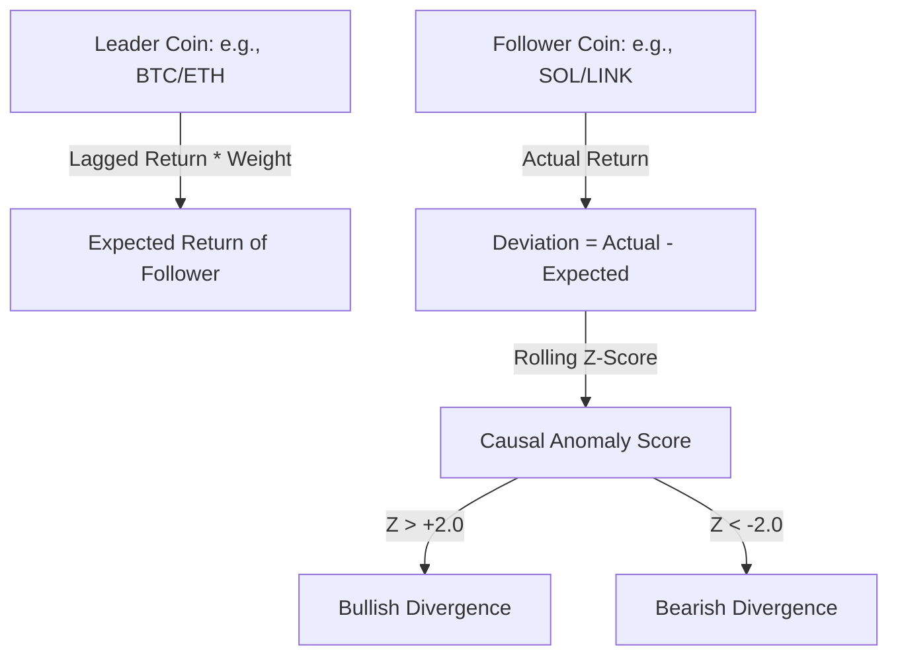

# Báo Cáo Tổng Hợp Về Causal Anomaly (Dự án: jarm237/besttime-crypto)

Báo cáo này tổng hợp chi tiết về lý thuyết, cấu trúc đồ thị nhân quả giữa các đồng coin và kết quả chạy thử nghiệm hệ thống phát hiện **Causal Anomaly** (Bất thường Nhân quả) dựa trên dữ liệu giá lịch sử.

---

## 1. Cơ Chế Phát Hiện Causal Anomaly Là Gì?

Trong thị trường crypto, các đồng coin lớn hoặc có vị thế dẫn dắt (ví dụ: **BTC**, **ETH**) thường dẫn dắt biến động giá của các đồng coin theo sau (**follower**) với một độ trễ thời gian (**lag**). 

Cơ chế **Causal Anomaly** phát hiện các điểm bất thường khi hành vi giá thực tế của một đồng coin theo sau lệch pha đáng kể so với kỳ vọng dự báo từ các đồng coin dẫn đầu:



*   **Expected Return ($R_{expected}$)**: Kỳ vọng của đồng coin follower được tính bằng tổng trọng số ($weight \times confidence$) các returns của leader coin tại thời điểm trễ ($t - lag$).
*   **Deviation**: Sự chênh lệch giữa lợi nhuận thực tế và kỳ vọng ($R_{actual} - R_{expected}$).
*   **Causal Anomaly Score**: Z-score của độ chênh lệch (Deviation) được tính trên một cửa sổ trượt (rolling window, mặc định 48 nến).
    *   **$Z \ge +2.0$ (Bullish Divergence)**: Đồng coin follower đang mạnh hơn đáng kể so với dự đoán của leader coin.
    *   **$Z \le -2.0$ (Bearish Divergence)**: Đồng coin follower đang yếu hơn đáng kể so với dự đoán của leader coin.
    *   **$|Z| \ge 3.0$ (Causal Breakout Flag)**: Tín hiệu bứt phá nhân quả cực mạnh.

---

## 2. Kết Quả Khám Phá Đồ Thị Nhân Quả (`causal_coin_graph.json`)

Đồ thị quan hệ nhân quả cấp coin [causal_coin_graph.json](file:///d:/Workspaces/Vọc%20vạch/data/causal_coin_graph.json) được sinh tự động bằng phương pháp thống kê **Granger Causality** kết hợp **Lagged Correlation** trên dữ liệu 600 nến demo. 

### Các Liên Kết Nhân Quả Được Tìm Thấy:
| Cặp Quan Hệ (Leader $\rightarrow$ Follower) | Phân Loại Cluster | Độ Trễ (Lag) | Hệ Số Tương Quan (Corr) | Độ Tin Cậy (Confidence) | Hướng Tác Động |
| :--- | :--- | :--- | :--- | :--- | :--- |
| **BTC $\rightarrow$ ETH** | Intra-cluster (Layer1 $\rightarrow$ Layer1) | 1 nến | $+0.698$ | $76.8\%$ | Positive (Tích cực) |
| **BTC $\rightarrow$ BNB** | Intra-cluster (Layer1 $\rightarrow$ Layer1) | 1 nến | $+0.483$ | $60.2\%$ | Positive (Tích cực) |
| **ETH $\rightarrow$ LINK** | Inter-cluster (Layer1 $\rightarrow$ DeFi) | 1 nến | $+0.431$ | $56.3\%$ | Positive (Tích cực) |

> [!NOTE]
> *   **BTC** đóng vai trò là Leader tối cao, dẫn dắt đồng thời cả **ETH** và **BNB** với độ trễ 1 nến.
> *   **ETH** đóng vai trò trung gian, vừa chịu tác động từ **BTC** vừa trực tiếp dẫn dắt **LINK** (DeFi) với độ trễ 1 nến.

---

## 3. Thống Kê Phát Hiện Bất Thường (`causal_anomaly_report.json`)

Dưới đây là thống kê chi tiết từ tệp báo cáo [causal_anomaly_report.json](file:///d:/Workspaces/Vọc%20vạch/data/causal_anomaly_report.json) sau khi chạy mô phỏng phát hiện bất thường:

| Coin Phân Tích | Tổng Số Bất Thường | Bullish Anomaly (Z $\ge$ 2) | Bearish Anomaly (Z $\le$ -2) | Strong Breakout (\|Z\| $\ge$ 3) | Tỷ Lệ Xuất Hiện (Rate) | Chỉ Số Z-Score Lớn Nhất |
| :---: | :---: | :---: | :---: | :---: | :---: | :---: |
| **ETH** | 27 | 9 | 18 | 2 | $4.50\%$ | $3.1755$ |
| **BNB** | 28 | 15 | 13 | 0 | $4.67\%$ | $2.8154$ |
| **LINK** | 26 | 14 | 12 | 0 | $4.33\%$ | $2.7388$ |

> [!IMPORTANT]
> *   **Tỷ lệ Anomaly lý tưởng**: Tỷ lệ xuất hiện bất thường dao động quanh mức $4.3\% - 4.7\%$ là rất lý tưởng đối với ngưỡng lọc $Z=2.0$ (phân phối chuẩn thường có khoảng $5\%$ dữ liệu nằm ngoài khoảng $2\sigma$). Điều này chứng tỏ ngưỡng lọc hoạt động chính xác, tránh gây nhiễu tín hiệu.
> *   **ETH** thể hiện 2 trường hợp bứt phá cực mạnh (Strong Breakout, $|Z| \ge 3.0$), đây thường là thời điểm có tin tức mạnh hoặc dòng tiền đột biến tự cô lập hành vi giá của ETH khỏi BTC.

---

## 4. Hướng Dẫn Vận Hành & Tích Hợp Hệ Thống

Để phát hiện quan hệ nhân quả và sinh tín hiệu liên tục trên dữ liệu thực tế, sử dụng script CLI [find_coin_causal_relations.py](file:///d:/Workspaces/Vọc%20vạch/scripts/find_coin_causal_relations.py):

### Chạy kiểm tra định kỳ với dữ liệu Cache của Bot:
```powershell
.venv\Scripts\python.exe scripts\find_coin_causal_relations.py `
  --cache data\rl_candle_cache.pkl `
  --timeframe 15m `
  --coins BTC ETH SOL BNB XRP AVAX DOGE LINK MATIC OP ARB `
  --output data\causal_coin_graph.json `
  --signal-output data\causal_anomaly_signals.parquet `
  --report-output data\causal_anomaly_report.json
```

### Các Tính Năng Feature Sinh Ra Cho Model Học Máy (ML Dataset v3):
Khi tích hợp vào Phase 8 feature store, mỗi coin follower sẽ được gán các cột đặc trưng sau:
1.  `causal_anomaly_score_<coin>`: Giá trị z-score liên tục dùng làm feature đầu vào cho mô hình hồi quy / phân loại.
2.  `causal_lead_lag_signal_<coin>`: Tín hiệu rời rạc (`BUY`, `SELL`, `NEUTRAL`) làm quy tắc lọc nhanh cho Meta Model.
3.  `causal_breakout_flag_<coin>`: Flag nhị phân (1/0) báo hiệu các thời điểm bứt phá mạnh độc lập khỏi thị trường chung.
