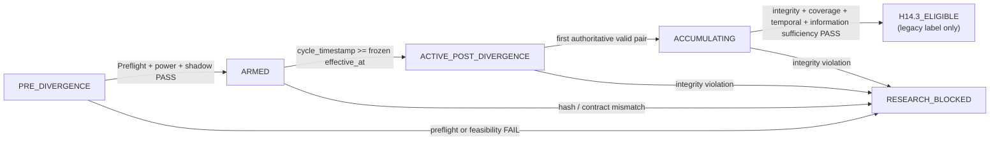

# Successor Research Design for Prospective Decision/Model-Contrast Validation

## Executive summary

The successor should **not** inherit H14’s failed membership-schedule comparison. It should preserve H14’s governance discipline while changing the scientific object of comparison: two candidates must process the **same prospective market-observation universe** but differ along one predeclared decision/model axis—preferably the **posterior/objective**, secondarily the **feature set**. Threshold-only or eligibility-only contrasts are viable but scientifically weaker, and randomized assignment is an experimental-allocation mechanism rather than a source of meaningful model divergence.

The most important design change is to separate **contrast feasibility** from **model quality**. During preflight, simulation, shadow operation, and prospective accumulation, outcomes and PnL should remain inaccessible exactly as they were under H14. The visible feasibility estimand should be the **daily rate of genuine candidate disagreement on a common upstream observation universe**. A downstream quality estimand may be frozen in advance but must remain sealed until a separately authorized sufficiency gate is reached. Otherwise, a design can accidentally optimize for disagreement rather than for a meaningful decision difference. This separation is consistent with trustworthy controlled-experiment practice and with the broader finance literature’s warnings about repeated reuse of historical outcomes for model selection. citeturn2search1turn4search0turn4search2

My prioritized design is:

| Priority | Design decision | Recommendation |
|---|---|---|
| **P0** | Experimental substrate | Remediate the known runtime-contract/parity issues before successor evidence can become authoritative. |
| **P1** | Candidate contrast | Compare **same-feature, same-universe models with different prediction objectives/posteriors**. |
| **P2** | Feasibility estimand | Daily disagreement incidence plus A-only/B-only rates on the common observation universe. |
| **P3** | Inference unit | UTC day; cycles and symbols are clustered repeated observations, not independent N. |
| **P4** | Power | Outcome-blind day-level simulation first; analytic formulas are screening checks only. |
| **P5** | Experimental operation | Score both candidates on every observation in shadow/prospective observer mode; randomize only if downstream execution/state creates interference. |
| **P6** | Activation | Freeze candidate artifacts, power contract, divergence contract and a future `effective_at` before evidence begins. |

A key prerequisite is independent of H14 closure: the uploaded project assessment identifies several current runtime defects that could destroy causal attribution between candidates, including the expected-value unit mismatch, S3 thresholds not being enforced in the production decision path, implicit symbol routing through the call stack, live/historical evaluator divergence, and duplicated/scattered scoring behavior. The project is already correctly blocked from live entry. A successor can be designed now, but it should not activate on that substrate until the experimental path is deterministic and contract-correct. fileciteturn0file0

The exact local H14 files under `/home/tran-huynh/...` were not mounted into this research environment. I therefore treat the project-owner-supplied H14 terminal state as authoritative: **H14 is CLOSED; raw #681 remains immutable; G5 v1 remains immutable and unsuperseded; H14.3 remains blocked final; no H14 outcome/PnL is accessible; and no successor is implicitly authorized by this report.** The uploaded project assessment was available for current code-level context. fileciteturn0file0

## Evidence base and design principles

### Preserve the H14 governance wins

H14’s most valuable output is not a trading result; it is a set of research controls that prevented an infeasible design from being rationalized after the fact. Those controls should become successor-wide platform invariants.

The successor should import the following concepts **by reference**, without changing H14 itself:

| H14 invariant | Successor rule |
|---|---|
| Raw #681 immutable | Record its hash in the successor preflight as historical lineage; never rewrite or reclassify H14 raw evidence. |
| G5 v1 immutable | Reference its hash/status only; do not interpret the successor’s power contract as H14 G5 v2. |
| No H14 outcome/PnL access | H14 outcome stores stay sealed permanently. |
| No retrospective activation | Shadow/replay observations before the successor’s `effective_at` are `NON_EVIDENCE`. |
| Timestamp integrity | Timezone-aware UTC canonical timestamps only; ambiguous/future timestamps fail closed. |
| Provenance purity | Test, dummy, unknown-lineage and artifact-mismatch rows cannot become authoritative. |
| Canonical semantic uniqueness | One authoritative candidate pair per canonical observation key; conflicting pairs are quarantined, never “last-write-wins.” |
| Deterministic rebuild | Same immutable inputs + same frozen candidate hashes must produce identical evidence and classification hashes. |
| Research thresholds frozen before outcome access | Power, primary endpoint, stopping rule and unlock conditions are committed before prospective outcomes can be inspected. |

This is also aligned with controlled-experiment methodology: randomization and predeclared experiment structure are useful precisely because they separate hypothesis formation from evaluation, while practical experimentation literature repeatedly warns that telemetry problems, changing treatment definitions, invalid variance assumptions and selective interpretation can invalidate apparently clean tests. citeturn2search0turn2search1

The finance-specific reason to be unusually strict is data reuse. White’s Reality Check formalized the problem that repeated model specification and selection on the same financial history can produce apparently superior strategies by chance; Harvey, Liu and Zhu similarly show how multiple testing raises the evidentiary hurdle in financial research. A successor should therefore permit historical data to answer **“will this design generate enough events?”** while prohibiting it from answering **“which candidate made more money?”** before prospective activation. citeturn4search0turn4search2

### Establish a clean boundary between model research and observer research

“Do not access outcomes” should be interpreted at the **prospective experiment/design layer**, not as a prohibition on ever training supervised models. A new objective-based model may require a historical labeled training corpus. That training corpus should be a separate, pre-cutoff research asset with its own lineage. The prospective-design process should receive only the frozen artifact and an outcome-blind observation stream.

The boundary should therefore look like:

```text
historical labeled training corpus
          │
          │ allowed only in model-development enclave
          ▼
candidate artifacts frozen
          │
          ├── artifact hash A
          └── artifact hash B
                     │
                     ▼
OUTCOME-BLIND SUCCESSOR PREFLIGHT
features / timestamps / regime / metadata only
                     │
                     ▼
structural + volume + power feasibility
                     │
                     ▼
shadow / prospective observer
                     │
             outcomes remain sealed
```

This is stricter than merely promising not to “look at PnL”: the replay reader should be physically unable to expose realized returns, future labels, trade outcomes, MFE/MAE, PnL, or H13/H14 quality summaries.

### Fix the experimental substrate before activation

The present project assessment indicates that the production path is suitable for dry-run/shadow research but not yet a clean substrate for a model-comparison experiment. In particular, the expected-value producer and decision engine disagree on units by roughly a factor of 100; symbol-specific S3 thresholds exist in a frozen research contract but are not actually enforced by the production path; symbol routing can depend on stack inspection; live and historical market analyzers differ; and scoring mixes inference, risk, sizing and side effects. These issues can change which candidate appears actionable independently of the candidate hypothesis. fileciteturn0file0

Therefore the successor’s preflight should contain a non-H14 prerequisite:

```text
EXPERIMENTAL_SUBSTRATE_READY =
    EV_UNIT_CONTRACT_PASS
AND S3_RUNTIME_PARITY_PASS
AND EXPLICIT_SYMBOL_ROUTING_PASS
AND PURE_COMMON_EVALUATOR_PASS
AND FULL_DECISION_PARITY_PASS
AND ARTIFACT_SCHEMA_LINEAGE_PASS
```

This is **platform remediation**, not reopening H14.

## Estimands and candidate contrast designs

### Use a two-level estimand architecture

A single estimand cannot simultaneously answer “do the models actually differ often enough?” and “is one model better?” without reopening the leakage problem. I recommend two formally separate estimands.

**Visible feasibility estimand.** During design and accumulation:

\[
\lambda_D
=
E[D_d]
\]

where \(D_d\) is the number of genuinely discordant candidate decisions on UTC day \(d\), normalized by the common upstream observation exposure if exposure varies:

\[
r_{D,d}
=
\frac{D_d}{N_d^{common}}.
\]

A discordance should be classified explicitly:

```text
A_ONLY
B_ONLY
OPPOSITE_ACTION
SHARED_SAME_ACTION
NEITHER
```

`A_ONLY`, `B_ONLY`, and `OPPOSITE_ACTION` contribute to the main disagreement count. Posterior differences that do not change the decision can be logged as secondary diagnostic evidence but should not inflate decision-level disagreement.

**Recommended primary validation estimand, frozen but outcome-sealed.** Once a successor-specific sufficiency gate is met, compare candidates on a predeclared decision-quality measure on the **common upstream opportunity universe**, aggregated by UTC day. A conceptually clean form is:

\[
\Delta_Q =
E[\bar Q_{A,d}-\bar Q_{B,d}],
\]

where \(Q\) is a bounded, predeclared outcome score. One possible non-monetary form is a fixed-horizon hurdle-success score, defined before activation, with HOLD assigned zero so that candidate activity itself remains part of the policy estimand. The realized \(Q\) values remain inaccessible until the quality gate is separately authorized.

This “intent-to-treat-like” common-universe definition is preferable to comparing “win rate among trades A chose” against “win rate among trades B chose,” because the latter conditions on different selected sets and can reward a candidate simply for being more selective.

If governance intends to prohibit **all future outcome access permanently**, then the successor cannot legitimately conclude that one candidate is better; it can only conclude that their behavior differs. That distinction should be explicit in the preflight.

### Estimand alternatives

| Estimand | What it answers | Outcome-blind? | Recommended role |
|---|---|---:|---|
| Daily disagreement incidence \(r_D\) | “Do these candidates create enough real contrast?” | Yes | **Primary feasibility estimand** |
| A-only/B-only rate ratio | “Does one candidate act materially more often?” | Yes | Secondary behavior estimand |
| Mean posterior separation | “How numerically different are their beliefs?” | Yes | Diagnostic only |
| Conditional accuracy/hurdle rate among actions | “Are selected trades higher quality?” | No | Secondary quality metric; selection-sensitive |
| Common-universe bounded quality difference \(\Delta_Q\) | “Which full decision rule is better per opportunity?” | No, but can be sealed | **Recommended eventual primary validation estimand** |
| PnL / realized economic utility | “Which is economically better?” | No | Final-stage only, if separately authorized |

### Compare contrast designs on one scientific axis at a time

The safest candidate pair changes **one mechanism** while holding population, timestamps, upstream feature availability, execution horizon and observer semantics fixed. That gives the later result a clear interpretation.

| Candidate design | Estimand preserved | Structural reachability | Projected days to required N | Pros / cons | Governance complexity |
|---|---|---|---|---|---|
| **Posterior/objective contrast** | **Yes**, if universe/features/eligibility are held fixed | **Yes by construction; empirical rate TBD** | **UNSPECIFIED:** \(T\approx N^*/\hat r_D\) after blind probe | Strong scientific meaning; isolates what the model is trained to predict. Requires separate artifact training/calibration and clean cost/hurdle units. | High |
| **Nested feature-set contrast** | Yes, if objective/model class/rules are identical | Reachable if added features alter posterior near decisions; rate TBD | **UNSPECIFIED:** \(N^*/\hat r_D\) | Clear attribution to information set. Risks feature leakage, missingness, latency and live/historical parity differences. | High |
| **Eligibility-rule contrast** | Common-universe ITT estimand yes; conditional-action estimand changes | Structurally easy | **UNSPECIFIED:** \(N^*/\hat r_D\) | Generates interpretable abstention contrast. More policy than model; can confound regime selection with model quality. | Medium |
| **Threshold/calibration contrast** | Same model, different operating point | Structurally easy if posterior mass exists between thresholds | **UNSPECIFIED:** \(N^*/\hat r_D\) | Very simple and replayable. Weakest scientific novelty; easy to tune merely to manufacture disagreement. | Low–Medium |
| **Randomized assignment wrapper** | Depends on candidate pair | **Does not itself create contrast** | Usually slower than paired shadow because each arm receives less authoritative exposure | Necessary only when candidate execution/state interferes. Pure observer research gains more information by scoring both candidates on every observation. | Medium–High |

The first choice should be **posterior/objective contrast**.

A concrete hypothesis would be:

> Candidate A predicts directional correctness; Candidate B predicts whether the signed move exceeds a predeclared economic hurdle at the same forecast horizon.

To isolate the objective, start with the **same frozen feature schema**, same upstream market observations, same universe, same eligibility and the same decision framework. Candidate A and B then differ because they are solving different prediction problems, not because one happens to trade BTC while the other sees BNB.

This direction is particularly relevant to the current codebase because the uploaded assessment identifies a mismatch between the semantics of expected return and the downstream gate. That bug must be corrected before a hurdle-aware target is specified in fractions/basis points. The same assessment also shows that current S3 symbol thresholds are not enforced in production, so a baseline candidate cannot be defined as “V5 + S3” until runtime actually implements that contract. fileciteturn0file0

A nested feature-set candidate is the strongest alternative. Candidate A could use a frozen minimal schema and Candidate B the same objective plus one predeclared additional feature family. The current detector already computes a broad set of technical/regime features, so a nested comparison need not introduce a new external data provider; however, live/historical feature parity must first be demonstrated. fileciteturn0file0

Threshold-only divergence should be a last resort unless the research hypothesis is explicitly about **selectivity/calibration**. Deliberately searching thresholds to maximize disagreement is analogous to optimizing the experiment’s treatment definition after looking at historical behavior; even without outcomes, that can turn “model comparison” into “engineered sample production.”

### Prefer paired scoring over random assignment in observer mode

Controlled experiments use randomization to isolate causal effects when the treatment changes what the experimental unit experiences. citeturn2search1turn1search0 In a pure trading observer, Candidate A’s prediction does not change the subsequent market path, so there is no need to hide Candidate B from the same observation. Scoring both candidates on each immutable feature snapshot gives a paired comparison, controls the exact market regime by construction, and maximizes disagreement information.

Randomization becomes useful only if one candidate can alter shared mutable state—account risk limits, position availability, adaptive features, order state, or live execution. In that case, the randomization unit should be large enough to prevent cross-arm interference; a deterministic assignment by **UTC day or symbol-day** is more defensible than cycle-level randomization if UTC day is also the inferential cluster. Cluster-level A/B tests are known to have reduced effective sample size and require variance methods that account for within-cluster dependence. citeturn1search2turn0search0turn0search2

Random assignment must never be presented as a “divergence mechanism.” Assigning two labels to the same decision code produces an A/A test, not a model contrast.

## Statistical power and outcome-blind simulation

### Treat UTC day as the inferential unit

The H14 design correctly moved away from pretending that every cycle is an independent sample. For the successor, preserve UTC day as the main inferential cluster, with symbol/cycle records treated as repeated observations inside the day.

This matters because within-cluster correlation reduces information. For approximately equal cluster sizes, the familiar screening design effect is:

\[
DE = 1 + (\bar m-1)\rho,
\]

where \(\bar m\) is observations per cluster and \(\rho\) is the intracluster correlation. Even small \(\rho\) can materially increase required sample size when many observations occur per cluster. citeturn0search2turn0search4

The successor should **not automatically inherit H14’s design effect of 1.50**. The candidate disagreement process can have a very different dependence structure from membership-schedule exclusivity. Estimate dependence again using outcome-blind candidate decisions.

A crude screen is:

\[
N_{\mathrm{eff}}\approx \frac{N_{\mathrm{raw}}}{DE},
\]

but this should not be the final power engine.

### Use daily count models for event-rate estimands

Let \(Y_{c,d}\) be the number of actionable decisions for candidate \(c\) on UTC day \(d\), with \(E_d\) the number of common upstream opportunities. A natural model is:

\[
\log E[Y_{c,d}]
=
\alpha + \beta I(c=B)+\log(E_d),
\]

where \(e^\beta\) is the action-rate ratio. For repeated/correlated observations, generalized estimating equations were designed precisely to estimate marginal effects while accounting for longitudinal correlation without requiring a full joint-distribution model. citeturn3search2

If daily counts are materially overdispersed relative to Poisson assumptions, negative-binomial modeling or simulation is preferable. Explicit sample-size methods for negative-binomial rate ratios incorporate both event rate, exposure and dispersion, and simulations are commonly used to validate their operating characteristics. citeturn3search6

As an analytic **screening approximation** under independent Poisson rates, the exposure required to detect a target rate ratio \(RR^*\) is proportional to:

\[
T_{\mathrm{iid}}
\approx
\frac{
\left(z_{1-\alpha/2}+z_{1-\beta}\right)^2
}{
[\log(RR^*)]^2
}
\left(
\frac{1}{\lambda_A}
+
\frac{1}{\lambda_B}
\right).
\]

The actual paired-day design has covariance between candidates:

\[
Var(\log\hat\lambda_A-\log\hat\lambda_B)
=
Var_A+Var_B-2Cov_{AB},
\]

so the historical paired bootstrap should be the source of truth rather than the independent-Poisson approximation.

### Power a quality endpoint separately

If the later locked quality endpoint is binary, an ordinary two-proportion approximation before cluster inflation is:

\[
n_{\mathrm{iid,arm}}
\approx
\frac{
\left[
z_{1-\alpha/2}
\sqrt{2\bar p(1-\bar p)}
+
z_{1-\beta}
\sqrt{
p_A(1-p_A)+p_B(1-p_B)
}
\right]^2
}{
(p_A-p_B)^2
}.
\]

If the analysis remains cycle-level, this must then be adjusted for clustering. If analysis is performed directly on daily aggregates, the number and variability of **days** matter more directly, and the daily Monte Carlo design below is preferable. Cluster-randomized-trial literature consistently emphasizes that sample-size planning must explicitly account for between-cluster variation rather than treating within-cluster observations as independent. citeturn0search0turn0search17

I recommend:

```text
two-sided alpha       = 0.05
target power          = 0.80
sensitivity power     = 0.90
primary endpoint      = exactly one
secondary endpoints   = descriptive / multiplicity controlled
```

The numerical minimum meaningful effect should **not automatically reuse H14’s RR = 1.50**, because the endpoint has changed. Freeze the new MDE from the scientific/operational question, not from whichever historical effect happens to be convenient. If several candidate pairs are ever evaluated using outcome information, multiplicity must be addressed; repeated financial-model searches are exactly the setting in which nominal significance is unreliable. citeturn4search0turn4search2

### Outcome-blind historical simulation protocol

The successor preflight should produce a single deterministic replay pipeline:

```text
authoritative outcome-blind historical observations
                │
                ▼
schema firewall
(no return labels / no outcome / no PnL / no MFE-MAE)
                │
                ▼
Candidate A frozen inference
Candidate B frozen inference
                │
                ▼
pair by canonical observation key
                │
                ▼
daily UTC vectors
                │
        ┌───────┴────────┐
        ▼                ▼
event-rate stats     dependence stats
        │                │
        └───────┬────────┘
                ▼
stationary/block bootstrap
                │
                ▼
calendar-horizon distribution
```

For every canonical observation, replay should retain only input/state fields available at that historical timestamp. The output dataset should contain candidate IDs/hashes, posterior/score, eligibility, action, disagreement class, UTC day, symbol and lineage fields—but no future market outcome.

Daily vectors should include:

\[
(N_d,\; A_d,\; B_d,\;D_d,\;Aonly_d,\;Bonly_d,\;Opposite_d)
\]

plus operational coverage and feature-availability diagnostics.

Estimate:

```text
mean and quantiles of daily actionable count
mean and quantiles of daily disagreement count
A-only / B-only balance
posterior-difference distribution
zero-event-day frequency
daily overdispersion
intraday clustering / ICC
daily autocorrelation
symbol concentration
regime concentration
```

Then bootstrap **whole UTC-day vectors**, rather than individual cycles, so symbol co-movement and intraday dependence stay intact. For additional serial dependence across days, the stationary bootstrap of Politis and Romano resamples blocks of random length and was developed specifically for weakly dependent stationary observations. citeturn5search0turn5search2

For each candidate pair and each prospective horizon \(H\), run—for example—10,000 replay simulations and estimate:

\[
P_{\mathrm{hit}}(H)
=
P(
N_D\ge N_D^*,
N_{Aonly}\ge N_A^*,
N_{Bonly}\ge N_B^*
).
\]

The output should report the median, 80th and 90th percentile calendar time to information sufficiency, not merely:

\[
T=N/r.
\]

A candidate should pass feasibility only if its **conservative** horizon distribution fits the project’s predeclared maximum calendar budget.

### Candidate projections are currently unspecified

No successor-specific, outcome-blind probe rates were supplied or accessible for this report. Therefore, it would be scientifically inappropriate to fabricate “feature-set = 1.2 disagreements/day” or “objective contrast = 2.0/day.” The candidate table correctly leaves projected days as `UNSPECIFIED`.

The following charts are therefore **sensitivity envelopes only**, showing how calendar accumulation changes once the blind probe supplies a measured daily rate. They are not empirical candidate forecasts.


At 60 days, disagreement rates of 0.25, 0.50, 1.0 and 2.0 events/day imply approximately 15, 30, 60 and 120 raw disagreements respectively, before any dependence adjustment.


At 60 days, actionable rates of 0.5, 1, 2 and 3 events/day imply approximately 30, 60, 120 and 180 raw events. These plots illustrate why successor activation should be conditional on a measured blind rate, rather than on a fixed 60-day assumption.

Variance-reduction methods such as CUPED can sometimes improve experiment sensitivity by leveraging pre-experiment covariates; Microsoft’s original WSDM work reports substantial variance reduction in online experiments. citeturn2search4 For this project, however, paired scoring on identical observations and day-level/block-resampling design should come first. CUPED or regression adjustment should be introduced only if covariates and the adjustment formula are frozen before outcome access.

## Implementation readiness and governance

### Define one pure pair evaluator

The successor should introduce an experimental API conceptually equivalent to:

```python
PairDecision evaluate_pair(
    observation: CanonicalObservation,
    candidate_a: FrozenCandidate,
    candidate_b: FrozenCandidate,
) -> PairDecision
```

It should be pure with respect to the canonical observation and frozen candidate state. No stack inspection, hidden symbol routing, mutable “current candidate” state, file-system model resolution during scoring, or logging side effect should change the result.

Every result should record:

```text
successor_research_id
canonical_observation_key
cycle_timestamp_utc
symbol

candidate_a_id
candidate_a_artifact_hash
candidate_a_config_hash
candidate_a_feature_schema_hash

candidate_b_id
candidate_b_artifact_hash
candidate_b_config_hash
candidate_b_feature_schema_hash

input_feature_snapshot_hash

action_a
action_b
posterior_a
posterior_b
eligibility_a
eligibility_b

disagreement_class

observer_release_sha
decision_contract_hash
provenance_environment
evidence_mode
```

The current project’s implicit stack-based symbol routing and artifact/schema mismatch are especially incompatible with this requirement because the candidate comparison must be reproducible from explicit inputs and lineage alone. fileciteturn0file0

### Required test matrix

| Test family | Required behavior |
|---|---|
| **Timestamp** | UTC-aware input accepted; explicit legacy conversion only under frozen producer contract; ambiguous naive timestamp rejected; future authoritative timestamp rejected. |
| **Provenance** | Production lineage accepted; test/dummy/unknown lineage quarantined. |
| **Candidate identity** | Candidate hashes/configs exactly match frozen divergence contract. |
| **Common observation** | Both candidates receive byte-/semantic-identical feature snapshot. |
| **Determinism** | Same snapshot + same candidate hashes → identical pair output across runs. |
| **Canonical uniqueness** | At most one authoritative pair for `(successor_epoch, symbol, cycle_timestamp)`. |
| **Collision** | Same key + different semantic pair output → quarantine whole group; never last-write-wins. |
| **A/A** | Two identical frozen candidate specs produce zero decision/posterior divergence, modulo explicitly tested serialization tolerance. |
| **A/B structural reachability** | Fixtures prove A-only, B-only and/or opposite-action paths can exist according to the frozen hypothesis. |
| **Shadow isolation** | `SHADOW` rows cannot enter authoritative prospective evidence. |
| **Outcome firewall** | Simulation/observer process cannot request outcome/PnL columns or outcome-bearing tables. |
| **Activation boundary** | `cycle_timestamp < effective_at` is non-evidence; `>= effective_at` follows frozen successor contract. |
| **Replay** | Two full replays yield identical classification/report SHA-256. |
| **Randomization**, if used | Deterministic assignment hash; frozen salt; no mutable reassignment; sample-ratio checks. |
| **Failure mode** | Missing feature/artifact/config mismatch fails closed, never silently falls back to the other candidate. |

An A/A shadow phase is particularly useful before any candidate comparison because A/A experiments are commonly used to expose telemetry and pipeline problems when the treatments should be identical. citeturn1search3

### Shadow mode

Shadow mode should run both candidates through the actual future production inference path but mark every record:

```text
mode = SHADOW
authoritative_evidence = false
outcome_access = false
trade_execution = false
```

Its objectives are limited to:

```text
pair completeness
timestamp/provenance integrity
candidate hash correctness
deterministic divergence
event-rate estimation
runtime latency/resource behavior
```

Do **not** use shadow output to choose whichever candidate looks more profitable.

Shadow should begin with A/A, then A/B. An A/A disagreement is an infrastructure defect. An A/B disagreement is expected only if it can be traced to the frozen scientific contrast.

### Governance artifacts that must exist before activation

The successor should require four minimal research artifacts plus one activation checkpoint.

**`successor_research_preflight_v1.md`**

This is the governing research statement:

```text
research question
population / common observation universe
candidate contrast axis
feasibility estimand
locked validation estimand
minimum meaningful effect
alpha / power
UTC-day inference unit
calendar feasibility limit
outcome-access prohibition
H14 non-reopening declaration
H14 final-state hash references
```

**`successor_power_feasibility_v1.json`**

Machine-readable statistical plan:

```text
historical blind-source hashes
candidate hashes
daily event-rate estimates
A-only / B-only / disagreement rates
ICC / overdispersion / ACF
bootstrap method
bootstrap seed
block-length rule
candidate-specific required N
calendar horizon quantiles
probability_of_sufficiency_by_horizon
power assumptions
sensitivity scenarios
```

**`successor_shadow_run_v1.md`**

It should record:

```text
A/A results
A/B pair completeness
integrity violations
shadow leakage = 0
observed blind event rates
artifact/config fingerprints
runtime parity checks
```

**`successor_divergence_contract_v1.json`**

The immutable activation definition:

```text
research_id
candidate A exact definition
candidate B exact definition
common upstream universe
candidate artifact hashes
feature schema hashes
decision rules
thresholds
eligibility
forecast horizon
effective_at

randomization specification, if any
outcome unlock rule
authoritative evidence rule
quarantine rules
retroactive_application = false
```

Then create a small:

```text
successor_activation_readiness_checkpoint.json
```

that may say `ARMED` only when every referenced artifact hash matches.

### Quarantine rules

The successor should inherit the H14 principle that raw evidence is not destroyed. A row or whole canonical pair is quarantined if any of the following occurs:

```text
TEST_OR_DUMMY_LINEAGE
UNKNOWN_LINEAGE
TIMESTAMP_AMBIGUOUS
FUTURE_TIMESTAMP
CANDIDATE_HASH_MISMATCH
FEATURE_SCHEMA_MISMATCH
MISSING_CANDIDATE_PAIR
CANONICAL_COLLISION
SHADOW_IN_AUTHORITATIVE_STREAM
PRE_EFFECTIVE_AT_EVIDENCE
OUTCOME_FIELD_PRESENT_IN_BLIND_PIPELINE
NONDETERMINISTIC_REPLAY
```

A quarantine manifest should record record IDs/canonical key, reason code, source hashes and contract hash. It should never repair raw evidence in place.

### Decision-state transition

The following diagram uses the `H14.3_ELIGIBLE` label requested for conceptual continuity. **A real successor should rename that terminal node to something like `SUCCESSOR_QUALITY_ELIGIBLE`; H14.3 itself remains permanently closed.**



The transition from `ARMED` to active must be driven by the **canonical cycle timestamp**, not process start time, so replay remains deterministic.

## Risk analysis

The dominant risk is no longer timestamp corruption; it is **experimental misattribution**.

| Risk | Why it matters | Required mitigation |
|---|---|---|
| **Multi-axis confounding** | Changing features, objective, threshold and eligibility simultaneously makes any later difference uninterpretable. | Change one scientific axis per successor pair. |
| **Outcome leakage** | Historical future returns can steer candidate/threshold selection toward accidental winners. | Hard schema firewall; separate labeled-training enclave; no outcome-bearing reader in preflight/shadow. White-style data-snooping discipline applies. citeturn4search0 |
| **Disagreement optimization** | A threshold can be chosen merely because it creates many exclusive events. | Freeze scientific hypothesis first; rate is only a feasibility gate, never an objective to maximize without bound. |
| **Multiple candidate search** | Trying many model pairs and later evaluating the same outcomes inflates false discoveries. | Outcome-blind feasibility selection only; freeze one pair before prospective outcomes; correct multiplicity if several survive to outcome testing. citeturn4search2 |
| **Pseudo-replication** | Thousands of 15-minute cycles can masquerade as thousands of independent samples. | UTC-day inference, cluster-aware methods, stationary/block bootstrap. citeturn0search2turn5search0 |
| **Overdispersion** | A few high-signal days can dominate event counts, defeating Poisson assumptions. | Estimate daily dispersion; use NB/GEE or simulation. citeturn3search2turn3search6 |
| **Operational drift** | Model/config/release changes during accumulation silently redefine treatment. | Exact artifact/config/release hashes; fail closed; any substantive change creates a new epoch/contract. |
| **Live/historical mismatch** | Blind replay rates may not represent actual observer behavior. | One pure evaluator and full parity tests before using replay for feasibility. Current project assessment flags this as unresolved. fileciteturn0file0 |
| **Incorrect EV semantics** | Hurdle-aware candidate could be defined in the wrong units. | Normalize fraction/bps contract end-to-end before objective/threshold definition. Current project assessment flags the existing mismatch. fileciteturn0file0 |
| **Threshold not truly enforced** | “Candidate B uses threshold X” is meaningless if production bypasses X. | Enforcement test at final-decision path, with threshold/probability/gate logged. fileciteturn0file0 |
| **Execution interference** | Candidate A can change account state and thereby B’s future opportunity set. | Observer-only paired phase first; if execution is later studied, cluster randomize and isolate account/risk state. |
| **Regime drift** | A long experiment can become a comparison of calendar regimes rather than models. | Same-time paired scoring, day-stratified reports, predeclared max calendar horizon. |
| **Small number of clusters** | Cluster-robust asymptotics may be optimistic with only a modest number of UTC days. | Day-level simulation/block bootstrap and small-sample sensitivity analysis; do not rely solely on raw cycle N. Cameron and Miller specifically warn that clustered inference requires care when cluster counts are limited. citeturn3search0 |

One subtle but important risk is **conditional-selection bias**. Suppose Candidate B is much more selective. Its “win rate among trades” may improve simply because it acts on fewer, easier cases. The main policy-level estimand should therefore use the common observation universe, while conditional-on-action quality remains a secondary diagnostic.

Another risk is treating randomization as automatically superior. Randomization is essential when treatment assignment is needed to identify a causal treatment effect, but it costs information when both deterministic models can safely be evaluated on the same immutable market path. Paired scoring is therefore the preferred observer design. Cluster randomization is reserved for the point at which candidate behavior actually changes shared state or execution. citeturn2search1turn1search2

## Recommended roadmap and concrete deliverables

### Recommended successor hypothesis

The first successor I would authorize for preflight—but **not yet activation**—is:

> **Same-observation objective/posterior contrast:** compare a frozen directional-probability candidate against a frozen hurdle-aware candidate, holding the feature universe, forecast horizon, upstream population and basic decision framework constant.

Conceptually:

```text
                     SAME CANONICAL OBSERVATION
                              │
                    SAME FROZEN FEATURE SET
                              │
              ┌───────────────┴────────────────┐
              │                                │
       Candidate A                       Candidate B
   directional objective              hurdle objective
   P(direction correct)          P(signed move > hurdle)
              │                                │
       posterior_A                       posterior_B
              │                                │
       frozen rule A                     frozen rule B
              └───────────────┬────────────────┘
                              │
                     disagreement class
                              │
                  prospective paired evidence
```

This design has more scientific content than changing membership, and it avoids conflating a feature-set change with an objective change. Its empirical feasibility is still unknown and must be demonstrated outcome-blind before activation.

The second candidate for preflight should be a **nested feature-set comparison** with the objective held constant. Do not run both successor experiments concurrently; choose one pair after the blind feasibility analysis.

### Suggested project staging

| Stage | Suggested window | Work | Exit condition |
|---|---:|---|---|
| **Research preflight** | Project days 0–3 | Freeze question, common population, contrast axis, visible/locked estimands, MDE, alpha/power, max calendar budget; reference H14 terminal hashes. | Preflight PASS |
| **Experimental-substrate gate** | In parallel, before any evidence | Fix/test EV units, S3 enforcement, explicit symbol routing, pure evaluator, artifact schema/parity. | `EXPERIMENTAL_SUBSTRATE_READY` |
| **Outcome-blind candidate replay** | Project days 4–7 | Run predetermined candidate specs; estimate actionability/disagreement/dependence; perform block-bootstrap feasibility/power analysis. | Exactly one feasible scientifically valid pair selected, or HARD STOP |
| **A/A shadow** | First shadow interval | Same candidate under A/B identities; validate pair completeness, zero divergence, lineage and no evidence leakage. | A/A PASS |
| **A/B shadow** | Subsequent shadow interval | Actual candidate pair; measure blind event rates and runtime integrity only. | Shadow results consistent with preflight assumptions |
| **Freeze activation** | After shadow PASS | Commit divergence contract and future UTC `effective_at`; freeze all hashes. | `ARMED` |
| **Prospective accumulation** | Simulation-derived, not hardcoded | Append authoritative paired evidence; integrity/coverage/event-information checkpoints only. | Successor-specific sufficiency gate |
| **Quality unlock** | Separate governance decision | Access only the predeclared locked outcome endpoint. | Not part of preflight authorization |

The important difference from H14 is that **calendar feasibility must be demonstrated before runtime implementation is allowed to become an experiment**. A candidate whose blind simulation requires 250 days under a 90-day owner budget should die in preflight even if its model idea is attractive.

### Minimal artifact set

The minimal acceptable package before activation is:

```text
successor_research_preflight_v1.md
successor_power_feasibility_v1.json
successor_shadow_run_v1.md
successor_divergence_contract_v1.json
```

A compact readiness checkpoint can reference those four hashes instead of duplicating them.

The preflight should contain a table similar to:

```text
H14 branch                         CLOSED / immutable
raw #681                           preserved / referenced by hash
G5 v1                              immutable / unsuperseded
H14 outcome/PnL                    inaccessible
successor outcome during design    inaccessible

primary contrast axis              OBJECTIVE_POSTERIOR
common population                  FROZEN
candidate A artifact               FROZEN
candidate B artifact               FROZEN
primary feasibility estimand       FROZEN
locked validation estimand         FROZEN
MDE                                FROZEN
alpha                              FROZEN
power                              FROZEN
UTC-day inference unit             FROZEN
max calendar horizon               FROZEN

structural reachability            PASS
volume feasibility                 PASS
statistical feasibility            PASS
experimental substrate             PASS
shadow                             PASS

effective_at                       FUTURE UTC
activation                         ARMED
```

### Activation decision rule

No successor should be armed merely because it produces disagreement. The final pre-activation logic should be:

```text
SUCCESSOR_ARMABLE =
    H14_TERMINAL_STATE_UNCHANGED
AND OUTCOME_FIREWALL_PASS
AND RESEARCH_ESTIMAND_FROZEN
AND ONE_AXIS_CONTRAST_FROZEN
AND EXPERIMENTAL_SUBSTRATE_READY
AND STRUCTURAL_REACHABILITY_PASS
AND BLIND_VOLUME_FEASIBILITY_PASS
AND POWER_FEASIBILITY_PASS
AND A_A_SHADOW_PASS
AND A_B_SHADOW_PASS
AND DIVERGENCE_CONTRACT_FROZEN
AND effective_at IS FUTURE_UTC
```

Anything else remains:

```text
RESEARCH_BLOCKED
```

The strongest lesson to carry from H14 is therefore not “collect more data.” It is **prove, before activation, that the research question, candidate contrast, effective information rate and statistical design fit together**. H14 correctly stopped once membership schedules could not produce enough independent contrast. The successor should move that feasibility test to the beginning of the lifecycle.

For this codebase, the most defensible first preflight is a **paired objective/posterior contrast on the same observations and feature universe**, followed by a nested feature-set design only if the objective contrast is not event-feasible. Eligibility and threshold variants should be used only when those mechanisms are themselves the research question. Randomized assignment should remain an execution/interference control, not a substitute for meaningful candidate divergence.