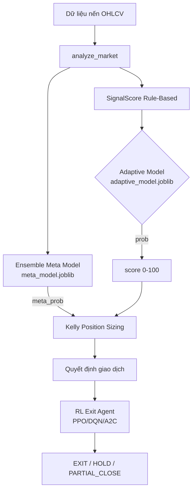

# 📊 Đánh giá Mô hình ML — besttime-crypto

> **Ngày đánh giá:** 24/06/2026 | **Model Version:** v3.0

---

## 1. Tổng quan Kiến trúc ML

Hệ thống sử dụng **3 tầng ML** hoạt động song song và phối hợp:



---

## 2. Meta Model — Tầng Chính (Production)

### 2.1 Kiến trúc Ensemble

**`EnsembleMetaModel` (v3.0)** — `logs/meta_model.joblib` (7.7 MB, cập nhật 24/06)

| Thành phần | Loại | Trọng số (Optuna) |
|-----------|------|-----------------|
| LightGBM | Gradient Boosting | **36.8%** |
| CatBoost | Gradient Boosting | **34.9%** |
| XGBoost | Gradient Boosting | 24.2% |
| RandomForest | Tree Ensemble | 4.1% |

> **Nhận xét:** RF hầu như bị loại bỏ (4%), hệ thống phụ thuộc chủ yếu vào 3 gradient boosting models.

### 2.2 Dataset Training

| Thông số | Giá trị |
|---------|--------|
| Tổng samples | **24,070** |
| WIN labels | 11,413 (47.4%) |
| LOSS labels | 12,657 (52.6%) |
| Features ban đầu (FEATURE_SCHEMA_V2) | 61 |
| Features sau zero-importance pruning | **46** |
| Phân chia Train/Calib/Test | 16,849 / 3,610 / 3,611 |
| Data period | 18 tháng lịch sử |

### 2.3 Hyperparameter Tuning (Optuna)

Pipeline tự động chạy **40 Optuna trials** tìm siêu tham số tối ưu cho tất cả 4 model đồng thời. Kết quả tốt nhất được lưu vào `model_bundle` cùng với trọng số ensemble.

---

## 3. Hiệu suất Model

### 3.1 Cross-Validation (TimeSeriesSplit, 5 folds)

| Metric | Base RF | Ensemble |
|--------|---------|----------|
| CV AUC (mean) | **0.6293** | 0.6203 |
| CV AUC (std) | ±0.0084 | — |
| CV Accuracy | 58.4% | 58.3% |

> [!NOTE]
> AUC ~0.63 là **hợp lý** cho dữ liệu tài chính có nhiễu cao. AUC > 0.65 trên thị trường crypto thực tế rất khó đạt được một cách bền vững.

### 3.2 Walk-Forward Validation

| Fold | Train size | Test size | ROC AUC | Accuracy |
|------|-----------|-----------|---------|---------|
| 1 | 15,645 | 3,610 | 0.6108 | 57.4% |
| 2 | 15,645 | 3,610 | **0.6443** | 60.4% |
| Trung bình | — | — | **0.6275** | 58.9% |

> [!IMPORTANT]
> Fold 2 AUC cao hơn đáng kể (0.6443 vs 0.6108), gợi ý model hoạt động tốt hơn trên dữ liệu gần đây → **ít covariate shift** so với data cũ.

### 3.3 Probability Calibration (Isotonic Regression)

Calibration method được chọn: **Isotonic** (mean error = 3.3 — tốt hơn Sigmoid).

| Bucket xác suất | Số lượng | Win Rate thực tế | Win Rate dự đoán | Sai số |
|----------------|---------|-----------------|-----------------|--------|
| 0.0 – 0.4 | 785 | 28.3% | 20.0% | **+8.3%** ⚠️ |
| 0.4 – 0.6 | 2,222 | 48.8% | 50.0% | -1.2% ✅ |
| 0.6 – 0.7 | 467 | 66.6% | 65.0% | +1.6% ✅ |
| 0.7 – 0.8 | 124 | 75.0% | 75.0% | **0.0%** ✅ |
| 0.8 – 1.0 | 13 | 84.6% | 90.0% | -5.4% ✅ |

> [!TIP]
> Calibration **rất tốt** ở vùng trung và cao (0.4–1.0). Vùng thấp (0.0–0.4) bị over-estimate loss (model thấy 20% win thực tế là 28.3%) → tín hiệu reject có nhiều false negatives.

---

## 4. Feature Importance — Top 20

| Hạng | Feature | Importance | Nhóm |
|------|---------|-----------|------|
| 1 | `rsi` | 9.06% | Indicator |
| 2 | `macd_hist` | 5.84% | Indicator |
| 3 | `fear_greed` | 5.75% | Sentiment |
| 4 | `distance_resistance_pct` | 5.74% | Structure |
| 5 | `mtf_alignment` | 5.32% | Multi-TF |
| 6 | `signal_score` | 4.19% | Score |
| 7 | `return_1d` | 3.45% | Return |
| 8 | `adx` | 3.44% | Indicator |
| 9 | `roc_14` | 3.36% | Momentum |
| 10 | `sentiment_momentum` | 3.24% | Sentiment |
| 11 | `ema_distance_zscore` | 3.13% | Trend |
| 12 | `distance_support_pct` | 3.07% | Structure |
| 13 | `return_15m` | 3.02% | Return |
| 14 | `mfi` | 2.71% | Volume |
| 15 | `cmf` | 2.64% | Volume |
| 16 | `sma50_slope` | 2.60% | Trend |
| 17 | `return_1h` | 2.22% | Return |
| 18 | `atr_percentile` | 2.21% | Volatility |
| 19 | `return_4h` | 2.06% | Return |
| 20 | `volume_acceleration` | 1.93% | Volume |

**Tổng nhóm features quan trọng nhất:**
- 🔴 **Sentiment** (fear_greed + sentiment_momentum): ~9% → Tác động lớn nhất ngoài indicators cơ bản
- 🟠 **Price Structure** (distance_resistance + distance_support): ~8.8%
- 🟡 **Multi-TF** (mtf_alignment): 5.3% → Xác nhận xu hướng đa khung
- 🟢 **Returns** (15m/1h/4h/1d): ~10.7% tổng → Momentum quan trọng

---

## 5. Adaptive Model — Tầng Phụ (Signal Scoring)

**`adaptive_model.joblib`** — RandomForest đơn giản (1.1 MB)

- Dùng trong `score_signal()` để convert signal text → probability → score 0-100
- Input: `FEATURE_SCHEMA` (14 features V1)
- Được thay thế bởi Meta Model confidence cho Kelly sizing
- **Vai trò hiện tại:** fallback khi Meta Model không có

---

## 6. RL Exit Agent — Tầng Exit Management (Phase 4)

### 6.1 Kiến trúc

**`TradeExitEnv` (Gymnasium)**

| Tham số | Giá trị |
|--------|--------|
| State space | 18 features |
| Action space | 5 (HOLD / PARTIAL_CLOSE_50 / MOVE_SL / TAKE_PROFIT / EXIT) |
| Episode length | 50 bars |

### 6.2 Models đã train

| Algorithm | Timesteps | Mean Reward | File |
|-----------|-----------|------------|------|
| PPO | 20,000 | ~0.50 | `rl_exit_ppo_20260614.zip` |
| DQN | ~1,000 | — | `rl_exit_dqn_20260615.zip` |
| A2C | — | — | `rl_exit_a2c_20260614.zip` |
| **PPO (latest)** | 1,000 | **-0.25** | `rl_exit_ppo_20260615_152925.zip` |

> [!WARNING]
> RL Agent **mean reward = -0.25** (negative) trên lần train cuối — cho thấy agent chưa học được policy có ích. Timesteps training (1,000–20,000) quá ít cho bài toán tài chính phức tạp.

### 6.3 Optimized Trading Params (Optuna Backtest)

Được lưu tại `logs/optimized_trading_params.json`:

| Param | Giá trị |
|-------|--------|
| `signal_cutoff` | **0.553** (Meta prob phải ≥ 55.3% để trade) |
| `kelly_multiplier` | 0.999 |
| `atr_tp_mult` | 3.13x ATR |
| `atr_sl_mult` | 2.39x ATR |

---

## 7. Pipeline Inference (Runtime)

```
analyze_market(candles_15m)
  └─→ signal text
      └─→ score_signal()
            ├─ adaptive_model → base score 0-100
            ├─ predict_meta_confidence() → meta_prob [0,1]
            │   └─ build_meta_features_v2() → 46 features
            │       └─ EnsembleMetaModel.predict_proba()
            ├─ Kelly fraction = f(meta_prob, b_ratio)
            ├─ MTF Confluence filter (±8/5/5 pts)
            └─ Position size = pos * meta_prob * vol_mult * regime_mult
```

---

## 8. Đánh giá Tổng thể & Vấn đề Cần Chú ý

### ✅ Điểm mạnh

1. **Calibration tốt** ở vùng 0.4–1.0 — model predict đáng tin cậy khi meta_prob cao
2. **Walk-Forward AUC ổn định** (0.61–0.64) — không overfit nặng
3. **Feature schema phong phú** (61 features V2) — phủ sentiment, structure, volume, MTF
4. **Optuna tuning tự động** — ensemble weights + hyperparams được tối ưu mỗi lần retrain
5. **Signal cutoff = 0.55** — loại bỏ các tín hiệu yếu

### ⚠️ Điểm yếu / Rủi ro

| Vấn đề | Mức độ | Chi tiết |
|--------|--------|---------|
| RF weight chỉ 4% | Trung bình | Ensemble gần như là 3-model, có thể xóa RF để giảm overhead |
| RL Agent underfitted | **Cao** | mean reward âm, cần >100k timesteps; hiện tại không thực sự hữu ích |
| Calibration bucket 0.0–0.4 | Trung bình | Sai số 8.3% — model reject tốt nhưng overclaims confidence ở vùng thấp |
| Dataset imbalance nhẹ | Thấp | 47.4% WIN vs 52.6% LOSS — đã dùng `class_weight='balanced'` |
| Feature leakage risk | Trung bình | `signal_score` (rank 6) được tính từ chính tín hiệu → circular dependency tiềm ẩn |

### 🔄 Đề xuất Cải thiện

1. **Tăng RL timesteps** lên ≥ 500,000 để PPO học được policy exit có ý nghĩa
2. **Monitor covariate shift** — retrain định kỳ khi win rate thực tế < 45% liên tục 2 tuần
3. **Loại RF khỏi ensemble** hoặc tăng max_depth để cạnh tranh với boosting models
4. **Thêm feature**: on-chain metrics, funding rate, open interest — đặc biệt với coins như BTC/ETH
5. **Backtesting hệ thống** sau mỗi retrain để validate signal_cutoff có còn optimal không

---

## 9. Files Model Hiện Tại

| File | Kích thước | Cập nhật | Mô tả |
|------|-----------|---------|-------|
| `logs/meta_model.joblib` | 7.7 MB | 24/06 08:04 | **Production model** |
| `logs/meta_model.json` | 3.3 KB | 24/06 08:04 | Metrics của lần train cuối |
| `logs/meta_feature_importance.json` | — | 24/06 | Feature importance |
| `logs/adaptive_model.joblib` | 1.1 MB | 15/06 | Signal scoring (fallback) |
| `logs/rl_models/rl_exit_ppo_*.zip` | ~165 KB | 14–15/06 | RL exit models |
| `logs/optimized_trading_params.json` | — | — | Optuna backtest params |
| `logs/adaptive_signals_v2.json` | **59 MB** | 24/06 | Dataset training (24,070 records) |
