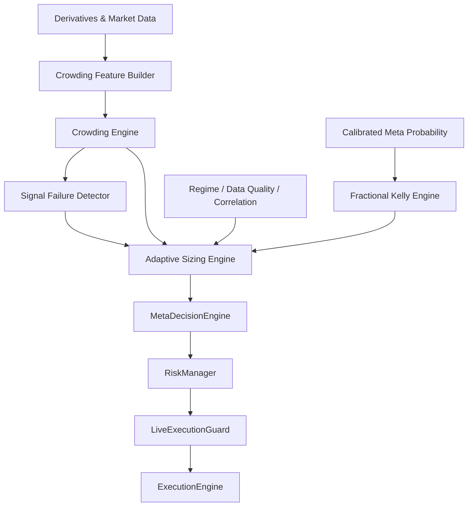

# Phase 11 — Crowding Intelligence & Adaptive Position Sizing

> **Dự án:** `besttime-crypto`  
> **Mục tiêu:** Đo mức độ crowded LONG/SHORT, phát hiện tín hiệu kỹ thuật thất bại và điều chỉnh risk budget bằng Fractional Kelly.  
> **Chế độ mặc định:** `SHADOW`  
> **Nguyên tắc an toàn:** Crowding chỉ là risk modifier; không tự động đảo chiều tín hiệu và không được vượt qua `HardRiskLimits`.

---

## 1. Executive Summary

Phase 11 bổ sung một lớp intelligence để trả lời ba câu hỏi:

1. Thị trường có đang quá crowded về phía LONG hoặc SHORT hay không?
2. Crowded positioning đó đang tiếp tục có hiệu lực hay bắt đầu thất bại?
3. Với xác suất thắng đã calibration, hệ thống nên phân bổ bao nhiêu risk budget cho giao dịch?

Luồng mục tiêu:

```text
Funding / Open Interest / Long-Short Ratio
Liquidations / Orderbook / Social / Technical Consensus
                         ↓
                 CrowdingFeatureBuilder
                         ↓
                   CrowdingEngine
                         ↓
               SignalFailureDetector
                         ↓
                  FractionalKelly
                         ↓
                AdaptiveSizingEngine
                         ↓
             MetaDecisionEngine / RiskManager
                         ↓
                  ExecutionEngine
```

Output hợp lệ:

```text
ALLOW
REDUCE
WAIT_RETEST
SKIP
```

Output bị cấm:

```text
AUTO_REVERSE_SIGNAL
BYPASS_HARD_RISK_LIMITS
BYPASS_PHASE5_LIVE_GATE
BLOCK_EXIT_ORDER
```

---

## 2. Phạm vi

### Trong phạm vi

- Thu thập dữ liệu derivatives crowding.
- Feature engineering theo point-in-time.
- Crowding Score ngắn hạn và trung hạn.
- Signal Failure Score.
- Fractional Kelly có calibration và hard cap.
- Adaptive position sizing.
- Historical replay, shadow mode, dashboard và audit.
- Governance và promotion gate.

### Ngoài phạm vi

- Dự đoán giá trực tiếp.
- Auto contrarian trading.
- Full Kelly.
- Tăng risk vượt giới hạn rollout stage.
- Dùng replay/synthetic data để mở live gate.
- Thay thế `HardRiskLimits`, `ExecutionRiskMonitor` hoặc `LiveExecutionGuard`.

---

## 3. Kiến trúc tổng thể



---

# Phase 11.1 — Data Collection

## Mục tiêu

Thu thập đủ dữ liệu để đo crowded positioning theo từng symbol/timeframe mà không phụ thuộc một nguồn duy nhất.

## Nguồn dữ liệu

| Nhóm | Field | Nguồn chính | Fallback | Bắt buộc |
|---|---|---|---|---|
| Funding | `funding_rate` | Binance Futures | Bybit/Deribit | Có |
| Open Interest | `open_interest` | Binance Futures | Bybit | Có |
| Long/Short | `global_long_short_ratio` | Binance Futures | None | Có |
| Top Traders | `top_trader_position_ratio` | Binance Futures | None | Không |
| Liquidations | `long_liquidation_usd`, `short_liquidation_usd` | WebSocket/provider | None | Không |
| Orderbook | `orderbook_imbalance` | Execution layer | CCXT | Có |
| Technical | `technical_consensus` | Signal engine | None | Có |
| Social | `social_sentiment` | Reddit/Trends | Cache | Không |

## Raw snapshot schema

```python
from dataclasses import dataclass
from datetime import datetime
from typing import Optional


@dataclass(frozen=True)
class CrowdingRawSnapshot:
    symbol: str
    timeframe: str
    observed_at: datetime

    funding_rate: Optional[float]
    open_interest: Optional[float]
    global_long_short_ratio: Optional[float]
    top_trader_position_ratio: Optional[float]

    long_liquidation_usd: Optional[float]
    short_liquidation_usd: Optional[float]

    orderbook_imbalance: Optional[float]
    technical_consensus: Optional[float]
    social_sentiment: Optional[float]
```

## Metadata bắt buộc

```python
{
    "available": True,
    "status": "success | missing | stale | error",
    "source": "binance_futures",
    "confidence": 0.95,
    "observed_at": "2026-07-11T10:00:00Z",
    "age_seconds": 12,
    "is_stale": False,
}
```

## Yêu cầu triển khai

- Không dùng `0.0` cho missing.
- NaN/Infinity chuyển thành `None`.
- Retry, timeout, circuit breaker và cache fallback.
- Cache fallback phải đánh dấu `stale`.
- Timestamp là thời điểm quan sát từ nguồn.
- Collector không được blocking trong execution path.

## Deliverables

```text
btc_scraper/crowding/data_collector.py
btc_scraper/crowding/source_registry.py
tests/test_crowding_data_collector.py
```

## Acceptance Criteria

- [ ] Dữ liệu bắt buộc có metadata đầy đủ.
- [ ] Missing không bị biến thành `0.0`.
- [ ] Stale cache được nhận diện.
- [ ] Collector failure không làm hỏng trading cycle.
- [ ] Point-in-time timestamp chính xác.

---

# Phase 11.2 — Crowding Feature Engineering

## Feature chính

```text
funding_zscore
funding_change_zscore
open_interest_change_15m
open_interest_change_1h
open_interest_change_4h
open_interest_zscore
price_return_zscore
price_oi_divergence
global_long_short_zscore
top_trader_ratio_zscore
liquidation_imbalance
liquidation_spike_zscore
orderbook_imbalance
technical_consensus
social_sentiment_zscore
crowding_acceleration
crowding_persistence
```

## Rolling windows

| Feature | Short-term | Medium-term |
|---|---:|---:|
| Funding | 7 ngày | 30–90 ngày |
| OI change | 1–7 ngày | 30 ngày |
| Long/Short ratio | 7 ngày | 30 ngày |
| Liquidations | 24 giờ | 7 ngày |
| Social | 7 ngày | 30 ngày |
| Technical consensus | 24 giờ | 7 ngày |

## Z-score

```python
def rolling_zscore(value, history):
    if value is None or len(history) < 20:
        return None

    mean = history.mean()
    std = history.std()

    if std == 0:
        return 0.0

    return (value - mean) / std
```

## Price–OI direction

```python
def calculate_oi_direction_score(
    price_return_z: float | None,
    oi_change_z: float | None,
) -> float | None:
    if price_return_z is None or oi_change_z is None:
        return None

    if oi_change_z <= 0:
        return 0.0

    direction = 1.0 if price_return_z >= 0 else -1.0
    magnitude = min(abs(oi_change_z) / 3.0, 1.0)

    return direction * magnitude
```

## Technical consensus

Nhóm indicator theo bản chất:

```text
Trend
Momentum
Breakout
Volume
Market Structure
Volatility
```

```python
technical_consensus = (
    trend_direction
    + momentum_direction
    + breakout_direction
    + volume_confirmation
    + structure_direction
) / 5.0
```

## Deliverables

```text
btc_scraper/crowding/feature_builder.py
btc_scraper/crowding/feature_schema.py
tests/test_crowding_feature_builder.py
```

## Acceptance Criteria

- [ ] Directional feature nằm trong `[-1, 1]`.
- [ ] Rolling calculation không look-ahead.
- [ ] Thiếu history trả `None`.
- [ ] Không double-count indicator tương quan cao.
- [ ] `observed_at <= signal_timestamp`.

---

# Phase 11.3 — Crowding Engine v1

## Output schema

```python
from dataclasses import dataclass


@dataclass(frozen=True)
class CrowdingResult:
    score: float | None
    short_term_score: float | None
    medium_term_score: float | None
    confidence: float
    regime: str
    available_weight: float
    missing_features: tuple[str, ...]
    contributions: dict[str, float]
```

## Công thức v1

```python
crowding_score = (
    0.25 * funding_score
    + 0.20 * oi_direction_score
    + 0.20 * long_short_score
    + 0.10 * liquidation_positioning_score
    + 0.10 * technical_consensus
    + 0.10 * social_score
    + 0.05 * orderbook_imbalance
)
```

Thiếu feature thì reweight theo `available_weight`; không dùng missing như `0.0`.

## Regime

```text
score >=  0.75 → EXTREME_CROWDED_LONG
score >=  0.50 → CROWDED_LONG
score <= -0.75 → EXTREME_CROWDED_SHORT
score <= -0.50 → CROWDED_SHORT
còn lại         → BALANCED
không đủ dữ liệu → UNKNOWN
```

## Confidence

```python
confidence = (
    available_weight
    * freshness_multiplier
    * source_quality_multiplier
)
```

Rule:

```text
confidence < 0.50 → không enforce
0.50–0.70         → chỉ giảm nhẹ size
>= 0.70           → dùng rule đầy đủ
```

## Short-term / Medium-term

```python
final_score = (
    0.60 * short_term_score
    + 0.40 * medium_term_score
)
```

## Deliverables

```text
btc_scraper/crowding/crowding_engine.py
btc_scraper/crowding/config.py
tests/test_crowding_engine.py
```

## Acceptance Criteria

- [ ] Score trong `[-1, 1]`.
- [ ] Confidence trong `[0, 1]`.
- [ ] Missing reweight đúng.
- [ ] Có contribution breakdown.
- [ ] Không tự tạo BUY/SELL action.

---

# Phase 11.4 — Signal Failure Detector

## Feature

```text
price_oi_divergence
breakout_rejection
weak_close_score
volume_absorption
orderbook_reversal
failed_retest
funding_price_divergence
late_entry_risk
```

## Weak close

```python
def weak_close_score(high: float, low: float, close: float) -> float | None:
    candle_range = high - low
    if candle_range <= 0:
        return None

    close_location = (close - low) / candle_range
    return 1.0 - close_location
```

SELL phải xử lý đối xứng theo hướng signal.

## Failure score

```python
failure_score = (
    0.30 * price_oi_divergence
    + 0.25 * breakout_rejection
    + 0.20 * weak_close_score
    + 0.15 * orderbook_reversal
    + 0.10 * volume_absorption
)
```

## Output

```python
{
    "failure_score": 0.67,
    "failure_confidence": 0.82,
    "reason_codes": [
        "price_oi_divergence",
        "failed_breakout",
        "weak_close",
    ],
}
```

## Deliverables

```text
btc_scraper/crowding/signal_failure.py
tests/test_signal_failure.py
```

## Acceptance Criteria

- [ ] Failure score trong `[0, 1]`.
- [ ] BUY/SELL xử lý đối xứng.
- [ ] Không SHORT chỉ vì crowded long.
- [ ] Contrarian action cần confirmation riêng.
- [ ] Reason codes đầy đủ.

---

# Phase 11.5 — Fractional Kelly Engine

## Công thức

```text
raw_kelly = p - (1 - p) / b
```

Trong đó:

```text
p = calibrated win probability
b = average win / average loss
```

## Rule

```text
raw_kelly <= 0 → size = 0
Không dùng Full Kelly
Mặc định Quarter Kelly
Hard cap luôn thắng Kelly
```

## Output schema

```python
@dataclass(frozen=True)
class KellyResult:
    raw_fraction: float
    fractional_fraction: float
    capped_fraction: float
    has_edge: bool
    disabled_reason: str | None
```

## Stage caps

```python
STAGE_KELLY_CAPS = {
    0: 0.0000,
    1: 0.0025,
    2: 0.0050,
    3: 0.0100,
}
```

## Disable conditions

```text
sample_count < 200
calibration_error > 0.10
data_completeness < 0.90
model drift critical
reward/risk sample không đủ
Phase5 gate chưa pass đối với live enforcement
```

## Reward/risk source

Ưu tiên:

```text
Real closed trades cùng strategy + regime
Walk-forward OOS results
Paper execution results
```

Không ưu tiên:

```text
TP/SL lý thuyết
Synthetic fills
Replay fills dùng cùng slippage model
```

## Deliverables

```text
btc_scraper/crowding/kelly_engine.py
tests/test_kelly_engine.py
```

## Acceptance Criteria

- [ ] Kelly âm trả `0`.
- [ ] Full Kelly không có trong live path.
- [ ] Stage cap luôn enforce.
- [ ] Calibration/data-quality gate hoạt động.
- [ ] Exit/emergency exit không bị Kelly chặn.

---

# Phase 11.6 — Adaptive Sizing Engine

## Công thức tổng hợp

```python
final_risk_fraction = min(
    base_kelly
    * calibration_multiplier
    * crowding_multiplier
    * failure_multiplier
    * regime_multiplier
    * data_quality_multiplier
    * correlation_multiplier,
    hard_risk_cap,
)
```

## Crowding multiplier

```python
def crowding_multiplier(
    signal_direction: int,
    crowding_score: float | None,
    confidence: float,
) -> float:
    if crowding_score is None:
        return 0.75

    if confidence < 0.50:
        return 0.75

    same_side = signal_direction * crowding_score

    if same_side >= 0.75:
        return 0.25

    if same_side >= 0.50:
        return 0.50

    if same_side <= -0.50:
        return 1.10

    return 1.0
```

## Failure multiplier

```python
def failure_multiplier(
    same_side_crowding: float,
    failure_score: float | None,
) -> float:
    if failure_score is None:
        return 0.75

    if same_side_crowding >= 0.75 and failure_score >= 0.65:
        return 0.0

    if failure_score >= 0.50:
        return 0.50

    return 1.0
```

## Position notional

```python
risk_budget = equity * final_risk_fraction
position_notional = risk_budget / stop_distance_pct
```

Sau đó áp dụng:

```text
max_position_usdt
liquidity safe size
portfolio exposure
correlation limit
rollout stage limit
hard risk limit
```

## Deliverables

```text
btc_scraper/crowding/adaptive_sizing.py
tests/test_adaptive_sizing.py
```

## Acceptance Criteria

- [ ] Final risk không vượt hard cap.
- [ ] Missing crowding không tăng size.
- [ ] Crowding ngược hướng chỉ tăng tối đa nhẹ.
- [ ] Failure mạnh có thể đưa size về `0`.
- [ ] Position sizing dùng stop distance thật.
- [ ] Audit toàn bộ multiplier.

---

# Phase 11.7 — Decision Engine Integration

## Mode

```env
CROWDING_MODE=OFF|SHADOW|ENFORCED
KELLY_SIZING_MODE=OFF|SHADOW|ENFORCED
```

Mặc định:

```env
CROWDING_MODE=SHADOW
KELLY_SIZING_MODE=SHADOW
```

## Decision rule

```python
if signal == "BUY":
    same_side_crowding = crowding_score

    if same_side_crowding >= 0.75 and failure_score >= 0.65:
        decision = "SKIP"
        reason = "crowded_long_failure"

    elif same_side_crowding >= 0.60:
        decision = "WAIT_RETEST"
        size_multiplier = 0.50

    else:
        decision = "ALLOW"
```

SELL xử lý đối xứng.

## Exit semantics

```text
ENTRY / ADD_POSITION:
  áp dụng Crowding + Kelly

REDUCE_POSITION / EXIT:
  không bị Kelly block

EMERGENCY_EXIT:
  bypass optional crowding guard
```

## Integration points

```text
MetaDecisionEngine
RiskManagerAgent
PortfolioManagerAgent
HardRiskLimits
LiveExecutionGuard
ExecutionEngine
```

## Deliverables

```text
btc_scraper/crowding/integration.py
tests/test_phase11_integration.py
```

## Acceptance Criteria

- [ ] Shadow mode không đổi production decision.
- [ ] Enforced mode có audit log.
- [ ] Exit không bị chặn.
- [ ] HardRiskLimits là trần cuối cùng.
- [ ] Không có direct sizing bypass.

---

# Phase 11.8 — Historical Replay

## Config

```env
TRADING_MODE=historical_replay
CROWDING_MODE=SHADOW
KELLY_SIZING_MODE=SHADOW
AUTO_TRADE_DRY_RUN=true
LIVE_TRADING_ENABLED=false
```

## Dataset tối thiểu

```text
BTCUSDT
ETHUSDT
SOLUSDT
```

Regime:

```text
Bull
Bear
Range
High volatility
Funding extreme
Liquidation event
```

## Variants

```text
Baseline fixed sizing
Current production sizing
Kelly only
Crowding only
Crowding + Kelly
```

## Metrics

```text
Net PnL
Max Drawdown
Profit Factor
Sharpe
Sortino
Tail loss
Average risk/trade
Consecutive losses
Cost drag
Position concentration
Performance by regime
```

## Look-ahead protection

- Signal tại candle `T`.
- Entry sớm nhất tại `T+1`.
- Alternative data dùng backward as-of join.
- Không dùng current snapshot cho historical timestamp.
- Intrabar ambiguity dùng conservative policy.

## Deliverables

```text
scripts/run_crowding_replay.py
scripts/generate_crowding_report.py
data/crowding/reports/
```

## Acceptance Criteria

- [ ] Không look-ahead.
- [ ] Replay fill có `fill_source=historical_replay`.
- [ ] Live gate eligible fills = `0`.
- [ ] Same execution path as paper/live.
- [ ] Report breakdown theo regime.
- [ ] Không tăng MaxDD đáng kể.

---

# Phase 11.9 — Shadow Validation

## Shadow record

```python
{
    "signal_id": "...",
    "symbol": "BTCUSDT",
    "production_size": 100.0,
    "shadow_size": 50.0,
    "crowding_score": 0.74,
    "failure_score": 0.42,
    "raw_kelly": 0.22,
    "final_risk_fraction": 0.005,
    "actual_outcome": None,
}
```

## Minimum sample

```text
>= 100 closed trades
>= 3 market regimes
>= 3 symbols
>= 30 days shadow runtime
```

## Promotion gate

```text
MaxDD không tăng
Tail loss giảm hoặc không xấu hơn 5%
Net PnL sau phí không giảm quá 10%
Position concentration không tăng
Không tạo risk-limit violation
Không làm tăng reject rate đáng kể
```

## Deliverables

```text
btc_scraper/crowding/shadow_tracker.py
data/crowding/shadow/
docs/remediation/Phase11_Shadow_Report.md
```

---

# Phase 11.10 — Dashboard & Monitoring

## Dashboard tab

```text
Crowding & Adaptive Risk
```

Hiển thị:

```text
Crowding score
Crowding regime
Confidence
Funding contribution
OI contribution
Long/short contribution
Failure score
Raw Kelly
Fractional Kelly
Final risk fraction
Position size before/after
Reason codes
```

## Alerts

```text
EXTREME_CROWDED_LONG
EXTREME_CROWDED_SHORT
CROWDING_REVERSAL
PRICE_OI_DIVERGENCE
KELLY_DISABLED
CALIBRATION_DEGRADED
CROWDING_DATA_STALE
```

## Monitoring metrics

```text
crowding_feature_completeness
crowding_data_stale_rate
average_crowding_confidence
kelly_disabled_rate
average_size_reduction
skip_rate_due_to_failure
shadow_vs_production_pnl
```

## Deliverables

```text
btc_scraper/crowding/monitor.py
api/crowding endpoints
dashboard Crowding tab
```

---

# Phase 11.11 — Governance

## Rule-based v1

Crowding Engine v1 dùng rule-based để dễ giải thích, audit và rollback.

## ML v2

Chỉ train khi có:

```text
>= 500 closed trades
>= 90 ngày dữ liệu
>= 3 regimes
Feature completeness >= 90%
```

Target:

```text
P(signal fails | crowding features)
```

Model output:

```text
crowding_failure_probability
```

ML model phải đi qua:

```text
ModelRegistry.register()
Challenger
Shadow
Promotion gate
Production
Rollback
```

Governance metrics:

```text
Holdout AUC
Calibration error
Brier score
High-confidence bucket
CV–holdout gap
PnL impact
Drawdown impact
```

---

## 4. File Structure

```text
btc_scraper/crowding/
├── __init__.py
├── config.py
├── source_registry.py
├── data_collector.py
├── feature_schema.py
├── feature_builder.py
├── crowding_engine.py
├── signal_failure.py
├── kelly_engine.py
├── adaptive_sizing.py
├── integration.py
├── shadow_tracker.py
└── monitor.py

scripts/
├── run_crowding_replay.py
├── generate_crowding_report.py
└── train_crowding_failure_model.py

tests/
├── test_crowding_data_collector.py
├── test_crowding_feature_builder.py
├── test_crowding_engine.py
├── test_signal_failure.py
├── test_kelly_engine.py
├── test_adaptive_sizing.py
└── test_phase11_integration.py

docs/remediation/
├── Phase11_Crowding_Adaptive_Sizing_Implementation_Plan.md
├── Phase11_Shadow_Report.md
└── Phase11_Completion_Report.md
```

---

## 5. Environment Configuration

```env
CROWDING_ENABLED=true
CROWDING_MODE=SHADOW
KELLY_SIZING_MODE=SHADOW

CROWDING_MIN_CONFIDENCE=0.50
CROWDING_EXTREME_THRESHOLD=0.75
CROWDING_HIGH_THRESHOLD=0.50

CROWDING_FAILURE_SKIP_THRESHOLD=0.65
CROWDING_FAILURE_REDUCE_THRESHOLD=0.50

KELLY_MULTIPLIER=0.25
KELLY_MIN_SAMPLE_COUNT=200
KELLY_MAX_CALIBRATION_ERROR=0.10

KELLY_STAGE1_MAX_RISK=0.0025
KELLY_STAGE2_MAX_RISK=0.0050
KELLY_STAGE3_MAX_RISK=0.0100

CROWDING_SHADOW_MIN_TRADES=100
CROWDING_SHADOW_MIN_DAYS=30
```

---

## 6. Test Plan

### Unit tests

```text
Missing feature reweight
Score boundaries
Confidence calculation
Funding/OI direction
Price–OI divergence
BUY/SELL symmetry
Kelly negative
Kelly stage cap
Failure multiplier
Crowding multiplier
Exit bypass
```

### Integration tests

```text
Signal → Crowding → Kelly → RiskManager
Shadow mode does not modify live order
Enforced mode reduces size
HardRiskLimits overrides Kelly
Emergency exit remains allowed
Historical replay no look-ahead
Model governance promotion/rollback
```

### Chaos/data tests

```text
Funding API down
OI stale
Long/short missing
Orderbook spoof-like spike
Calibration degraded
Model artifact missing
Replay data gap
```

---

## 7. Acceptance Gates

### Functional Gate

- [ ] Score nằm trong `[-1, 1]`.
- [ ] Missing không chuyển thành `0`.
- [ ] Confidence phản ánh available weight.
- [ ] Kelly âm trả size `0`.
- [ ] Hard cap luôn thắng Kelly.
- [ ] Exit/emergency exit không bị block.
- [ ] Crowding không tự động đảo tín hiệu.
- [ ] Audit log đầy đủ reason codes.

### Replay Gate

- [ ] Không look-ahead.
- [ ] Same execution path.
- [ ] Replay fills không mở live gate.
- [ ] Ổn định trên ít nhất 3 regime.
- [ ] MaxDD không tăng đáng kể.
- [ ] Tail loss không xấu hơn 5%.

### Shadow Gate

- [ ] Tối thiểu 100 closed trades.
- [ ] Tối thiểu 30 ngày.
- [ ] Tối thiểu 3 symbols.
- [ ] Position concentration không tăng.
- [ ] Net PnL sau phí không giảm quá 10%.
- [ ] Không có hard-risk violation.

### Enforcement Gate

- [ ] `CROWDING_MODE=SHADOW` trước `ENFORCED`.
- [ ] `KELLY_SIZING_MODE=SHADOW` trước `ENFORCED`.
- [ ] Phase 5 live gate phải PASS.
- [ ] Model governance PASS nếu dùng ML v2.
- [ ] `HardRiskLimits` vẫn là trần cuối cùng.
- [ ] Có rollback config tức thời.

---

## 8. Rollout Plan

### Stage A — Offline

```text
Data collection
Feature engineering
Rule-based crowding
Kelly unit tests
Historical replay
```

### Stage B — Shadow

```text
CROWDING_MODE=SHADOW
KELLY_SIZING_MODE=SHADOW
100+ trades
30+ days
```

### Stage C — Partial Enforcement

```text
Crowding chỉ giảm size
Không tăng size
Không skip tín hiệu
Quarter Kelly capped
```

### Stage D — Full Enforcement

```text
Allow REDUCE / WAIT_RETEST / SKIP
No auto reverse
Stage caps active
Governance active
```

---

## 9. Risks

| Rủi ro | Mức độ | Giảm thiểu |
|---|---:|---|
| Funding/OI bị nhiễu | Cao | Z-score + multi-source |
| Crowding score quá trễ | Trung bình | Short-term score |
| Kelly phóng đại sai số | Rất cao | Quarter Kelly + hard cap |
| Double-count technical signals | Cao | Grouped consensus |
| Replay quá lý tưởng | Cao | Conservative fills |
| Missing data giả neutral | Cao | `None` + missing flag |
| Contrarian sai | Cao | Failure confirmation |
| Shadow sample không đủ | Trung bình | Minimum sample gate |

---

## 10. Definition of Done

Phase 11 hoàn thành khi:

```text
Data pipeline ổn định
Crowding Engine v1 pass
Signal Failure Detector pass
Fractional Kelly pass
Adaptive Sizing pass
Historical replay pass
Shadow validation pass
Dashboard và audit hoạt động
Enforcement gate được phê duyệt
```

Mục tiêu cuối cùng:

```text
Không giao dịch ngược đám đông một cách máy móc.
Đo crowded positioning.
Kiểm tra crowd có đang thất bại.
Giảm risk khi uncertainty tăng.
Chỉ dùng Kelly đã calibration và luôn có hard cap.
```
