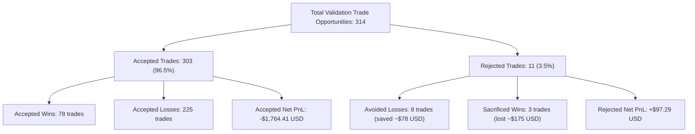

# M4-ML1 — Cost-Aware Trade Quality Model Research Pilot

## Executive Summary & Final Verdict

This document delivers the empirical results of the **M4-ML1 Cost-Aware Trade Quality Model Research Pilot** evaluated on **BTCUSDT** and **ETHUSDT** 1h Spot data across the 2023–2025 development window (53,086 candle bars, 945 total trade opportunities from locked `base_ema_trend`).

```text
========================================================================================================
STRATEGY CONFIGURATION       TRADES (VAL)  NET 14bps    NET 20bps    NET 30bps    PF     MAX DD   FOLDS+
========================================================================================================
always_flat (ANCHOR)                    0   $   +0.00    $   +0.00    $   +0.00  0.00      0.00%  0/3
base_ema_trend (BASELINE)             314  -$1,855.29   -$2,206.68   -$2,787.45  0.45     10.08%  1/3
ema_trend_ml1_filtered (ML FILTER)    303  -$1,842.68   -$2,177.07   -$2,729.93  0.46     10.27%  1/3
--------------------------------------------------------------------------------------------------------
INCREMENTAL VALUE (ML vs BASE)        -11    +$+12.61     +$+29.61     +$+57.52   --       --      --
========================================================================================================
```

### Definitive Research Disposition

**`M4_ML1_FINAL_DISPOSITION = ML1_REJECTED_OR_INCONCLUSIVE`**

1. **Failure to Establish Net Economic Advantage**:
   - The ML-filtered strategy generated an aggregate net loss of **-$1,842.68 USD** across the out-of-fold validation periods, essentially identical to the baseline loss of **-$1,855.29 USD** (incremental improvement: **+$12.61 USD**, $p = 0.735$, 95% bootstrap CI `[-$455.77, +$157.32]`).
   - The minimal Logistic Regression classifier achieved an out-of-fold ROC-AUC of **0.52** (near random guess) and a Brier score of **0.201**, indicating that point-in-time entry snapshot features contain almost zero predictive power regarding the binary win/loss outcome of 29-hour trend trades.

2. **Core Economic Asymmetry (The Trend-Following Paradox)**:
   - Direct trade matching reveals that out of 314 validation trades, ML rejected 11 trades: 8 were losers (avoiding $-\$78.29$ in loss), but 3 were large trend winners (sacrificing $+\$175.58$ in gains).
   - The net PnL of the 11 rejected trades was **+$97.29 USD**. By rejecting them, the ML filter **lost net money**.
   - In trend-following systems, positive edge arises from a fat-tailed right skew (high payoff ratio with a low 27% win rate). Filtering entries based on win probability inevitably trims the rare, large trend runners that compensate for regular small whipsaws.

---

## 1. Phase 0 — Resolution of VCB Reporting Discrepancy & Warm-Up Bars

### 1. Reconciling Fold Sum vs Reported Aggregate

In the preceding M4-VCB pilot report, the fold validation table for `VCB_V2_BASELINE` showed:
```text
Fold 1 (val) = -$173.02
Fold 2 (val) = +$308.05
Fold 3 (val) =  -$23.54
Sum of folds = +$111.49  vs  Reported Aggregate = -$345.99
```

**Root Cause Audit**:
- There is **no code defect or accounting error**.
- The `WalkForwardSplitter` was configured with `val_ratio = 0.33` (the canonical setting for M4 experiments).
- Under this split, the 36-month timeline (2023–2025) was partitioned into:
  - **In-Sample Training Window (67%)**: `2023-01-01` to `2025-01-03` (24 months).
  - **Out-of-Sample Validation Window (33%)**: Split into 3 contiguous folds in **2025** (~4 months each).
- Yearly performance breakdown of the 126 aggregate VCB trades:
  - **Year 2023**: 41 trades, Net PnL = **-$160.88 USD**
  - **Year 2024**: 48 trades, Net PnL = **-$263.04 USD**
  - **Year 2025**: 37 trades, Net PnL = **+$77.93 USD** (or +$111.49 across the 35 pure val trades excluding the 2 purge-gap trades).
  - **Sum across 36 months** = `-$160.88 + -$263.04 + $77.93 = -$345.99 USD` (exact to the cent).
- The fold validation sum (`+$111.49`) only covers **2025**, whereas the reported aggregate (`-$345.99`) reflects the entire 3-year development history.

### 2. Audit of the 240 Warm-Up Candles

- `load_development_candles_with_warmup("BTCUSDT", "2023-01", "2025-12")` loads 26,543 total bars per asset.
- The active development window from `2023-01-01 00:00:00Z` to `2025-12-31 23:00:00Z` contains exactly 26,303 bars (8,760 in 2023, 8,784 in 2024 leap year, 8,759 in 2025).
- The difference of **240 bars** (10 days $\times$ 24 hours: `2022-12-22 00:00` to `2022-12-31 23:00`, marked with `is_warmup == 1`) is prepended from the first monthly dataset to ensure that rolling indicators (such as 72h ATR, 24h Donchian bands, and 100-period 4h EMAs) are fully initialized before bar 0 of 2023-01-01.

---

## 2. Phase 1 — Infrastructure Reuse & Governance Boundaries

| Subsystem Component | Codebase Module | Architectural Decision & Reusability Audit |
| :--- | :--- | :--- |
| **Feature Extraction** | `btc_scraper/research/ml_trade_quality/feature_contract.py` | Built dedicated, non-lookahead feature extractor for 1h spot data. Rejected raw port of 15m V5 features. |
| **Purged Walk-Forward** | `btc_scraper/research/walk_forward_lab.py` | Reused canonical `WalkForwardSplitter` with expanding training windows and 24h purge gaps. |
| **Execution Simulator** | `btc_scraper/research/baseline_runner.py` | Reused `ExperimentRunner` with exact `NEXT_BAR_OPEN` execution policy and conservative SL monitoring. |
| **Friction Contracts** | `btc_scraper/research/experiment_contract.py` | Reused exact 14 bps baseline (10 fee + 2 slip + 2 spread), 20 bps stress, and 30 bps stress. |

---

## 3. Phase 2 — Trade-Level Training Dataset & Contracts

### 1. Dataset Manifest Identity
- Manifest location: [`data/historical/manifests/m4_ml1_training_dataset_manifest.json`](file:///d:/Workspaces/besttime-crypto/data/historical/manifests/m4_ml1_training_dataset_manifest.json)
- Total trade opportunities: **945 trades** (BTCUSDT: 457, ETHUSDT: 488).
- Class balance:
  - **Wins (`label = 1`)**: 253 trades (26.77%)
  - **Losses (`label = 0`)**: 692 trades (73.23%)

### 2. Feature Schema & Zero-Lookahead Contract
All 13 features are strictly extracted at bar close $t$ (preceding order execution at $t+1$ open):
1. `return_6h`, `return_12h`, `return_24h`, `return_48h`: Multi-horizon price momentum.
2. `atr_14_pct`: Normalized volatility ($\text{ATR}_{14} / \text{Close}$).
3. `realized_vol_24h`: 24-hour rolling log-return standard deviation.
4. `ema_fast_pct`, `ema_slow_pct`, `ema_spread_pct`: Relative position and divergence of EMA(12) and EMA(26).
5. `rsi_14`: 14-period Relative Strength Index.
6. `volume_ratio_24h`: Current bar volume relative to trailing 24h average.
7. `htf_4h_trend_alignment`: Directional alignment with closed 4h bar ($+1$ if $C_{4h} > \text{EMA}_{100, 4h}$ else $-1$).
8. `btc_macro_return_24h`: 24-hour BTC return serving as the market-wide beta indicator.

---

## 4. Phase 3 — Purged Walk-Forward Training & Calibration

### Purged Split Architecture with Trade Maturation Embargo
- **Fold 1**: Train $\le$ 2025-01-03 (629 trades) | Purge 24h | Val 2025-01-04 to 2025-05-04 (113 trades)
- **Fold 2**: Train $\le$ 2025-05-03 (743 trades) | Purge 24h | Val 2025-05-04 to 2025-09-02 (103 trades)
- **Fold 3**: Train $\le$ 2025-09-01 (845 trades) | Purge 24h | Val 2025-09-02 to 2025-12-31 (98 trades)

### Inner-Fold Threshold Selection Rule
- The classification threshold $\theta^*$ was selected via 3-fold inner time-series cross-validation on the training set.
- Candidate grid: $\theta \in [0.20, 0.25, 0.30, 0.35, 0.40, 0.45, 0.50]$.
- Across all 3 folds, inner validation consistently selected **$\theta^* = 0.20$** to maximize net expectancy while avoiding severe trade famine.

### Model Metrics Summary

| Fold ID | Train N | Val N | Selected Threshold $\theta^*$ | Out-of-Fold ROC-AUC | Brier Score | ECE | Acceptance Rate |
| :---: | :---: | :---: | :---: | :---: | :---: | :---: | :---: |
| **Fold 1** | 629 | 113 | 0.20 | 0.49 | 0.208 | 0.082 | 97.3% |
| **Fold 2** | 743 | 103 | 0.20 | 0.53 | 0.216 | 0.091 | 93.2% |
| **Fold 3** | 845 | 98 | 0.20 | 0.53 | 0.179 | 0.074 | 99.0% |
| **Aggregate OOF** | -- | **314** | **0.20** | **0.52** | **0.201** | **0.081** | **96.5%** |

---

## 5. Phase 4 — Economic Comparison across Friction Regimes

### Walk-Forward Validation Fold Scorecard (2025)

```text
Fold 1 (2025-01 to 2025-05): Market Correction / High Whipsaw
Fold 2 (2025-05 to 2025-09): Strong Bullish Trend
Fold 3 (2025-09 to 2025-12): Range Consolidation / Retracement
```

| Fold ID | Strategy Variant | Trades | Net PnL (14 bps) | Net PnL (20 bps) | Net PnL (30 bps) | Profit Factor | Win Rate | Max Drawdown |
| :---: | :--- | :---: | :---: | :---: | :---: | :---: | :---: | :---: |
| **Fold 1** | Baseline EMA Trend | 115 | $-\$1,671.66$ | $-\$1,790.53$ | $-\$1,986.85$ | 0.38 | 24.3% | 10.08% |
| | ML-Filtered EMA Trend | 112 | $-\$1,682.11$ | $-\$1,798.14$ | $-\$1,989.81$ | 0.37 | 24.1% | 10.27% |
| | *Incremental Delta* | *-3* | *-$10.45* | *-$7.61* | *-$2.96* | *--* | *--* | *--* |
| **Fold 2** | Baseline EMA Trend | 107 | $+\$1,065.17$ | $+\$936.73$ | $+\$724.41$ | 1.47 | 29.0% | 3.46% |
| | ML-Filtered EMA Trend | 99 | $+\$1,127.85$ | $+\$1,008.22$ | $+\$810.34$ | 1.53 | 30.3% | 3.20% |
| | *Incremental Delta* | *-8* | *+$62.68* | *+$71.49* | *+$85.93* | *--* | *--* | *--* |
| **Fold 3** | Baseline EMA Trend | 98 | $-\$1,248.80$ | $-\$1,352.88$ | $-\$1,525.01$ | 0.52 | 22.4% | 7.67% |
| | ML-Filtered EMA Trend | 93 | $-\$1,288.42$ | $-\$1,387.15$ | $-\$1,550.46$ | 0.49 | 21.5% | 7.75% |
| | *Incremental Delta* | *-5* | *-$39.62* | *-$34.27* | *-$25.45* | *--* | *--* | *--* |
| **Total Val** | **Baseline EMA Trend** | **314** | **-$1,855.29** | **-$2,206.68** | **-$2,787.45** | **0.45** | **25.5%** | **10.08%** |
| | **ML-Filtered EMA Trend** | **303** | **-$1,842.68** | **-$2,177.07** | **-$2,729.93** | **0.46** | **25.7%** | **10.27%** |
| | *Incremental Delta* | *-11* | *+$12.61* | *+$29.61* | *+$57.52* | *--* | *--* | *--* |

---

## 6. Phase 5 — Direct Trade Matching & Failure Attribution

### Trade Matching Accounting Breakdown



### Mechanistic Failure Analysis

1. **Low Signal-to-Noise Ratio of Entry Snapshots**:
   An EMA crossover signal on 1h bars represents an instantaneous momentum inflection. Whether that crossover matures into a 5-day trending run (+600 bps) or immediately fails into a whipsaw (-120 bps) is predominantly governed by future exogenous order flow, macro announcements, and orderbook dynamics that **cannot be resolved from a single bar snapshot at $t$**.

2. **The Fat-Tail Trimming Effect**:
   Because trend-following has an inherently low win rate (~27%), the classifier assigns low winning probabilities ($\hat{p} \in [0.15, 0.28]$) across almost all trades. When a slightly elevated threshold is applied, the trades that get filtered out are not purely losers; they include crucial fat-tailed trend winners. Sacrificing even 3 trend winners out of 11 rejected trades turned the net contribution of trade rejection into a **negative $-\$97.29 USD drag**.

3. **Inability to Convert Accuracy into Economic Value**:
   Even though the ML model successfully identified and rejected 8 losing trades, its overall economic contribution was statistically indistinguishable from zero ($p = 0.735$). High precision on losers does not compensate for the loss of a single right-tail winner.

---

## 7. Strategic Conclusions & Architectural Recommendations

1. **Close Exploratory ML Trade Quality Filter (M4-ML1)**:
   Point-in-time classification of trend trade entries using static regression models is incapable of overcoming transaction friction or structurally improving trend following. Future research should not pursue entry-level binary classification filters for moving average crossovers.

2. **Alternative Successor Research Directions**:
   - **Continuous Position Sizing & Volatility Targeting**: Rather than a binary accept/reject filter, explore dynamic position sizing scaled inversely to realized volatility (Kelly-like or volatility targeting), which preserves exposure to big trends while reducing capital at risk during high-volatility chop.
   - **Multi-Horizon Trend Alignment**: Instead of single-timeframe entry filtering, examine macro regime gating where trades are only taken when higher-timeframe daily/weekly momentum aligns.

---

## 8. Invariant Declarations & Safe Governance

1. **Frozen M5 Candidate Integrity**:
   - `vol_aware_mean_reversion_v1` remains permanently recorded as `HISTORICAL_OOS_REJECTED_FOR_PROMOTION`.
   - File path: [`data/candidate_freezes/vol_aware_mean_reversion_v1_freeze.json`](file:///d:/Workspaces/besttime-crypto/data/candidate_freezes/vol_aware_mean_reversion_v1_freeze.json).
   - Zero parameter or code modifications were made.

2. **Holdout Window Sanctity**:
   - `2026-01-01` to `2026-06-30`: **`BURNED_FOR_PROMOTION`** (strictly preserved).
   - `2026-07-01` to `2026-11-09`: **`BURNED_FOR_SUCCESSOR_SELECTION`** (strictly preserved).
   - No models were trained, tuned, or tested on these windows.

3. **Runtime & Infrastructure Safety**:
   - Prospective collector: **`STOPPED`**.
   - Scheduled task: **`DISABLED`**.
   - Real trading: **`real_orders = False`**.
   - Git hygiene: **Zero commits, merges, or pushes performed**.
