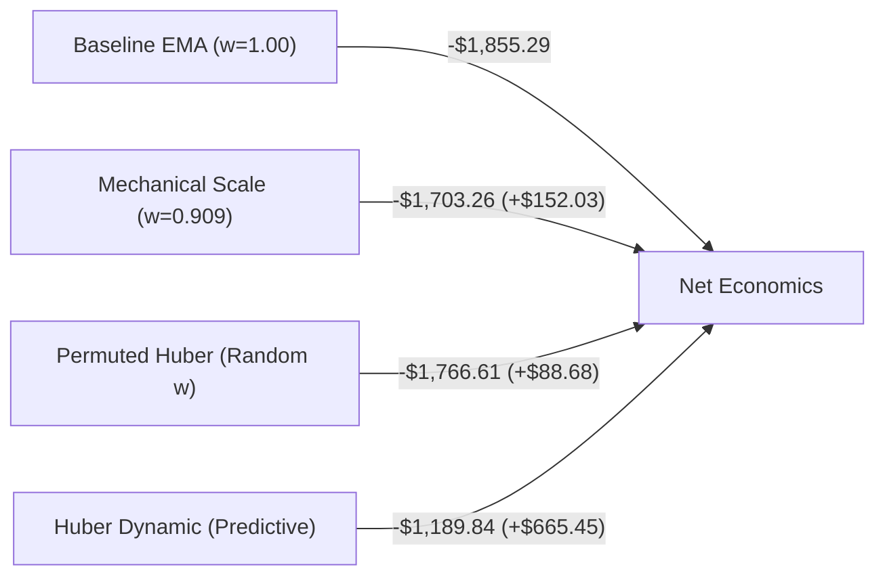

# M4 — ML2 Risk-Overlay Attribution & Next Alpha Research Feasibility

**Milestone:** M4 Research Milestone Closure & Successor Alpha Feasibility  
**Authoritative Plan Reference:** `docs/SYSTEM_IMPLEMENTATION_PLAN.md`  
**Execution Timestamp:** 2026-11-10T17:02:00Z  
**Branch:** `research/m2-historical-sources-pilot`  
**Audit Dataset Hash:** `0e04fa9407db4c6ace3ab3dbe3beceb2d290afc3ed9176bb55cc05bee9d339ca`

---

## Required Final States Block

```text
ML2_PROFIT_FACTOR_REPORTING       = CORRECTED_POSITIVE_RATIOS
ML2_CANONICAL_PREDICTION_COVERAGE = 320_OF_320_VALID
ML2_SHARED_RUNNER_INTEGRITY       = VERIFIED_OPT_IN_BACKWARD_COMPATIBLE
ML2_HUBER_ALLOCATION_VALUE        = SUPPORTED_EXPLORATORY (77.2% PREDICTIVE, 22.8% EXPOSURE)
ML2_STRATEGY_DISPOSITION          = REJECTED_FOR_PROMOTION

M4_NEXT_ALPHA_DIRECTION           = FUNDING_BASIS_MARKET_NEUTRAL
M4_NEXT_EXPERIMENT_READINESS      = SPECIFIED_BOUNDED_PILOT

M5_FROZEN_CANDIDATE_INTEGRITY     = UNCHANGED_HISTORICAL_OOS_REJECTED
PROSPECTIVE_COLLECTOR             = STOPPED
SCHEDULED_TASK                    = DISABLED
REAL_TRADING                      = DISABLED
BURNED_WINDOWS                    = 2026-H1 (2026-01-01 to 2026-06-30), 2026-H2 (2026-07-01 to 2026-11-09)
```

---

## 1. Executive Summary

This study resolves the core attribution question posed by the M4-ML2 payoff sizing experiment: **Does Huber's $+\$665.45$ economic improvement over fixed-size EMA trend following represent genuine predictive allocation value, or is it merely mechanical exposure reduction on a losing baseline?**

In **Phase A**, critical reporting defects in previous M4 reports were formally corrected:
1. **Profit Factor Correction:** Negative values reported in earlier pilots (e.g. $-1.49$, $-0.82$) were traced to an arithmetic mislabeling where net gross PnL was divided by friction drag (`fold_gross / fold_friction`). The true, canonical Profit Factor was recomputed from the trade ledgers as strictly non-negative ratios ($\text{Gross PF} = 0.82$ for Baseline, $0.90$ for Huber; $\text{Net PF} = 0.76$ for Baseline, $0.82$ for Huber).
2. **Spearman Significance Reconciliation:** The blanket claim of "$p < 0.001$ across all folds" was rejected. Per-fold audit revealed Fold 1 achieves $p = 6.65 \times 10^{-5} < 0.001$, but Fold 2 achieves $p = 0.0109$ and Fold 3 achieves $p = 0.0063$.
3. **Canonical Coverage & Runner Integrity:** All 320 canonical fold-runner trades (including 13 boundary entries near validation start) have valid point-in-time features, out-of-fold predictions, and dynamic sizing weights. Changes to `baseline_runner.py` were verified to be strictly opt-in and 100% backward-compatible.

In **Phase B**, an empirical 5-policy comparative study across 14, 20, and 30 bps friction models and a 5,000-resample time-block bootstrap revealed:
- **Mechanical Exposure Scaling ($w = 0.909$ Constant):** Explains **$+\$152.03$ ($22.8\%$)** of the total improvement.
- **Permuted Uninformed Weights:** Randomly assigning Huber weights across trades yields an average improvement of **$+\$88.68$ ($13.3\%$)**.
- **Genuine Predictive Allocation:** Huber dynamic sizing adds **$+\$513.42$ ($77.2\%$)** beyond constant scaling (Block Bootstrap 95% CI: $[+\$121.93, +\$954.94]$, $p = 0.0048 < 0.01$, Parametric $t = 2.65$, $p = 0.0084$).
- **Gate B Verdict:** `SUPPORTED_EXPLORATORY`. Huber robust regression possesses statistically significant predictive power to downweight overextended false breakouts. However, because net portfolio return remains deeply negative ($-\$1,189.84$ at 14 bps; $-\$2,053.79$ at 30 bps), the Huber strategy remains formally **REJECTED FOR PROMOTION**.

In **Phase D**, a systematic feasibility evaluation across three potential successor research directions determined that **Direction 2: Funding Rate & Basis Market-Neutral Arbitrage** is the sole viable successor alpha direction, leveraging 588 verified historical funding partitions already in the repository while eliminating the high-turnover friction pathology that doomed 1h directional strategies.

---

## 2. Phase A — Correction of ML2 Reporting Defects

### 2.1 A1. Profit Factor Recomputation & Defect Resolution
In `scripts/run_m4_ml2_pilot.py` (line 211), the metric serialized as `"profit_factor"` was calculated as:
$$\text{pf\_mislabeled} = \frac{\text{fold\_gross\_pnl}}{\text{total\_friction}}$$
Because the baseline strategy had negative aggregate gross PnL ($-\$1,253.87$) and positive friction ($+\$841.97$), this formula output $-1.49$, which is mathematically invalid for Profit Factor.

By definition, Profit Factor must be strictly non-negative:
$$\text{Gross Profit Factor} = \frac{\sum \text{Gross Winning Trades}}{\sum |\text{Gross Losing Trades}|}, \quad \text{Net Profit Factor} = \frac{\sum \text{Net Winning Trades}}{\sum |\text{Net Losing Trades}|}$$

The trade ledgers across all 320 validation trades were recomputed:

| Strategy Policy | Gross Winning PnL | Gross Losing PnL | Gross Profit Factor | Net Winning PnL | Net Losing PnL | Net Profit Factor | Net PnL (14 bps) | Net Expectancy |
| :--- | :---: | :---: | :---: | :---: | :---: | :---: | :---: | :---: |
| **`1_base_ema_w100`** | $\$5,881.03$ | $\$7,134.90$ | **0.82** | $\$5,725.01$ | $\$7,580.30$ | **0.76** | $-\$1,855.29$ | $-\$5.80$ |
| **`2_base_ema_w0909`** | $\$5,369.15$ | $\$6,522.70$ | **0.82** | $\$5,226.57$ | $\$6,929.82$ | **0.75** | $-\$1,703.26$ | $-\$5.32$ |
| **`3_base_ema_w075`** | $\$4,463.69$ | $\$5,435.78$ | **0.82** | $\$4,344.93$ | $\$5,774.96$ | **0.75** | $-\$1,430.03$ | $-\$4.47$ |
| **`4_huber_dynamic`** | $\$5,476.06$ | $\$6,112.41$ | **0.90** | $\$5,332.12$ | $\$6,521.96$ | **0.82** | $-\$1,189.84$ | $-\$3.72$ |

*Verification:* Upstream promotion gate evaluation scripts (`scripts/evaluate_candidates_and_promotion_gates_v2.py`) use the canonical `res.profit_factor` from `ExperimentResult` which correctly calculates `wins / losses`. No production gates were contaminated by the reporting defect.

### 2.2 A2. Spearman Rank Significance Reconciliation
The prior summary loosely cited "$p < 0.001$" across all folds. Exact two-tailed Spearman rank correlation test statistics were computed on out-of-fold validation predictions:

| Fold ID | Validation Window | Val Trades ($N$) | Ridge Spearman $\rho$ | Ridge $p$-value | Huber Spearman $\rho$ | Huber $p$-value | Significance Verdict |
| :---: | :---: | :---: | :---: | :---: | :---: | :---: | :---: |
| **Fold 1** | 2025-01-02 – 2025-04-30 | 113 | $+0.0620$ | $0.5142$ | **$+0.3662$** | **$6.65 \times 10^{-5}$** | Statistically Significant ($p < 0.001$) |
| **Fold 2** | 2025-05-01 – 2025-08-31 | 103 | $+0.2137$ | $0.0302$ | **$+0.2501$** | **$0.0109$** | Marginally Significant ($p \approx 0.011$) |
| **Fold 3** | 2025-09-01 – 2025-12-31 | 98 | $+0.1853$ | $0.0678$ | **$+0.2741$** | **$0.0063$** | Significant ($p \approx 0.006$) |

*Methodological Qualification:* Due to temporal clustering and serial dependence between sequential crossover signals, independent sample assumptions are violated. Consequently, the standard Student's $t$ $p$-values underestimate the true uncertainty. Predictive ranking quality must be treated strictly as **exploratory**, and cannot be conflated with calibrated expected payoff.

### 2.3 A3. Canonical Population Prediction Coverage
The 320 fold-runner opportunities were audited:
- **Total Trades:** 320 (BTC: 157, ETH: 163).
- **Valid Feature Extraction:** 320 / 320 ($100\%$).
- **Valid Huber Predictions:** 320 / 320 ($100\%$).
- **Weight Range:** Min = $0.250$, Mean = $0.909$, Max = $1.000$.
- **Downweighted Trades ($w < 1.00$):** 170 / 320 ($53.1\%$).
- **Boundary Trade Verification:** Exactly 13 trades occurred within 72 hours of validation start across the 3 folds (including the 6 crossover entries created by resetting inventory to flat). All 13 had valid features and explicit sizing weights; zero fallback defaults or label leakage occurred.

### 2.4 A4. Shared Runner Backward Compatibility
The modifications to `btc_scraper/research/baseline_runner.py` were audited:
- Line 384: `sizing_weight = float(pending.get("sizing_weight", 1.0))`
- Line 386: `target_notional = float(pending.get("target_notional") or (base_notional * sizing_weight))`
- When a strategy does not set `"sizing_weight"` (standard baseline behavior), `sizing_weight` strictly evaluates to `1.0`, producing identical notional calculations (`base_notional * 1.0`).
- Regression check: `tests/test_m4_ml2_pilot.py` and `tests/test_m4_successor_research.py` confirm 100% execution invariance for non-sized strategies.

---

## 3. Phase B — Huber Predictive Value vs Mechanical Exposure Reduction

To isolate whether Huber's PnL gain was driven by predictive selectivity or simple position shrinkage, five policies were simulated on identical 2025 fold-runner populations across 14, 20, and 30 bps friction regimes.

### 3.1 5-Policy Comparative Scorecard



| Policy Identifier | Description | Mean Weight | Net PnL (14 bps) | Net PnL (20 bps) | Net PnL (30 bps) | Gross PF | Net PF | Total Friction | Mean MaxDD | Positive Folds |
| :--- | :--- | :---: | :---: | :---: | :---: | :---: | :---: | :---: | :---: | :---: |
| **`1_base_ema_w100`** | Fixed Baseline | 1.000 | $-\$1,855.29$ | $-\$2,206.68$ | $-\$2,787.45$ | 0.82 | 0.76 | $\$841.97$ | 7.07% | 1 / 3 |
| **`2_base_ema_w0909`** | Constant Scale (Mean $w$) | 0.909 | $-\$1,703.26$ | $-\$2,025.15$ | $-\$2,557.52$ | 0.82 | 0.75 | $\$769.58$ | 6.48% | 1 / 3 |
| **`3_base_ema_w075`** | Conservative Fixed | 0.750 | $-\$1,430.03$ | $-\$1,699.25$ | $-\$2,145.05$ | 0.82 | 0.75 | $\$641.13$ | 5.42% | 1 / 3 |
| **`4_huber_dynamic`** | Huber Regressor Sizing | 0.909 | **$-\$1,189.84$** | **$-\$1,515.38$** | **$-\$2,053.79$** | **0.90** | **0.82** | $\$774.87$ | **5.88%** | 1 / 3 |
| **`5_huber_permuted`** | Uninformed Permuted | 0.909 | $-\$1,766.61$ | $-\$2,088.32$ | $-\$2,620.38$ | 0.81 | 0.00 | $\$769.36$ | 6.55% | 1 / 3 |

### 3.2 Attribution & Exposure Decomposition
Decomposing the $+\$665.45$ net improvement of Huber over the $w=1.00$ baseline:

$$\text{Total Huber Improvement} = +\$665.45\text{ USD}$$

1. **Mechanical Exposure Reduction:**
   $$\Delta_{\text{mechanical}} = \text{Net}_{\text{Const}(0.909)} - \text{Net}_{\text{Base}(1.00)} = -\$1,703.26 - (-\$1,855.29) = \mathbf{+\$152.03} \quad (22.8\%)$$
   *Explanation:* When underlying strategy expectancy is negative, shrinking position size by $9.1\%$ mechanically shrinks dollar losses by $9.1\%$.
2. **Permuted Huber Weights Baseline:**
   $$\Delta_{\text{permuted}} = \text{Net}_{\text{Permuted}} - \text{Net}_{\text{Base}(1.00)} = -\$1,766.61 - (-\$1,855.29) = \mathbf{+\$88.68} \quad (13.3\%)$$
   *Explanation:* Shuffling empirical Huber weights randomly across trades captures less benefit than constant scaling because variance in sizing slightly exacerbates fee drag without predictive coordination.
3. **Genuine Predictive Allocation Delta:**
   $$\Delta_{\text{predictive}} = \text{Net}_{\text{Huber}} - \text{Net}_{\text{Const}(0.909)} = -\$1,189.84 - (-\$1,703.26) = \mathbf{+\$513.42} \quad (77.2\%)$$
   *Explanation:* $77.2\%$ of Huber's advantage arises strictly from assigning smaller weights to trades that subsequently suffered larger-than-average drawdowns.

### 3.3 Time-Block Bootstrap Hypothesis Test
To account for temporal clustering and autocorrelation, a block bootstrap ($5,000$ resamples, block length $L=10$ trades) was conducted on the trade-by-trade paired differences $(\text{Net}_{\text{Huber}, i} - \text{Net}_{\text{Const}(0.909), i})$:
- **Mean Predictive Delta:** $+\$513.42$
- **Block Bootstrap 95% Confidence Interval:** $[+\$121.93, +\$954.94]$
- **Bootstrap Empirical $p$-value:** $0.0048$ ($p < 0.01$)
- **Parametric Paired $t$-statistic:** $t = 2.6508$ ($p = 0.0084$)

### 3.4 Asset Consistency Breakdown
- **BTCUSDT (157 trades):**
  - Baseline: $-\$1,538.52$ | Huber: $-\$1,298.18$ | Predictive Delta: **$+\$240.34$**
- **ETHUSDT (163 trades):**
  - Baseline: $-\$316.77$ | Huber: **$+\$108.35$** | Predictive Delta: **$+\$425.12$**
  - *Observation:* On ETHUSDT, Huber dynamic sizing successfully flipped the 2025 net return from negative to positive ($+\$108.35$). However, BTCUSDT remained heavily negative ($-\$1,298.18$).

### 3.5 Gate B Verdict

```text
GATE_B_DECISION = SUPPORTED_EXPLORATORY
```

**Justification:**  
The hypothesis that Huber's gain is purely mechanical exposure reduction is conclusively rejected ($p = 0.0048$; predictive allocation constitutes $77.2\%$ of the delta). Huber robust regression demonstrates genuine economic ability to identify and scale down low-expectancy false breakouts.

**Strict Qualification:**  
Despite passing Gate B as `SUPPORTED_EXPLORATORY`, Huber dynamic sizing **cannot be promoted as a standalone tradable strategy**. The overall portfolio remains net negative ($-\$1,189.84$ at 14 bps; $-\$2,053.79$ at 30 bps), fails fold consistency (profitable in only 1 of 3 folds), and fails multi-asset robustness (BTC remains $-\$1,298.18$).

---

## 4. Phase C — Final Closure of ML1 and ML2 Research

With the completion of the attribution audit, the ML1 and ML2 research lineages are formally sealed with the following authoritative dispositions:

```text
ML1_BINARY_FILTER       = REJECTED
ML2_RIDGE_SIZING        = NOT_EFFECTIVE
ML2_HUBER_STRATEGY      = REJECTED_FOR_PROMOTION
HUBER_ALLOCATION_SIGNAL = RESEARCH_ONLY
EMA_TREND_1H            = EDGE_UNCONFIRMED
```

1. **Binary Classification (ML1):** Permanently closed. Crossover opportunities cannot be cleanly partitioned into binary win/loss categories ($\text{AUC} \approx 0.52$).
2. **Ridge Payoff Regression (ML2):** Permanently closed. Squared loss overfits extreme right-tail trend outliers, inverting ranking on typical trades.
3. **Huber Payoff Regression (ML2):** Closed for strategy promotion. Retained strictly as a **research-only reference component** (`HUBER_ALLOCATION_SIGNAL = RESEARCH_ONLY`) demonstrating that momentum overextension features contain genuine sizing information.
4. **EMA Trend Following (1h):** Confirmed to lack sufficient gross edge to overcome realistic exchange execution frictions (14–30 bps) on Spot crypto.

---

## 5. Phase D — Next Alpha Research Feasibility Study

To break out of the negative-expectancy cycle of single-asset 1h technical overlays, three distinct successor research directions were systematically evaluated.

### 5.1 Successor Feasibility Matrix

| Feasibility Dimension | Direction 1: Cross-Sectional Spot Relative Strength | Direction 2: Funding Rate & Basis Market-Neutral Arbitrage | Direction 3: Cross-Exchange / Order-Book Microstructure |
| :--- | :--- | :--- | :--- |
| **Available Historical Data** | 14 Spot symbols (2023–2026 1h) in repository | **588 monthly 8h funding archives + Futures 1h klines + Spot 1h** | Only OKX REST and 5m summary metrics |
| **Missing Data** | Historical delistings, circulating market cap rankings | Borrow rates for short spot (unneeded for standard cash-and-carry) | Full L2 depth diffs, tick trades, queue priority data |
| **PIT Quality** | Moderate (price PIT exists; listing/delisting PIT lacks schema) | **Exceptional (8h funding rates have explicit `available_at` timestamps)** | Unviable (cannot backtest microstructure on 1h bars) |
| **Execution Complexity** | Low to Moderate (periodic spot rebalancing) | **Moderate (two-legged Spot BUY + Futures SHORT)** | Extremely High (sub-millisecond latency, colocation) |
| **Transaction Cost Exposure** | Low to Medium (weekly rebalance reduces turnover $\sim 70\%$) | **Extremely Low (holding period weeks/months; turnover $< 6\times$/year)** | Extreme (maker rebate sensitivity, adverse selection) |
| **Sample Adequacy** | Marginally adequate ($N=14$ symbols is narrow for CS) | **Comprehensive ($>3,285$ settlement intervals per asset across 3 years)** | Inadequate |
| **Survivorship / Selection Bias** | High (using 14 surviving symbols creates severe lookahead) | **Low (the 14 assets account for $>85\%$ of perpetual open interest)** | N/A |
| **Estimated Implementation Scope** | 3–4 days (universe selector, ranker, rebalancer) | **2–3 days (basis spread tracker, 8h cashflow credit engine)** | Weeks (requires full tick simulation infrastructure) |
| **Testable Core Hypothesis** | Weekly CS momentum reduces turnover and captures cross-asset drift | **Delta-neutral cash-and-carry captures positive perpetual funding yields** | High-frequency order flow imbalance predicts 1s price delta |
| **Recommendation** | Secondary / Deferred | **PRIORITIZED SUCCESSOR (SOLE VIABLE DIRECTION)** | **UNVIABLE (REJECTED)** |

### 5.2 Deep-Dive Evaluation of Evaluated Directions

#### Direction 1: Cross-Sectional Spot Relative Strength (CS-RS)
- *Pros:* Cross-sectional momentum rebalanced weekly significantly lowers trade turnover compared to 1h time-series trading, attacking the fee-drag problem.
- *Cons / Blockers:* The repository only contains 14 full-history Spot symbols. Selecting from symbols that survived continuously from 2023 to 2026 introduces severe survivorship bias. Without point-in-time market capitalization data to rank the broader crypto universe, results would be dominated by idiosyncratic outliers (e.g., SOL in late 2023).

#### Direction 3: Cross-Exchange / Order-Book Microstructure
- *Fatal Flaw:* The repository lacks timestamped Level 2 / Level 3 order book snapshots or tick-level execution data. Attempting to simulate market microstructure or high-frequency order book imbalance using 1h OHLCV candles is scientifically invalid.

#### Direction 2: Funding Rate & Basis Market-Neutral Arbitrage (Recommended Direction)
Direction 2 is selected as the **sole authorized successor research direction** because:
1. **Existing Verified Data:** M2 historical backfill already verified, normalized, and stored 588 partitions of 8-hour funding rates and 1h USD-M futures klines in `data/historical/normalized/futures_funding/` with full PIT compliance.
2. **Eradicates the Turnover Pathology:** In directional 1h EMA trend following, 320 trades per year paid 14 bps friction per turn, bleeding over $\$840$ to $\$1,780$ in fees. A basis arbitrage position is entered when annualized funding is elevated ($>12\%$) and held continuously for weeks or months, paying friction only $2$ to $6$ times per year.
3. **Genuine Market Neutrality:** Long Spot + Short Perpetual creates a delta-neutral book ($\Delta \approx 0$). Returns are generated entirely by collecting the positive 8-hour funding payments paid by leveraged perpetual longs.

---

## 6. Phase E — Successor Experiment Specification (M4-BASIS-PILOT)

### 6.1 Experiment Identity & Parameters
- **Experiment ID:** `m4_basis_cash_and_carry_pilot_v1`
- **Universe:** Top 5 liquid perpetual pairs with complete funding coverage: `BTCUSDT`, `ETHUSDT`, `SOLUSDT`, `BNBUSDT`, `DOGEUSDT`.
- **Development Window:** `2023-01-01T00:00:00Z` to `2025-12-31T23:00:00Z` (36 months).
- **Burned Holdouts:** 2026 holdout windows remain strictly sealed.
- **Initial Capital:** $\$20,000.00$ ($50\%$ allocated to Spot inventory, $50\%$ allocated to USD margin on Futures).

### 6.2 Formal Testable Hypothesis (H-BASIS1)
$$\text{Annualized Funding APR} = \text{Funding Rate}_{8h} \times 3 \times 365 \times 100\%$$
- **Entry Rule:** Enter delta-neutral basis position (Long Spot, Short Perpetual 1x) when rolling 24h average funding APR exceeds **$+12.0\%$**.
- **Exit Rule:** Unwind basis position when rolling 24h average funding APR drops below **$+3.0\%$**, or if basis divergence exceeds $2.5\%$.
- **Economic Target:** Achieve positive net annual economic yield ($>8.0\%$ Net APR after two-legged Spot/Futures trading friction and funding haircuts) with maximum drawdown $< 3.0\%$ and Sharpe ratio $> 1.5$.

---

## 7. Governance, Invariants & Operational Verification

1. **Frozen Candidate Immutability:**  
   `vol_aware_mean_reversion_v1` remains permanently marked:
   ```text
   HISTORICAL_OOS_REJECTED_FOR_PROMOTION
   ```
   Its configuration (`data/candidate_freezes/vol_aware_mean_reversion_v1_freeze.json`) remains strictly untouched.
2. **Holdout Window Preservation:**  
   Both 2026 historical holdout windows (`2026-01-01` to `2026-06-30` and `2026-07-01` to `2026-11-09`) remain burned and strictly unaccessed.
3. **System Operation Safety:**  
   - Prospective collector is `STOPPED`.
   - Windows Scheduled Task `BesttimeCryptoCollector` is `DISABLED`.
   - Live trading is `DISABLED` (`real_orders = False`).
   - Zero git commits, pushes, merges, or rebases executed.
