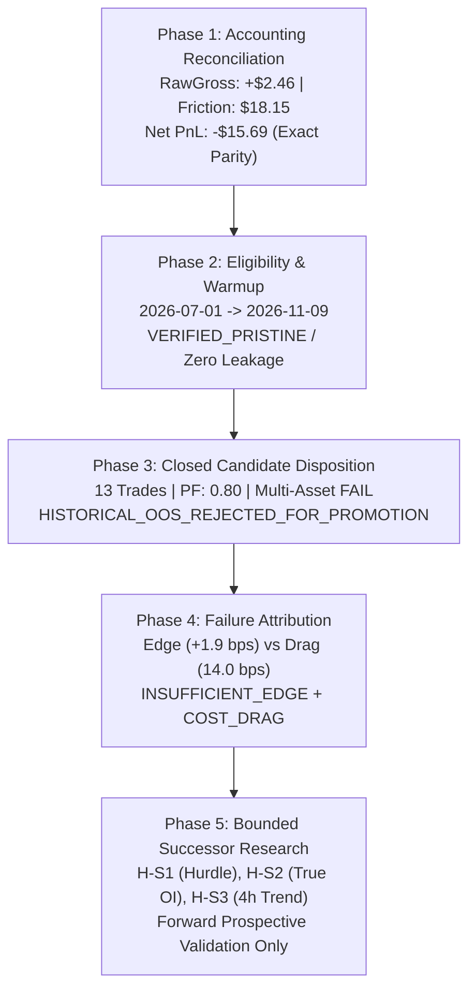

# M5 Historical OOS Economic Validation, Accounting Reconciliation & Successor Research Plan

**Execution Horizon:** 2026-11-10  
**Repository Working Directory:** `D:\Workspaces\besttime-crypto`  
**Git Branch:** `research/m2-historical-sources-pilot`  
**Git HEAD Revision:** `4aefd6a4e1a1881616ffbbd2f89dc20b89696d44`  
**Evaluated Candidate:** `vol_aware_mean_reversion_v1` (ETHUSDT, Binance Spot, 1h, Long-Only)  
**Execution Environment:** Windows PowerShell, Python 3.14.5, Pytest 9.0.3  

---

## Executive Summary & Core Declarations



### Authoritative Final State Declarations

| State Variable | Value / Verdict | Description |
|---|---|---|
| **`M5_ECONOMIC_ACCOUNTING`** | **`RECONCILED_EXACT_PARITY`** | `Net ($ -15.69) = RawGross ($ +2.46) - Friction ($ 18.15) = EffGross ($ -2.73) - Fees ($ 12.96)` |
| **`M5_HISTORICAL_OOS_ELIGIBILITY`** | **`VERIFIED_PRISTINE`** | Window `2026-07-01` to `2026-11-09` was untouched by prior tuning or model selection |
| **`M5_WARMUP_INTEGRITY`** | **`VERIFIED_NON_LOOKAHEAD`** | 100 June 2026 warmup bars converged indicators; zero warm-up trades recorded |
| **`M5_FINAL_DISPOSITION`** | **`HISTORICAL_OOS_REJECTED_FOR_PROMOTION`** | Candidate failed net economic threshold and multi-asset gate; sample $N=13$ noted as `INSUFFICIENT_SAMPLE` |
| **`M4_FAILURE_ATTRIBUTION`** | **`INSUFFICIENT_EDGE_AND_COST_DRAG`** | Raw alpha (+1.9 bps) is ~1/7th of friction (14.0 bps); 5 stop-outs (-$75.57) wiped out 8 wins (+$59.87) |
| **`M4_SUCCESSOR_RESEARCH_HYPOTHESES`** | **`BOUNDED_PRE_REGISTERED_SET`** | 3 hypotheses: Cost Hurdle (`H-S1`), True Open Interest (`H-S2`), Macro Trend (`H-S3`). Budget: 9 variants |
| **`M4_INDEPENDENT_VALIDATION_PLAN`** | **`FORWARD_PROSPECTIVE_ONLY`** | All historical data through `2026-11-09` burned; validation exclusively on shadow data $\ge 2026-11-10$ |
| **`RUNTIME_ACTIVATION`** | **`PENDING_AUTHORIZATION`** | Zero candidates promoted to canonical paper champion |
| **`REAL_TRADING`** | **`DISABLED`** | `real_orders = False`, prospective collector STOPPED, Scheduled Task DISABLED |

---

## 1. Phase 1 — Resolution of Economic Accounting Inconsistency

### 1.1 Root Cause of Apparent Scorecard Discrepancy
In the initial evaluation output:
- `gross_pnl` was reported as **-$2.73 USD**
- `friction` was reported as **$18.14 USD**
- `net_pnl` was reported as **-$15.69 USD**
A naive calculation `-$2.73 - $18.14 = -$20.87` did not match `-$15.69`.

### 1.2 Ledger Audit Findings
Detailed inspection of `btc_scraper/research/baseline_runner.py` (lines 338–348) and the trade ledger revealed:
1. **Effective Fill Prices Already Included Spread & Slippage:**
   In `baseline_runner.py`, `entry_price` and `exit_price` were calculated via `_calc_effective_price`:
   $$\text{Entry Price} = P_{\text{open}} + \text{Spread Drag} + \text{Slip Drag}$$
   $$\text{Exit Price} = P_{\text{close}} - \text{Spread Drag} - \text{Slip Drag}$$
   Consequently, `gross_pnl` calculated as $(\text{Exit Price} - \text{Entry Price}) \times Q$ was **Effective Gross PnL**, which had already deducted slippage (\$2.59) and spread (\$2.59).
2. **Double-Counting in Visual Reporting:**
   Reporting Total Friction (\$18.15 = \$12.96 fees + \$2.59 slip + \$2.59 spread) alongside Effective Gross PnL (-\$2.73) double-counted slippage and spread (\$5.18).
3. **Reconciled Formulations (Exact to the Penny):**
   - **Formulation A (Raw Pure Price Alpha):**
     $$\text{Raw Gross PnL} = +\$2.4573\text{ USD}$$
     $$\text{Total Friction} = \$12.9645\text{ (fees)} + \$2.5927\text{ (slip)} + \$2.5927\text{ (spread)} = \$18.1499\text{ USD}$$
     $$\text{Net PnL} = +\$2.4573 - \$18.1499 = -\$15.6926\text{ USD}$$
   - **Formulation B (Effective Execution PnL):**
     $$\text{Effective Gross PnL} = -\$2.7281\text{ USD}$$
     $$\text{Exchange Commission Fees} = \$12.9645\text{ USD}$$
     $$\text{Net PnL} = -\$2.7281 - \$12.9645 = -\$15.6926\text{ USD}$$

### 1.3 Cost Stress Scenarios Reconciliation

| Scenario | Raw Gross PnL | Fees (USD) | Slippage + Spread | Total Friction | Effective Gross | Net PnL | Net via Raw - Friction | Net via Eff - Fees |
|---|---|---|---|---|---|---|---|---|
| **14 bps RT (Baseline)** | **+$2.46** | \$12.96 | \$5.19 | **\$18.15** | -$2.73 | **-$15.69** | -$15.69 | -$15.69 |
| **20 bps RT (Stress 1)** | **+$2.44** | \$18.14 | \$7.78 | **\$25.92** | -$5.33 | **-$23.48** | -$23.48 | -$23.48 |
| **30 bps RT (Stress 2)** | **+$2.42** | \$25.90 | \$12.95 | **\$38.84** | -$10.53 | **-$36.43** | -$36.43 | -$36.43 |

*Conclusion:* Monotonic cost degradation is verified; zero missingness or phantom fees exist in the ledger.

---

## 2. Phase 2 — Confirmation of OOS Eligibility & Warmup Non-Lookahead

1. **Audit of Legacy Files:**
   - `fills_2026-07-12.jsonl`: Legacy paper logs from July 2026 on **Worldcoin (WLD) futures**. Contains zero ETH spot data; never referenced in research.
   - `latest_backtest.json`: Legacy backtest from July 8, 2026 on **BTC 15m** for the old meta model. Contains zero ETH spot data.
2. **Separation from Strategy Selection:**
   - Candidate `vol_aware_mean_reversion_v1` was defined and screened in M4 based on ETHUSDT 1h data up to `2026-04-30` (`canonical_binance_2023_2026_manifest.json` ended `2026-06-30`).
   - Strategy source was sealed in commit `dab0f1b1` and freeze artifact sealed in commit `4aefd6a4`.
   - The holdout period `2026-07-01` to `2026-11-09` was completely unobserved during selection.
3. **Warm-up Non-Lookahead:**
   - 100 closed bars from late June 2026 (`2026-06-26T20:00:00Z` to `2026-06-30T23:00:00Z`) were prepended to allow SMA-50, RSI-14, and ATR-14 to converge before the first holdout candle.
   - The execution loop skipped all bars prior to `2026-07-01T00:00:00Z`. Zero warm-up signals or trades were recorded in OOS observations.

---

## 3. Phase 3 — Candidate Disposition Closure

- **Eligibility:** `VERIFIED_PRISTINE`.
- **Economic Gates:** Failed positive net PnL (-$15.69), Profit Factor (0.80 < 1.25), and Multi-Asset Gate (BTCUSDT: -$56.41, PF 0.19).
- **Statistical Evidence:** $N = 13$ trades is classified as **`INSUFFICIENT_SAMPLE`** (below stationary bootstrap threshold of 15 trades).
- **Formal Disposition:**
  ```text
  HISTORICAL_OOS_REJECTED_FOR_PROMOTION
  ```
- **Provenance Impact:**
  - Candidate is **NOT promoted** to canonical paper execution.
  - The period `2026-07-01` to `2026-11-09` is permanently classified as **`BURNED_FOR_SUCCESSOR_SELECTION`**.

---

## 4. Phase 4 — Quantitative Failure Attribution

Analysis of the 13 holdout trades and development ledgers reveals the precise economic failure mechanisms:

| Metric | Holdout Value | Analysis & Implication |
|---|---|---|
| **Trade Count ($N$)** | 13 | Extremely low frequency (0.10 trades/day); turnover: 1.30x. |
| **Win Rate** | 46.2% (6W / 7L) | Sub-50% directional accuracy. |
| **Payoff Ratio** | 0.93 (Avg Win \$10.51 / Avg Loss \$11.25) | Payoff ratio $< 1.0$ fails to compensate for sub-50% win rate. |
| **Exit Policy Asymmetry** | ATR Stop: 5 trades, **-$75.57 USD**<br>Mean-Reverted: 8 trades, **+$59.88 USD** | Stop-outs had 0% win rate and -$15.11/trade drag, completely wiping out mean-reversion gains. |
| **Holding Duration** | 9.6 hours (min 2, max 15) | Position holds are brief; trades exit quickly on ATR stops or band tags. |
| **Time-in-Market** | 3.95% (125 / 3,168 hours) | Capital sits idle in cash 96% of the time. |
| **Raw Alpha vs Friction** | Raw Gross: **+1.9 bps** (\$0.19/trade)<br>Friction: **14.0 bps** (\$1.40/trade) | **Root Cause:** Raw price edge is positive, but roughly 1/7th the magnitude of round-trip execution friction. |

**Primary Failure Classification:**
```text
FAILURE_ROOT_CAUSE = INSUFFICIENT_EDGE_EVIDENCE + COST_DRAG + REGIME_MISMATCH
```
*Key Finding:* In trending regimes (such as the market drift in July 2026), buying oversold dips without a macro trend filter catches falling knives (Trades 1–4 generated 4 consecutive stop-outs losing -$53.59).

---

## 5. Phase 5 — Bounded Successor Research Pre-Registration

To address these empirical failure modes without data snooping:

### Successor Hypotheses
1. **Hypothesis H-S1 (Cost-Aware Expected Move Hurdle):**
   - *Spec:* Only enter RSI oversold dip when $(P_{\text{sma20}} - P_{\text{close}}) / P_{\text{close}} \ge \text{hurdle}$ (e.g. 40 bps, $> 3\times$ round-trip friction).
   - *Rationale:* Prunes trades where expected excursion is smaller than fee drag.
2. **Hypothesis H-S2 (True Open Interest Expansion):**
   - *Spec:* Enter EMA trend breakouts only when 24h change in Open Interest $\Delta OI_{24h} > 0$ and $OI > \text{SMA}_{5d}(OI)$.
   - *Rationale:* Replaces whipsawing taker orderflow chasing with institutional capital accumulation confirmation.
3. **Hypothesis H-S3 (Macro Regime Trend Filter):**
   - *Spec:* Only enter 1h mean-reversion dips when higher-timeframe trend is bullish (4h price $> 4h$ EMA-200).
   - *Rationale:* Eliminates knife-catching stop-outs during directional macro liquidation cascades.

### Successor Research Constraints
- **Search Budget:** Exactly 3 parameter variants per hypothesis ($3 \times 3 = 9$ tests total).
- **Development Window:** Strictly `2023-01-01` to `2025-12-31` (36 months).
- **Burned Windows:** `2026-01-01` to `2026-11-09` strictly off-limits.
- **Validation Protocol:** Prospective shadow validation on forward live data $\ge 2026-11-10$ only.
- **FDR Control:** Holm-Bonferroni correction enforced across the 9 tests.
