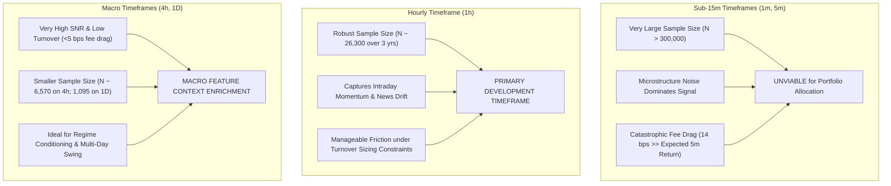

# Greenfield Neural Market Data Requirements & Ingestion Specification

**Document ID:** `NEURAL_MARKET_DATA_REQUIREMENTS`  
**Milestone:** Phase N0 — Greenfield Neural Trading Foundation  
**Workspace:** `D:\Workspaces\besttime-crypto`  
**Authoritative Plan Reference:** `docs/SYSTEM_IMPLEMENTATION_PLAN.md`  
**Timestamp:** 2026-11-11T00:48:30Z  

---

## 1. Objective-Driven Data Requirements

In traditional machine learning pipelines, datasets are often compiled ad-hoc from whatever files are easily accessible. In Greenfield Neural Trading, data requirements are derived strictly from the **mathematical demands of the end-to-end portfolio optimization objective**:

$$\mathcal{L}(\theta) = - \widehat{\text{Sharpe}}(\{R_t\}_{t=1}^K) + \lambda_{\text{turnover}} \overline{\text{Turnover}} + \lambda_{\text{downside}} \overline{\text{Downside}}$$

To optimize this objective without lookahead leakage or execution distortion, the data architecture must satisfy four primary criteria:
1. **Cross-Asset Synchronization:** Assets must be strictly aligned along identical UTC timestamp boundaries ($t \in \mathcal{T}$). Missing or unsynchronized timestamps distort cross-sectional covariance matrices and portfolio allocation vectors.
2. **Strict Scale Independence & Stationarity:** Neural networks cannot generalize across years if fed absolute prices ($p_t \in [\$16,000, \$100,000]$ for BTC). All state representations must be strictly stationary relative returns, normalized spreads, or standardized ratios.
3. **Point-in-Time (PIT) As-Of Consistency:** Features for decision at bar $t$ (closing at $t_{\text{close}}$) must be provably observable strictly on or before $t_{\text{close}}$, prior to simulated fills at $t_{\text{open}, t+1}$.
4. **Dynamic Listing Masks:** Models must support dynamic asset eligibility masks $M_{t, i} \in \{0, 1\}$ to handle variable listing dates without lookahead or survivorship distortion.

---

## 2. Timeframe Evaluation & Selection

The choice of bar aggregation interval represents a fundamental tradeoff between **effective sample size**, **signal-to-noise ratio (SNR)**, and **friction drag**:



| Timeframe | 3-Year Sample Size ($N$) | Typical Price Return Std | Round-Trip Cost (14 bps) / Vol Ratio | Signal-to-Noise Ratio (SNR) | Turnover Sensitivity | Verdict |
| :---: | :---: | :---: | :---: | :---: | :---: | :---: |
| **1-minute** | $\sim 1,576,800$ | $0.08\%$ | $175.0\%$ (Friction exceeds return) | Extremely Low | Fatal | **REJECTED** |
| **5-minute** | $\sim 315,360$ | $0.18\%$ | $77.8\%$ | Very Low | Fatal | **REJECTED** |
| **1-hour** | **$\sim 26,280$** | **$0.75\%$** | **$18.7\%$** | **Moderate / High** | **Controlled via Loss** | **SELECTED (BASE)** |
| **4-hour** | $\sim 6,570$ | $1.65\%$ | $8.5\%$ | High | Low | **SELECTED (CONTEXT)** |
| **1-day** | $\sim 1,095$ | $3.40\%$ | $4.1\%$ | Very High | Negligible | **BENCHMARK** |

**Formal Selection:** The base decision interval is established at **1-hour (1h)**, enriched with **4-hour (4h) macro rolling context**. This provides 26,280 time steps per asset across 2023–2025, providing adequate statistical sample power for deep neural representations while maintaining a favorable return-to-friction ratio ($0.75\% \text{ std} \gg 0.14\% \text{ cost}$).

---

## 3. Multi-Modal Market State Channels

To capture the multi-faceted nature of crypto asset dynamics, the input state tensor $\mathbf{X}_t \in \mathbb{R}^{N \times T \times F}$ incorporates five orthogonal feature modalities:

```text
Channel 0: Log Price Return (1h)          -> r_{1h} = ln(close_t / close_{t-1})
Channel 1: Intrabar Volatility Spread     -> vol_spread = (high_t - low_t) / close_t
Channel 2: Volume Flow Ratio              -> v_ratio = ln(volume_t / SMA(volume, 24)_t + epsilon)
Channel 3: Higher-Timeframe Trend Return  -> r_{4h} = ln(close_t / close_{t-4})
Channel 4: Perpetual Funding Skew         -> funding_skew = funding_rate_{8h} * (close_t / SMA(close, 24))
```

### 3.1 Feature Channel Definitions & Mathematical Formulation

1. **Stationary Price Relative Return ($F_0$):**
   $$f_{0, t, i} = \ln \left( \frac{p_{t, i}^{\text{close}}}{p_{t-1, i}^{\text{close}}} \right)$$
   Guarantees strict zero-mean stationarity across market cycles.

2. **Normalized Intrabar True Range Spread ($F_1$):**
   $$f_{1, t, i} = \frac{p_{t, i}^{\text{high}} - p_{t, i}^{\text{low}}}{p_{t, i}^{\text{close}}}$$
   Measures localized volatility and liquidity compression without depending on price levels.

3. **Logarithmic Volume Flow Intensity ($F_2$):**
   $$f_{2, t, i} = \ln \left( \frac{v_{t, i}}{\frac{1}{24} \sum_{k=0}^{23} v_{t-k, i} + 1e-8} + 1e-4 \right)$$
   Captures institutional volume surges while remaining invariant to token nominal denominations.

4. **Multi-Scale Macro Momentum ($F_3$):**
   $$f_{3, t, i} = \ln \left( \frac{p_{t, i}^{\text{close}}}{p_{t-4, i}^{\text{close}}} \right)$$
   Encodes 4-hour trend momentum into the hourly step, allowing the network to observe multi-scale price trajectories.

5. **Perpetual Funding Rate Context ($F_4$):**
   $$f_{4, t, i} = \text{clip} \left( \text{funding\_rate}_{t, i} \times 10,000, \, -50.0, \, 50.0 \right)$$
   Measures structural retail leverage skew (in basis points) with PIT alignment strictly reflecting the most recently finalized 8-hour settlement.

---

## 4. Multi-Asset Universe Selection & Survivorship Control

### 4.1 Candidate Universe Audit (2023-01 to 2025-12)
To build a balanced, multi-sector portfolio without lookahead bias, assets are selected based on verifiable trading volume and continuous market existence on Binance Spot from `2023-01-01T00:00:00Z` through `2025-12-31T23:00:00Z`:

| Asset Symbol | Sector Classification | 3-Year Bar Count | Complete 2023–2025 History? | Average Daily Volume | Pilot Universe Inclusion |
| :---: | :---: | :---: | :---: | :---: | :---: |
| **`BTCUSDT`** | Market Benchmark / Store of Value | 26,303 | YES (Verified) | $> \$1.5\text{B}$ | **CORE (Asset 1)** |
| **`ETHUSDT`** | Smart Contract Platform / L1 | 26,303 | YES (Verified) | $> \$800\text{M}$ | **CORE (Asset 2)** |
| **`SOLUSDT`** | High-Throughput L1 | 26,303 | YES (Verified) | $> \$400\text{M}$ | **CORE (Asset 3)** |
| **`BNBUSDT`** | Exchange Ecosystem L1 | 26,303 | YES (Verified) | $> \$150\text{M}$ | **CORE (Asset 4)** |
| **`DOGEUSDT`**| High-Beta Momentum / Meme | 26,303 | YES (Verified) | $> \$200\text{M}$ | **CORE (Asset 5)** |
| `AVAXUSDT` | Smart Contract L1 | 26,303 | YES (Verified) | $> \$80\text{M}$ | Expanded Universe (N=10) |
| `NEARUSDT` | Sharded L1 | 26,303 | YES (Verified) | $> \$60\text{M}$ | Expanded Universe (N=10) |
| `XRPUSDT`  | Payment / Enterprise L1 | 26,303 | YES (Verified) | $> \$150\text{M}$ | Expanded Universe (N=10) |
| `TRXUSDT`  | Stablecoin Settlement L1 | 26,303 | YES (Verified) | $> \$70\text{M}$ | Expanded Universe (N=10) |
| `XLMUSDT`  | Payment Network | 26,303 | YES (Verified) | $> \$30\text{M}$ | Expanded Universe (N=10) |

**Initial Pilot Universe ($N=5$ + Cash):**  
`BTCUSDT`, `ETHUSDT`, `SOLUSDT`, `BNBUSDT`, `DOGEUSDT` plus **Cash Slack (USDT)**. This provides cross-sector representation (Macro Store of Value, Smart Contract Platform, High-Throughput L1, Exchange Ecosystem, and High-Beta Momentum) while ensuring zero missing bars across 3 years.

---

## 5. Point-in-Time Integrity & Anti-Leakage Protocol

1. **Signal Availability Boundary:**  
   Features for hour $t$ (e.g. `2024-06-15 14:00:00 UTC`) are computed strictly using candles where `close_time <= 14:00:00 UTC`. Execution is simulated at `14:00:00 UTC` using next bar open price (`open_price` of candle starting at `14:00:00 UTC`).
2. **Deterministic Data Hashing:**  
   Every synthesized multi-asset tensor $\mathbf{X} \in \mathbb{R}^{S \times N \times T \times F}$ is deterministically serialized and hashed with SHA-256 to guarantee reproducible experiment lineage.
3. **Missing Data Handling:**  
   Any missing timestamp (such as the verified 1-hour Binance outage on `2023-03-24 13:00 UTC`) is handled by carrying forward previous valid prices (`ffill`) and zeroing relative returns, with an explicit boolean valid mask $M_{t, i} = 0$ preventing gradient updates on distorted bars.
