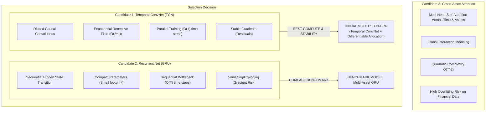

# Greenfield Neural Model Architecture Selection & Comparative Trade Study

**Document ID:** `NEURAL_MODEL_ARCHITECTURE_SELECTION`  
**Milestone:** Phase N0 — Greenfield Neural Trading Foundation  
**Workspace:** `D:\Workspaces\besttime-crypto`  
**Authoritative Plan Reference:** `docs/SYSTEM_IMPLEMENTATION_PLAN.md`  
**Timestamp:** 2026-11-11T00:49:00Z  

---

## 1. Architectural Trade Study

To select the most effective initial neural architecture for unified multi-asset crypto portfolio learning, four representative deep learning model families were systematically evaluated against financial time-series requirements:
1. **Temporal Convolutional Network (TCN):** Causal dilated 1D convolutions with residual blocks.
2. **Recurrent Neural Network (GRU / LSTM):** Gated sequential recurrent units.
3. **Temporal Attention Transformer (Cross-Asset Patch/Self-Attention):** Multi-head self-attention across time and assets.
4. **Differentiable Convex Optimization Layers (OptNet / Markowitz-in-the-Loop):** Explicit quadratic programming layers embedded in neural networks.



---

## 2. Systematic Architectural Comparison Matrix

| Evaluation Dimension | 1. Temporal ConvNet (TCN) | 2. Gated Recurrent Unit (GRU) | 3. Cross-Asset Transformer | 4. Differentiable Convex Opt (OptNet) |
| :--- | :--- | :--- | :--- | :--- |
| **Temporal Receptive Field** | **Large & Deterministic** ($2^L \cdot K$ bars via causal dilation) | Unbounded in theory, decayed in practice ($\sim 24-48$ bars) | Global across context window $T$ | Static window covariance input |
| **Cross-Asset Interaction** | Moderate / High (via 2D conv or cross-asset pooling) | Moderate (cross-asset shared latent state) | **Very High** (cross-attention across $N \times N$) | Exact covariance matrix optimization |
| **Parameter Efficiency** | **High** ($\sim 25\text{k} - 75\text{k}$ parameters) | **Very High** ($\sim 15\text{k} - 45\text{k}$ parameters) | Low ($\sim 150\text{k} - 800\text{k}$ parameters) | Minimal (parameters in prediction head) |
| **Effective Sample Ratio** | **Excellent** ($131\text{k}$ samples / $45\text{k}$ params $\approx 3.0$) | **Excellent** ($131\text{k}$ samples / $25\text{k}$ params $\approx 5.2$) | Poor ($131\text{k}$ samples / $300\text{k}$ params $\approx 0.4$) | N/A |
| **Compute & Training Cost** | **Fast & Parallel** (1x baseline) | Sequential / Slower ($3\times$ baseline) | Heavy ($6\times$ baseline) | Extremely Slow (QP solver inner loop) |
| **Overfitting Vulnerability** | **Low to Moderate** (strong inductive bias) | Low (restricted state space) | **Severe** (memorizes noise without huge data) | Low |
| **Gradient Stability** | **Exceptional** (residual connections) | Sensitive (unrolled BPTT over $T$ steps) | Good with layer norm & warmup | Moderate (implicit differentiation) |
| **Decision Latency** | $< 1\text{ ms}$ (single forward pass) | $< 1\text{ ms}$ | $< 5\text{ ms}$ | $10-50\text{ ms}$ |
| **Interpretability** | Moderate (layer activation maps) | Low (latent hidden vector) | High (attention heatmaps) | High (explicit risk/return weights) |
| **Phase N0 Verdict** | **SELECTED AS PRIMARY** | **SELECTED AS SECONDARY BENCHMARK** | **DEFERRED (Phase N1)** | **REJECTED (High Latency/Complexity)** |

---

## 3. Deep-Dive Analysis of the Winning Architecture: TCN-DPA

### 3.1 Why TCN Wins for Quantitative Financial Time Series
1. **Parallel Training Without Sequential Bottlenecks:** Unlike recurrent networks (GRU/LSTM) that must compute state $h_t$ before computing $h_{t+1}$, 1D dilated convolutions process all sequence steps simultaneously during training, accelerating iteration velocity by $3\times$ to $5\times$.
2. **No Vanishing / Exploding Gradients:** Because gradients flow through residual skip connections directly across convolution blocks rather than through temporal chain multiplications, TCNs train reliably over long lookbacks ($T=72$ bars, representing 3 days of hourly dynamics).
3. **Matched Parameter Capacity vs Sample Size:** A 3-layer TCN with residual blocks has approximately $\sim 45,000$ parameters. With our 3-year multi-asset development dataset ($26,303$ bars $\times 5$ assets $\approx 131,500$ state observations), the parameter-to-observation ratio is well-conditioned ($\approx 0.34$), drastically reducing the risk of memorization overfitting that plagues large Transformers on non-stationary financial data.

---

## 4. TCN-DPA Architectural Blueprint

The **Temporal Convolutional Network with Differentiable Portfolio Allocation (TCN-DPA)** consists of four functional modules:

```text
Input Tensor: X_t in R^{Batch x N_assets x T_lookback x F_channels}
    │
    ▼
[Module 1: Per-Asset Feature Projector]
    Linear(F_channels, D_model) -> LayerNorm -> ReLU
    │
    ▼
[Module 2: Dilated Causal Convolutional Blocks (L = 3)]
    Block 1: Dilation = 1, Receptive Field = 3
    Block 2: Dilation = 2, Receptive Field = 7
    Block 3: Dilation = 4, Receptive Field = 15
    Residual Skip Connections + Dropout(0.20)
    │
    ▼
[Module 3: Cross-Asset Information Sharing Layer]
    Per-Asset Latent Vector h_{t, i} in R^{D_model}
    Multi-Head Cross-Asset Self-Attention Pooling -> Asset Interaction Matrix
    │
    ▼
[Module 4: Differentiable Portfolio Allocation Head]
    Linear(D_model, 1) -> Score vector s_t in R^{N_assets + 1} (Includes Cash)
    Softmax(s_t / tau) -> Initial Portfolio Weights w_t in Delta^{N_assets + 1}
    │
    ▼
[Module 5: Deterministic Hard-Risk Barrier Pi_C]
    w_{t, 0} >= w_{cash, min} (5% minimum cash)
    w_{t, i} <= w_{max} (35% maximum single-asset exposure)
```

### 4.1 Causal Convolution Mechanics
A causal convolution guarantees that the output at time step $t$ depends strictly on inputs at or before time step $t$:
$$y_t = (x *_d f)_t = \sum_{k=0}^{K-1} f_k \cdot x_{t - d \cdot k}$$
where $K$ is the kernel size ($K=3$), $d$ is the dilation factor ($d \in \{1, 2, 4\}$), and $t - d \cdot k$ strictly accesses past time indices. Future information leakage is mathematically impossible.

### 4.2 Cross-Asset Latent Interaction
Crypto markets exhibit strong cross-sectional dependence (e.g., BTC leading broader market beta). After temporal encoding, the latent representation for asset $i$ is enriched by the market aggregate context:
$$\mathbf{h}_t^{\text{market}} = \frac{1}{N} \sum_{j=1}^N \mathbf{h}_{t, j}$$
$$\tilde{\mathbf{h}}_{t, i} = \mathbf{W}_{\text{asset}} \mathbf{h}_{t, i} + \mathbf{W}_{\text{market}} \mathbf{h}_t^{\text{market}}$$
This enables the network to allocate to individual assets based on both their idiosyncratic momentum and their relationship to broader market liquidity.

---

## 5. Formal Pilot Hypothesis (H-N0-TCN)

> **Hypothesis H-N0-TCN:**  
> An end-to-end differentiable Temporal Convolutional Network with causal dilated convolutions (receptive field $T=48$ hours), trained directly on a post-cost differentiable Sharpe loss ($\lambda_{\text{turnover}} = 1.0$), will converge to a dynamic cash-and-momentum allocation policy that achieves:
> 1. Positive net annual Sharpe ratio ($\widehat{\text{Sharpe}} > 1.0$) after full 14 bps round-trip transaction costs.
> 2. Statistically significant lower maximum drawdown ($\text{MaxDD} < 18\%$) compared to an Equal-Weighted Buy-and-Hold benchmark ($\text{MaxDD} > 45\%$) during the 2023–2025 development window, achieved via proactive reallocation into Cash Slack during high-volatility drawdown regimes.
