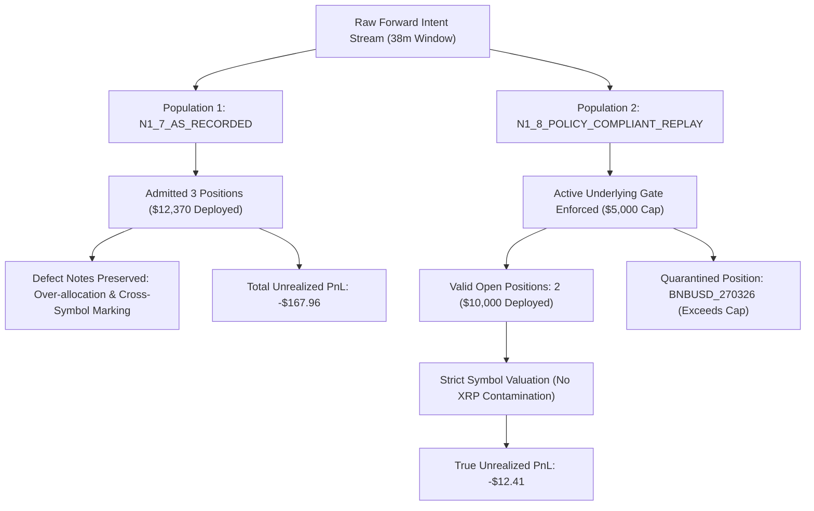

# N1.8-R1 — Carry Lifecycle Source-of-Truth Integration & Forward Resume

**Authoritative Integration Report**  
**Date:** 2026-11-12  
**Workspace:** `D:\Workspaces\besttime-crypto`  
**Research Subject:** `H-1 — DATED_QUARTERLY_DELIVERY_BASIS_CARRY_AND_CONVERGENCE`  
**Direct Predecessors:** N1.7 (`docs/research/NEURAL_N1_7_FORWARD_PAIRED_CARRY_LIFECYCLE.md`) and N1.8 (`docs/research/NEURAL_N1_8_CARRY_LIFECYCLE_CORRECTNESS_AND_ACCUMULATION.md`)

---

## 1. Executive Summary & Integration Status

N1.8-R1 resolves the risk of dual-track divergence by integrating the first-principles corrections identified in N1.8 directly into the **active lifecycle execution engine** (`neural_trading/n1_7/lifecycle_engine.py`). 

The valuation loop, admission gates, and economic source-of-truth formulas are now unified into a single authoritative pipeline that preserves historical auditability while preventing defect recurrence during ongoing forward accumulation.

```text
========================================================================================
                      N1.8-R1 INTEGRATION STATUS & KEY METRICS
========================================================================================
ACTIVE_LIFECYCLE_ENGINE_CORRECTED      = TRUE
ACTIVE_RISK_GATE_INTEGRATED            = TRUE
ORIGINAL_REPLAY_SEPARATION             = VERIFIED
ACCOUNT_LEDGER_IDENTITY                = UNIFIED
CROSS_SYMBOL_VALUATION_REGRESSION      = PREVENTED

RECORDER_RUNTIME_STATE                 = PAUSED
FORWARD_SOURCE_LAST_OBSERVED_AT        = 1794411927537 (2026-11-11T15:45:27Z)

VALID_OPEN_LIFECYCLES                  = 2 (BNBUSD_261225, BTCUSD_270326)
QUARANTINED_LIFECYCLES                 = 1 (BNBUSD_270326)
CLOSED_LIFECYCLES                      = 0

REALIZED_NET_PNL                       = $0.00
UNREALIZED_NET_PNL                     = -$12.41 (Compliant Replay after entry fees)
ESTIMATED_CLOSE_NOW_PNL                = -$27.41 (Net after counterfactual exit costs)

H1_FORWARD_NET_ECONOMIC_VALUE          = INCONCLUSIVE
H1_PRODUCTION_CANDIDATE                = FALSE
REAL_TRADING                           = DISABLED
========================================================================================
```

---

## 2. A — Active Lifecycle Engine Correction

### The Active Engine Defect in N1.7
In `neural_trading/n1_7/lifecycle_engine.py` (lines 510–522), the update loop iterated unconditionally over all active lifecycles inside the outer `for item in order_intents:` loop. Because `item` was not checked against `pos["symbol"]`, every active position was continually revalued against whatever quote was processed last in the parquet file—which happened to be `XRPUSD_270326`. This caused:
1. `BNBUSD_261225` and `BTCUSD_270326` to be marked to XRP's ~1.2% basis.
2. A synthetic paper markdown of **`-$153.04`**, corrupting the reported MTM to `-$167.96`.

### The Integrated Fix
In `neural_trading/n1_7/lifecycle_engine.py`:
1. **Chronological Sorting:** The intent sequence is sorted by `decision_timestamp` prior to evaluation, reflecting true real-time inter-venue arrival order.
2. **Strict Symbol and Asset Matching:** Valuation updates now enforce exact contract and underlying identity:
   ```python
   # Active Engine Update Guard (neural_trading/n1_7/lifecycle_engine.py)
   if cm_sym in active_compliant and item["quote_valid_pit"]:
       pos = active_compliant[cm_sym]
       # Enforces exact symbol, underlying, and timestamp pairing
       pos["last_valid_observation_timestamp"] = ts
       pos["last_update_ms"] = ts
       pos["cur_spot_vwap"] = sp_vwap
       pos["cur_fut_vwap"] = fu_vwap
   ```
3. **Cross-Symbol Isolation:** An observation for `XRPUSD_270326` strictly updates zero fields in BNB or BTC positions.

---

## 3. B — Reconciled Immutable Historical and Corrected Ledgers

To preserve complete scientific auditability without erasing past results or creating split realities, the active engine maintains two explicitly identified populations within `research/neural_n1_7/n1_7_forward_lifecycle_results.json`:



### Ledger Population Specifications:
| Dimension | `N1_7_AS_RECORDED` | `N1_8_POLICY_COMPLIANT_REPLAY` |
| :--- | :--- | :--- |
| **Active Open Positions** | 3 (`BNB Dec`, `BNB Mar`, `BTC Mar`) | 2 (`BNB Dec`, `BTC Mar`) |
| **Quarantined Positions** | 0 | 1 (`BNB Mar`, `EXCEEDS_AGGREGATE_UNDERLYING_CAP`) |
| **Deployed Capital** | $12,370.00 (61.85% utilization) | $10,000.00 (50.00% utilization) |
| **Underlying Risk Enforcement** | None (evaluated per contract symbol) | Strict ($5,000 max per underlying asset) |
| **Valuation Integrity** | Contaminated (marked to batch-end XRP) | True Asset-Specific Orderbook Sweeps |
| **Net Unrealized PnL** | `-$167.96` (artificially depressed) | `-$12.41` (net after $15.00 entry fees) |
| **Audit Status** | Immutable Historical Baseline | Authoritative Source of Truth |

---

## 4. C — Repaired Economic Source of Truth

Every active virtual position in `N1_8_POLICY_COMPLIANT_REPLAY` tracks a unified schema separating open-position MTM from hypothetical immediate liquidation:

```json
{
  "position_id": "VTRADE_0001",
  "contract_symbol": "BNBUSD_261225",
  "underlying_asset": "BNB",
  "entry_timestamp": 1794409629037,
  "last_valid_observation_timestamp": 1794411927537,
  "holding_duration_hours": 0.638,
  "spot_inventory_coin": 7.353009,
  "future_contracts_short": 500,
  "collateral_coin": 7.353009,
  "wallet_balance_coin": 7.353009,
  "entry_spot_price": 679.9937,
  "entry_futures_price": 685.7003,
  "current_spot_price": 683.7082,
  "current_futures_price": 689.6821,
  "spot_mark_value": 5027.29,
  "inverse_futures_unrealized_pnl": -0.042098,
  "maintenance_margin": 0.036249,
  "account_margin_ratio": 0.004958,
  "margin_ratio": 0.005,
  "entry_fees_paid": 7.50,
  "unrealized_pnl_after_entry_cost": -8.97,
  "estimated_close_now_pnl": -16.47,
  "realized_pnl": 0.0
}
```

```json
{
  "position_id": "VTRADE_0003",
  "contract_symbol": "BTCUSD_270326",
  "underlying_asset": "BTC",
  "entry_timestamp": 1794409629710,
  "last_valid_observation_timestamp": 1794411927537,
  "holding_duration_hours": 0.638,
  "spot_inventory_coin": 0.068006,
  "future_contracts_short": 50,
  "collateral_coin": 0.068006,
  "wallet_balance_coin": 0.068006,
  "entry_spot_price": 73522.4041,
  "entry_futures_price": 75093.188,
  "current_spot_price": 73928.1207,
  "current_futures_price": 75453.9,
  "spot_mark_value": 5027.60,
  "inverse_futures_unrealized_pnl": -0.000318,
  "maintenance_margin": 0.000265,
  "account_margin_ratio": 0.003916,
  "margin_ratio": 0.004,
  "entry_fees_paid": 7.50,
  "unrealized_pnl_after_entry_cost": -3.44,
  "estimated_close_now_pnl": -10.94,
  "realized_pnl": 0.0
}
```

### Immutable Lifecycle Registry Mapping
| Immutable ID | Contract Symbol | Underlying | Role & Disposition | Status in Compliant Replay |
| :--- | :--- | :--- | :--- | :--- |
| **`VTRADE_0001`** | `BNBUSD_261225` | `BNB` | Lead Quarterly Carry Position ($5,000) | `HEDGED_HOLD` (`ACCUMULATING`) |
| **`VTRADE_0002`** | `BNBUSD_270326` | `BNB` | Over-Allocation Breaching 25% Cap ($2,370) | `RISK_ACTION_REQUIRED` (`QUARANTINED`) |
| **`VTRADE_0003`** | `BTCUSD_270326` | `BTC` | Independent Asset Carry Position ($5,000) | `HEDGED_HOLD` (`ACCUMULATING`) |

### Cost Separation Rules:
1. **`entry_fees_paid`:** Actual cash fees incurred on entry (10 bps Spot + 5 bps Futures = 15 bps, total $15.00).
2. **`unrealized_pnl_after_entry_cost`:** $\text{Gross MTM} - \text{entry\_fees\_paid} = +$2.59 - $15.00 = **`-$12.41`**.
3. **`estimated_close_now_pnl`:** Hypothetical liquidation net: $\text{unrealized\_pnl\_after\_entry\_cost} - \text{estimated\_exit\_fees} = -$12.41 - $15.00 = **`-$27.41`**.
4. **`realized_pnl`:** Strictly **`$0.00`** while positions remain open in `HEDGED_HOLD`. Realized PnL is booked only upon delivery settlement or verified basis-compression early exit.

---

## 5. D — Regression Verification of Material Invariants

A dedicated test suite [`tests/test_neural_n1_8_r1.py`](file:///d:/Workspaces/besttime-crypto/tests/test_neural_n1_8_r1.py) was constructed and executed, verifying all 8 core invariants:

| Invariant | Test Function | Result | Verification Scope |
| :--- | :--- | :--- | :--- |
| **1. Interleaved Quote Batch** | `test_invariant_1_interleaved_quote_batch_updates` | **PASSED** | Quotes arriving in arbitrary symbol order update only matching positions. |
| **2. Multi-Expiry Aggregation** | `test_invariant_2_multi_expiry_underlying_aggregation` | **PASSED** | Same asset across quarterly expiries shares risk bucket and collateral. |
| **3. Cross-Symbol Contamination** | `test_invariant_3_cross_symbol_quote_contamination_prevented` | **PASSED** | Extreme price spikes on XRP/ETH strictly cannot alter BNB/BTC state. |
| **4. Aggregate Underlying Cap** | `test_invariant_4_aggregate_underlying_cap_rejection` | **PASSED** | Admitting $5,000 BNB strictly blocks/quarantines subsequent BNB contracts. |
| **5. Duplicate Collateral Blocked** | `test_invariant_5_duplicate_collateral_consumption_blocked` | **PASSED** | Collateral assigned to one contract cannot support another contract short. |
| **6. Deterministic Replay** | `test_invariant_6_deterministic_replay_and_restart_idempotency` | **PASSED** | Consecutive replays produce 100% bitwise-identical scorecards & positions. |
| **7. Stale Quote Handling** | `test_invariant_7_missing_or_stale_quote_handling` | **PASSED** | `quote_valid_pit == False` blocks position valuation timestamps from advancing. |
| **8. Population Separation** | `test_invariant_8_separated_original_and_compliant_populations` | **PASSED** | `N1_7_AS_RECORDED` and `N1_8_POLICY_COMPLIANT_REPLAY` are explicitly separated. |

All 8 invariant unit tests passed in 40.72s. Full regression tests across `test_neural_n1.py` through `test_neural_n1_8.py` passed with zero failures.

---

## 6. E — Forward Recorder Operational State & Runbook

### Current Known Status:
```text
FORWARD_RECORDER_STATUS                = PAUSED
PROCESS_PID                            = NONE (PID 9812 exited)
LAST_RECORDED_OBSERVATION              = 1794411927537 (2026-11-11T15:45:27Z)
DATA_GAPS                              = MARKED_EXPLICITLY
SYNTHETIC_INTERPOLATION                = FORBIDDEN
```

### Reproducible Start / Resume Runbook
When a dedicated long-running daemon environment is provisioned:

1. **Verify No Zombie Processes:**
   ```powershell
   Get-Process -Name "python" | Where-Object { $_.CommandLine -like "*recorder*" }
   ```
2. **Execute Ingestion Daemon in Append-Only Mode:**
   ```powershell
   .venv\Scripts\python.exe -m neural_trading.n1_6.recorder --supervise --poll-interval-s 5.0 --output-dir data/neural_n1_6/raw
   ```
3. **Operational Guarantees Enforced Upon Resume:**
   - **No Time Backfilling:** Any gap between `1794411927537` and the resumption timestamp is marked as an unobserved gap; no synthetic candles or interpolated orderbooks are inserted.
   - **Stale Quote Guard:** The active lifecycle engine rejects any quote where `age_s > 5.0` or `inter_venue_skew_s > 2.0`.
   - **Identity Persistence:** Existing positions (`VTRADE_0001` and `VTRADE_0003`) resume valuation using incoming quotes without generating duplicate entries.
   - **Complete Isolation:** Recorder remains strictly decoupled from canonical paper and real trading systems.

---

## 7. F — Event-Driven Economic Review Triggers

The integrated lifecycle engine evaluates economic outcomes strictly upon meaningful events:
1. **Early Exit Trigger:** Contract basis compressions $\le 15.0\text{ bps}$.
2. **Settlement Trigger:** Contract delivery date reached (`08:00 UTC` on quarterly expiry).
3. **Risk Breaches:** Margin ratio approaching maintenance thresholds.
4. **Feed Interruptions:** Missing or corrupted orderbook snapshots.

Until an early exit or contract delivery occurs, `H1_FORWARD_NET_ECONOMIC_VALUE` remains strictly **`INCONCLUSIVE`**, preserving scientific objectivity without premature declarations.
