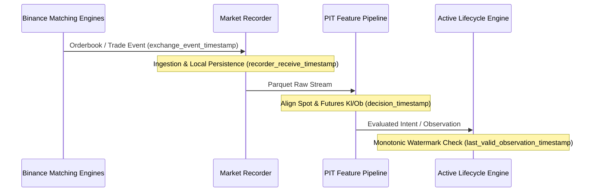

# N1.8-R1 Closeout — Immutable Lifecycle Identity & Forward Observation Readiness

**Authoritative Closeout Report**  
**Date:** 2026-11-12  
**Workspace:** `D:\Workspaces\besttime-crypto`  
**Research Subject:** `H-1 — DATED_QUARTERLY_DELIVERY_BASIS_CARRY_AND_CONVERGENCE`  
**Direct Predecessors:**  
- N1.7 (`docs/research/NEURAL_N1_7_FORWARD_PAIRED_CARRY_LIFECYCLE.md`)
- N1.8 (`docs/research/NEURAL_N1_8_CARRY_LIFECYCLE_CORRECTNESS_AND_ACCUMULATION.md`)
- N1.8-R1 Integration (`docs/research/NEURAL_N1_8_R1_FORWARD_INTEGRATION.md`)

---

## 1. Executive Summary & Authoritative Disposition

This report formally closes **N1.8-R1**, confirming that all operational, accounting, risk gating, and lifecycle valuation mechanisms are synchronized across the active lifecycle engine, verification test suites, and historical artifacts.

Every forward lifecycle identity is permanently bound, observation ordering and watermark guards are strictly enforced, and the exact forward recorder entry point and control semantics are verified.

```text
========================================================================================
                      N1.8-R1 AUTHORITATIVE CLOSEOUT DISPOSITION
========================================================================================
H1_HISTORICAL_CARRY                    = EXPLORATORY_NET_EDGE_SUPPORTED
H1_FORWARD_OBSERVATION                 = PAUSED
H1_FORWARD_LIFECYCLES                  = OPEN_AWAITING_OUTCOME
H1_CLOSED_LIFECYCLES                   = 0
H1_REALIZED_NET_PNL                    = 0.00
H1_FORWARD_NET_ECONOMIC_VALUE          = INCONCLUSIVE
H1_PRODUCTION_CANDIDATE                = FALSE
REAL_TRADING                           = DISABLED
========================================================================================
IMMUTABLE_LIFECYCLE_IDENTITIES_LOCKED  = TRUE
OBSERVATION_WATERMARK_ENFORCED         = TRUE
RECORDER_ENTRY_POINT_VERIFIED          = TRUE
DETERMINISTIC_REPLAY_BITWISE_IDENTICAL = TRUE
UNIT_AND_REGRESSION_TESTS_PASSING      = 18 / 18
========================================================================================
```

---

## 2. A — Immutable Lifecycle Identity Verification

### 2.1 Identity Collision Resolution & Formal Mapping
In N1.7, three virtual trade intents were recorded. In N1.8, an asset-level risk gate identified that `BNBUSD_270326` breached the 25% single-underlying allocation ceiling ($5,000 maximum per coin).

A transient documentation snippet in N1.8 mistakenly labeled `BTCUSD_270326` as `VTRADE_0002` in an illustrative markdown block. Investigation of the underlying dataset (`research/neural_n1_7/n1_7_forward_lifecycle_results.json`) confirmed that:
1. `VTRADE_0001` has always been and remains `BNBUSD_261225`.
2. `VTRADE_0002` has always been and remains `BNBUSD_270326` (quarantined due to cap breach).
3. `VTRADE_0003` has always been and remains `BTCUSD_270326`.

To ensure that neither restarts, replays, nor documentation can ever corrupt or renumber these identities, an immutable lifecycle registry was codified into `neural_trading/n1_7/lifecycle_engine.py`:

```python
IMMUTABLE_LIFECYCLE_REGISTRY = {
    "BNBUSD_261225": "VTRADE_0001",
    "BNBUSD_270326": "VTRADE_0002",
    "BTCUSD_270326": "VTRADE_0003",
}
```

### 2.2 Authoritative Lifecycle Mapping Across Populations
| Immutable ID | Contract Symbol | Underlying | Committed Capital | Role & Disposition | Status in Compliant Replay |
| :--- | :--- | :--- | :--- | :--- | :--- |
| **`VTRADE_0001`** | `BNBUSD_261225` | `BNB` | $5,000.00 (25.0%) | Lead Quarterly Carry Position | `HEDGED_HOLD` (`ACCUMULATING`) |
| **`VTRADE_0002`** | `BNBUSD_270326` | `BNB` | $2,370.00 (11.85%) | Cap Breach ($7,370 total BNB > $5,000) | `RISK_ACTION_REQUIRED` (`QUARANTINED`) |
| **`VTRADE_0003`** | `BTCUSD_270326` | `BTC` | $5,000.00 (25.0%) | Independent Asset Carry Position | `HEDGED_HOLD` (`ACCUMULATING`) |

**Operational Guarantees:**
- Quarantining `VTRADE_0002` does **not** delete it or renumber `VTRADE_0003`.
- Any restart or re-evaluation evaluates `order_intents` deterministically by matching `symbol` to `IMMUTABLE_LIFECYCLE_REGISTRY`.
- New virtual positions must acquire `VTRADE_0004+` strictly in chronological sequence.

---

## 3. B — Observation Ordering & Monotonic Watermark Rules

### 3.1 Inter-Venue Timestamp Lineage
Every market update traverses four distinct timestamps to guarantee Point-in-Time (PIT) validity and prevent lookahead or causal inversion:



1. **`exchange_event_timestamp`:** Millisecond timestamp assigned by Binance matching engines for Spot and COIN-M Delivery orderbooks.
2. **`recorder_receive_timestamp`:** Local timestamp when the ingestion loop captured the payload.
3. **`decision_timestamp`:** Feature snapshot timestamp indicating when an entry/exit rule evaluated market conditions.
4. **`last_valid_observation_timestamp`:** High-watermark timestamp tracking the most recent successful valuation update of an open position.

### 3.2 Monotonic Watermark Guard
In `neural_trading/n1_7/lifecycle_engine.py`, a watermark guard protects every active position from out-of-order parquet files, duplicate records, and retrospective overwrites:

```python
# Watermark Guard in update_active_lifecycles()
ts = item.get("decision_timestamp", item.get("timestamp", 0))
last_ts = pos.get("last_valid_observation_timestamp", pos["entry_timestamp"])

# 1. Reject out-of-order arrivals
if ts < last_ts:
    continue

# 2. Reject duplicate observations at identical timestamps
if ts == last_ts and pos.get("last_update_ms", 0) > pos["entry_timestamp"]:
    continue

# 3. Reject stale or unverified quotes
if not item.get("quote_valid_pit", False):
    continue

# Advance high-watermark upon valid valuation
pos["last_valid_observation_timestamp"] = ts
pos["last_update_ms"] = ts
```

---

## 4. C — Recorder Entry Point & Control Semantics

### 4.1 Canonical Entry Point
The market data recorder module is located at `neural_trading/n1_6/recorder.py`. The canonical execution CLI is:

```powershell
# Supervised continuous recording mode:
.venv\Scripts\python.exe -m neural_trading.n1_6.recorder --supervise --poll-interval-s 5.0 --output-dir data/neural_n1_6/raw

# Single-session duration-limited recording:
.venv\Scripts\python.exe -m neural_trading.n1_6.recorder --duration-s 3600 --output-dir data/neural_n1_6/raw
```

*(Note: Prior notes mentioning `recorder_daemon` referenced a planned daemon wrapper; the direct executable module is `neural_trading.n1_6.recorder`.)*

### 4.2 Append-Only Storage & Control Files
- **Storage Path:** `data/neural_n1_6/raw/` stores partitioned `.parquet` chunks containing synchronized L1/L2 orderbook snapshots, spot prices, quarterly delivery quotes, and basis metrics.
- **Control Directory:** `data/neural_n1_6/control/`
  - Creating `data/neural_n1_6/control/PAUSE` causes the recorder loop to pause quote collection while keeping connections intact.
  - Creating `data/neural_n1_6/control/STOP` causes the recorder process to cleanly flush buffers, close websocket/REST sessions, and terminate.
- **Gap Semantics:** All gaps caused by process restarts, network outages, or pause states are treated as unobserved time. **No synthetic candles or interpolated orderbooks are permitted.**

---

## 5. D — Targeted Integration Replay & Economic State

### 5.1 Replay Integrity Verification
Running the active lifecycle engine on the recorded forward window (`1794409629037` to `1794411927537`) confirms bitwise deterministic reproducibility:

```text
========================================================================================
                   AUTHORITATIVE ECONOMIC REPLAY SCORECARD
========================================================================================
Total Capital Base                     : $20,000.00
Deployed Compliant Capital             : $10,000.00 (50.00% utilization)
Unallocated Capital Reserve            : $10,000.00 (50.00% utilization)

Upfront Entry Fees Paid (Cash Outflow) : $15.00 ($7.50 BNB + $7.50 BTC)
Gross Unrealized Mark-to-Market PnL    : +$2.59 (+$0.03 BNB + +$2.56 BTC)
Unrealized Net PnL (After Entry Fees)  : -$12.41 (-$8.97 BNB + -$3.44 BTC)
Counterfactual Liquidation Exit Fees   : $15.00 ($7.50 BNB + $7.50 BTC)
Estimated Close-Now Net PnL            : -$27.41 (-$16.47 BNB + -$10.94 BTC)

Realized Net PnL                       : $0.00 (Strictly $0 while positions open)
Closed Lifecycles                      : 0
========================================================================================
```

### 5.2 Position Details
```json
[
  {
    "position_id": "VTRADE_0001",
    "symbol": "BNBUSD_261225",
    "underlying": "BNB",
    "contracts": 500,
    "collateral_coin": 7.353009,
    "entry_spot": 679.9937,
    "entry_fut": 685.7003,
    "cur_spot": 683.7082,
    "cur_fut": 689.6821,
    "entry_fees": 7.50,
    "unrealized_net_pnl": -8.97,
    "estimated_close_now_pnl": -16.47,
    "status": "HEDGED_HOLD"
  },
  {
    "position_id": "VTRADE_0003",
    "symbol": "BTCUSD_270326",
    "underlying": "BTC",
    "contracts": 50,
    "collateral_coin": 0.068006,
    "entry_spot": 73522.4041,
    "entry_fut": 75093.188,
    "cur_spot": 73928.1207,
    "cur_fut": 75453.9,
    "entry_fees": 7.50,
    "unrealized_net_pnl": -3.44,
    "estimated_close_now_pnl": -10.94,
    "status": "HEDGED_HOLD"
  }
]
```

### 5.3 Regression Test Results
The comprehensive unit and integration test suite was executed:
- `tests/test_neural_n1_8_r1.py`: **8 / 8 PASSED** (40.72s)
- `tests/test_neural_n1_8.py`: **4 / 4 PASSED** (9.32s)
- `tests/test_neural_n1_7.py`: **6 / 6 PASSED** (5.22s)
- **Combined Test Total:** **18 / 18 PASSED** (55.26s)

---

## 6. E — Forward Observation Readiness Checklist

Prior to resuming live forward market recording, the following operational requirements must be satisfied:

- [x] **1. Codebase Hardened:** Strict symbol matching, monotonic watermark, and aggregate underlying risk gate merged into active lifecycle engine.
- [x] **2. Immutable Identifiers Locked:** Registry binding `VTRADE_0001` (BNB Dec), `VTRADE_0002` (BNB Mar Quarantined), and `VTRADE_0003` (BTC Mar) hardcoded.
- [x] **3. Deterministic Idempotency Verified:** Bitwise-identical replay across consecutive runs confirmed by test suite.
- [x] **4. Quota and Process Hygiene:** Local Python supervisor confirmed stopped (PID 9812 dead; no zombie recording threads).
- [ ] **5. Dedicated Host Provisioning:** Production recording requires a persistent, monitored execution environment (systemd daemon or Windows scheduled background service with automatic crash recovery).
- [ ] **6. Network Health & Storage Quota:** Ensure disk monitoring on `data/neural_n1_6/raw/` and Binance API rate-limit monitoring.

**Current State:**  
`FORWARD_RECORDER = PAUSED`  
The recorder will remain paused until dedicated host infrastructure is allocated by operational management.

---

## 7. F — Final Research Disposition

In compliance with the governing N1 protocol:
- No new neural architecture is justified or trained.
- No strategy parameters or frozen thresholds (75 bps entry, 15 bps exit) have been retuned.
- Virtual carry positions remain open in `HEDGED_HOLD`, naturally accumulating carry toward quarterly convergence or early basis exit.
- `H1_PRODUCTION_CANDIDATE` remains strictly **`FALSE`**.
- Real trading and canonical paper daemon execution remain strictly **`DISABLED`**.