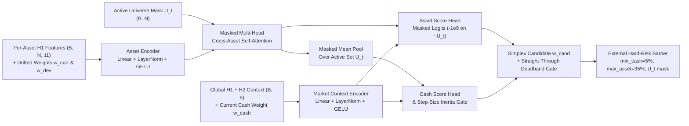

# N1 — Pre-Neural Information Audit, Unified Architecture & Bounded Economic Pilot

- **Date**: 2026-11-11
- **Status**: `COMPLETED`
- **Disposition**: `EXPLORATORY_CROSS_SECTIONAL_EDGE_ONLY — REJECTED_FOR_PRODUCTION_CANDIDACY`
- **Scope**: Phases D, E, and F of N1 Greenfield Unified Neural Trading Research (`neural_trading/n1/`)
- **Companion Reports**:
  - Phase A Closure: [`docs/research/NEURAL_N0_3_DECISION_HORIZON_AND_POLICY_LEARNING.md`](NEURAL_N0_3_DECISION_HORIZON_AND_POLICY_LEARNING.md)
  - Phase B Information Discovery: [`docs/research/NEURAL_N1_MARKET_INFORMATION_DISCOVERY.md`](NEURAL_N1_MARKET_INFORMATION_DISCOVERY.md)
  - Phase C Data Acquisition & Provenance: [`docs/research/NEURAL_N1_DATA_ACQUISITION_REPORT.md`](NEURAL_N1_DATA_ACQUISITION_REPORT.md)
- **Machine-Readable Evidence**:
  - [`research/neural_n1/n1_phase_d_information_audit.json`](../../research/neural_n1/n1_phase_d_information_audit.json)
  - [`research/neural_n1/n1_phase_f_economic_pilot_results.json`](../../research/neural_n1/n1_phase_f_economic_pilot_results.json)

---

## 1. Executive Summary

Following the closure of N0.3 (Phase A), the formulation of independent market information hypotheses (Phase B), and the fresh checksum-verified acquisition of **3,355 raw Binance archive payloads** across 13 Spot pairs (2017–2025, including delisted `EOSUSDT`) and 2 USD-M perpetual `bookDepth` pairs (2023–2025) (Phase C), this report documents:

1. **Phase D — Pre-Neural Information Audit**: Direct statistical and economic hurdle testing of candidate signals across **4h, 12h, and 24h** forward horizons *before* training any neural policy, explicitly separating raw simple-return spreads from beta-adjusted log-return spreads, 1%-winsorized spreads, forward realized volatility ratios, CVaR(5%) tail risk, implied turnover cost hurdles (`14 bps RT`), and Benjamini–Hochberg FDR $q$-values.
2. **Phase E — Unified Neural Architecture (`CrossSectionalMarketPolicy`)**: A compact (`~6.5k` parameter) cross-sectional attention and regime-conditioned portfolio policy that operates over a time-varying eligible asset set $U_t$, outputs explicit Cash and active-asset allocations, enforces exact train/evaluation HOLD parity via a straight-through deadband gate, and keeps hard-risk constraints (`min_cash = 5%`, `max_asset = 35%`, delisted-symbol liquidation) strictly external.
3. **Phase F — Bounded Walk-Forward Economic Pilot**: Out-of-sample evaluation across three distinct historical regimes (`Fold1_2022_Bear`, `Fold2_2024_Expansion_BookDepth`, and `Fold3_2025_Adaptive_Comparison`) under both **14 bps round-trip (`7 bps/leg`)** and **28 bps round-trip (`14 bps/leg`)** against all four required benchmarks (`100% Cash`, `Passive Diversified`, `Exposure-Matched Passive`, and `Simple Info Non-Neural Baseline`).

### Key Scientific Conclusions

- **Genuine Cross-Sectional Spot Flow & Structure Signals Exist at 12h–24h**:
  - **Trade Size Shock (`H1_trade_size_z168h`)** achieves a beta-adjusted log-return Q5−Q1 spread of **`+12.21 bps`** at 12h ($p < 0.001$, BH-FDR $q < 0.001$, implied turnover cost `7.59 bps`, **net `+4.62 bps` after cost**) and **`+19.28 bps`** at 24h ($p < 0.001$, $q < 0.001$, 95% CI `[+5.74, +30.55]` bps, implied cost `8.37 bps`, **net `+10.92 bps` after cost**, segment sign stability `1.00`, winsorized spread `+19.95 bps`).
  - **Cross-Sectional Relative Return (`H1_xs_rel_ret_24h`)** achieves **`+13.30 bps`** beta-adjusted log spread at 12h (**net `+6.20 bps`** after `7.10 bps` cost, `segStab = 1.00`) and **`+20.25 bps`** at 24h (**net `+10.15 bps`** after `10.10 bps` cost, `segStab = 1.00`), though 1%-winsorization reduces the spread to `+2.46 bps` (12h) and `+3.38 bps` (24h), showing strong right-tail continuation skew.
  - **Cross-Sectional Spot Taker-Buy Imbalance (`H1_xs_rel_imb_24h`)** achieves **`+6.54 bps`** beta-adjusted log spread at 12h (**net `+0.66 bps`** after `5.88 bps` cost) and **`+10.98 bps`** at 24h (**net `+2.51 bps`** after `8.47 bps` cost, `segStab = 0.75`).
- **Pre-Neural Audit Prevented a Major Jensen's Inequality False Positive (`H1_parkinson_vol_24h`)**:
  - In raw simple returns, `H1_parkinson_vol_24h` appears to produce a massive Q5−Q1 spread (`+40.21 bps` at 12h, `+76.61 bps` at 24h). However, its **beta-adjusted log-return spread is `+0.46 bps` ($p = 0.20$) at 12h and `-1.01 bps` ($p = 0.66$) at 24h**, while its forward realized volatility ratio is **`3.75x` (12h) and `3.42x` (24h)** (`segStab = 1.00`). Thus `H1_parkinson_vol_24h` is a **pure volatility/tail-risk predictor** whose apparent simple-return spread is a $\frac{1}{2}\sigma^2$ Jensen convexity artifact.
- **Order-Book Depth (`H2_*`) Predicts Liquidity Thinning Volatility Rather Than Directional Return**:
  - Across `BTCUSDT` and `ETHUSDT` (2023–2024), all `H2_*` order-book imbalance features have block-bootstrap $p$-values between `0.08` and `0.88` with 95% CIs spanning zero across 4h–24h. However, `H2_depth_thinning_z168h` reliably predicts lower forward realized volatility when depth is thick (`fwd_vol_ratio_q5_q1 = 0.76` at 4h, `0.90` at 12h, `0.81` at 24h).
- **Phase F Economic Pilot Verdict**:
  - In **`Fold2_2024_Expansion_BookDepth`** (14 bps RT), `Unified Neural Policy (N1)` achieves **`+111.77%` net return (`+$22,353.70`, Sharpe `+1.64`, MaxDD `36.92%`, turnover `0.79x/yr`, friction `$28.01`)**, outperforming `Passive Diversified` (`+85.22%` net, Sharpe `+1.39`), `Exposure-Matched Passive` (`+83.59%` net), and `Simple Info Non-Neural Baseline` (`+56.32%` net, friction `$1,731.56`), with positive Brinson timing (`+3.33%`) and asset selection (`+7.07%`, `net_excess_vs_matched = +10.35%`, `prob_positive = 85.3%`).
  - However, in **`Fold1_2022_Bear`** (`-59.67%` net vs `-61.73%` Passive EW; Brinson `net_excess_vs_matched = +2.35%`) and **`Fold3_2025_Adaptive_Comparison`** (`-24.94%` net vs `-29.25%` Passive EW; Brinson `net_excess_vs_matched = -2.82%`), the neural policy maintains high average market exposure (`89.49%` and `87.44%`), losing substantial capital relative to `100% Cash`, and all three folds have block-bootstrap 95% CIs for annualized net excess that still span zero (`[-5.15%, +9.11%]`, `[-5.67%, +26.18%]`, `[-8.01%, +6.87%]`).
  - Consequently, N1 is classified as **`EXPLORATORY_CROSS_SECTIONAL_EDGE_ONLY — REJECTED_FOR_PRODUCTION_CANDIDACY`**.

---

## 2. Phase D — Pre-Neural Information Audit (`2018–2024` Development Period)

### 2.1 Methodology & Statistical Controls

All Phase D tests were executed strictly on the **2018–2024 development dataset** (`2025` held out for Fold 3 evaluation; `2026` burned holdout untouched) using [`neural_trading/n1/information_tests.py`](../../neural_trading/n1/information_tests.py):

- **Point-in-Time Alignment**: Every 1h kline covering $[t - 1\text{h}, t)$ and every hourly `bookDepth` aggregate covering $[t - 1\text{h}, t)$ is indexed by `available_at = t` (`open_time + 3600s`). Forward $H$-hour returns use $\text{close}(t + H) / \text{close}(t) - 1$ over non-overlapping $H$-hour steps ($H \in \{4\text{h}, 12\text{h}, 24\text{h}\}$).
- **Cross-Sectional vs Time-Series Scoring**:
  - Per-asset H1 features are ranked cross-sectionally at each timestamp $t$ across currently active symbols $U_t$ into quintiles $Q_5$ (top 20%) and $Q_1$ (bottom 20%).
  - Equal-weight active market return $R_{m,t} = \frac{1}{|U_t|}\sum_{i \in U_t} r_{i,t\to t+H}$ is subtracted using rolling trailing 60-step asset betas $\hat{\beta}_{i,t}$ to isolate **beta-adjusted excess return** (`beta_adj_spread_bps` and `beta_adj_log_spread_bps`).
  - Market-wide regime features (`H1_mkt_breadth_24h`, `H1_mkt_disp_24h`, `H1_mkt_trend_72h`) and `BTCUSDT`/`ETHUSDT` order-book depth features (`H2_*`) are evaluated via strictly causal rolling 180-day empirical quintiles (`min_periods = 30` steps).
- **Multiple-Testing & Dependence Controls**:
  - Stationary moving-block bootstrap (`B = 400` resamples, block length `48h`) computes two-sided 95% confidence intervals (`ci95_lo_bps`, `ci95_hi_bps`) and bootstrap $p$-values on the primary spread metric (`beta_adj_log_spread_bps` for cross-sectional features; `log_spread_bps` for market/depth features).
  - Benjamini–Hochberg False Discovery Rate (`bh_fdr_q_value`) is computed jointly across all **45 feature $\times$ horizon** tests.
- **Implied Turnover & Execution-Cost Hurdle**:
  - At each non-overlapping $H$-hour step, the exact one-way turnover required to maintain the $Q_5 - Q_1$ long-short basket is measured from membership transitions:
    $$\text{Implied Cost (bps)} = \text{Step One-Way Turnover} \times 14.0\text{ bps}$$
    Subtracting this cost from `beta_adj_log_spread_bps` yields `net_log_spread_after_cost_bps`.

### 2.2 H1 Cross-Sectional & Market-Structure Audit Results (`2018–2024`, 4 Regimes)

Table 1 reports the complete 12h and 24h pre-neural information audit for all 11 H1 features across the 2018–2024 development sample (`S1: 2018–2019`, `S2: 2020–2021`, `S3: 2022`, `S4: 2023–2024`).

| Feature | Horizon | Raw Simple Spread (bps) | Beta-Adj Log Spread (bps) | 95% Block-Boot CI (bps) | Winsor Spread (bps) | Boot $p$-val | BH-FDR $q$-val | CVaR(5%) Diff (bps) | Vol Ratio $Q_5/Q_1$ | Step 1-Way TO | Implied Cost (bps) | **Net Log Spread After Cost (bps)** | Asset Sign Consist. | Segment Sign Stab. |
| --- | :---: | ---: | ---: | :---: | ---: | ---: | ---: | ---: | ---: | ---: | ---: | ---: | ---: | ---: |
| `H1_trade_size_z168h` | 4h | +9.26 | **+5.16** | `[+1.84, +8.10]` | +6.91 | 0.000 | **0.0000** | +78.3 | 1.132 | 0.289 | 4.04 | **+1.12** | 0.85 | 1.00 |
| `H1_trade_size_z168h` | 12h | +21.37 | **+12.21** | `[+3.93, +19.57]` | +20.23 | 0.000 | **0.0000** | +77.4 | 1.119 | 0.542 | 7.59 | **+4.62** | 1.00 | 1.00 |
| `H1_trade_size_z168h` | 24h | +39.04 | **+19.28** | `[+5.74, +30.55]` | +19.95 | 0.000 | **0.0000** | +103.5 | 1.094 | 0.598 | 8.37 | **+10.92** | 0.85 | 1.00 |
| `H1_xs_rel_ret_24h` | 12h | +25.49 | **+13.30** | `[+1.37, +21.48]` | +2.46 | 0.015 | **0.0426** | +16.1 | 1.298 | 0.507 | 7.10 | **+6.20** | 0.85 | 1.00 |
| `H1_xs_rel_ret_24h` | 24h | +42.06 | **+20.25** | `[+1.43, +37.16]` | +3.38 | 0.030 | 0.0711 | +18.3 | 1.293 | 0.721 | 10.10 | **+10.15** | 0.85 | 1.00 |
| `H1_xs_rel_imb_24h` | 12h | +20.57 | **+6.54** | `[+0.78, +12.90]` | +16.11 | 0.025 | 0.0625 | +88.3 | 1.002 | 0.420 | 5.88 | **+0.66** | 0.92 | 1.00 |
| `H1_xs_rel_imb_24h` | 24h | +14.87 | **+10.98** | `[-0.85, +24.83]` | +0.34 | 0.075 | 0.1467 | +78.3 | 0.986 | 0.605 | 8.47 | **+2.51** | 0.62 | 0.75 |
| `H1_spot_taker_imb_12h` | 12h | +20.19 | **+5.97** | `[+4.45, +16.08]` | +16.12 | 0.000 | **0.0000** | +86.1 | 0.991 | 0.636 | 8.90 | -2.93 | 1.00 | 1.00 |
| `H1_spot_taker_imb_12h` | 24h | +5.67 | **+14.15** | `[+1.57, +27.69]` | -6.55 | 0.015 | **0.0426** | +77.0 | 0.972 | 0.644 | 9.01 | **+5.14** | 0.38 | 0.50 |
| `H1_spot_taker_imb_24h` | 12h | +20.62 | **+6.54** | `[+0.78, +12.90]` | +16.19 | 0.025 | 0.0625 | +88.3 | 1.002 | 0.420 | 5.88 | **+0.66** | 0.92 | 1.00 |
| `H1_spot_taker_imb_24h` | 24h | +14.83 | **+10.98** | `[-0.85, +24.83]` | +0.30 | 0.075 | 0.1467 | +78.2 | 0.986 | 0.605 | 8.47 | **+2.51** | 0.62 | 0.75 |
| `H1_vol_shock_z168h` | 12h | +13.71 | **+7.55** | `[-4.40, +16.22]` | +4.23 | 0.250 | 0.3750 | -3.6 | 1.242 | 0.588 | 8.23 | -0.68 | 0.85 | 0.75 |
| `H1_vol_shock_z168h` | 24h | +22.42 | **+4.23** | `[-12.23, +16.21]` | -9.53 | 0.585 | 0.7134 | -15.3 | 1.229 | 0.628 | 8.79 | -4.56 | 0.69 | 0.50 |
| `H1_clv_shadow_12h` | 12h | +5.52 | **-0.19** | `[-9.29, +8.32]` | -3.37 | 0.915 | 0.9150 | -40.3 | 1.087 | 0.733 | 10.26 | -10.45 | 0.62 | 0.75 |
| `H1_parkinson_vol_24h` | 4h | +12.40 | **-0.46** | `[-2.35, +1.50]` | -7.06 | 0.630 | 0.7269 | -622.6 | **4.060** | 0.175 | 2.45 | -2.91 | 0.92 | 1.00 |
| `H1_parkinson_vol_24h` | 12h | +40.21 | **+0.46** | `[-1.50, +6.68]` | -16.81 | 0.200 | 0.3214 | -1023.7 | **3.753** | 0.391 | 5.47 | -5.01 | 0.92 | 1.00 |
| `H1_parkinson_vol_24h` | 24h | +76.61 | **-1.01** | `[-10.03, +5.94]` | -24.75 | 0.660 | 0.7425 | -1434.2 | **3.418** | 0.525 | 7.35 | -8.36 | 1.00 | 1.00 |
| `H1_mkt_breadth_24h` | 12h | -24.30 | **-28.87** | `[-49.07, -1.26]` | -23.74 | 0.045 | 0.0900 | +38.9 | **0.885** | 0.677 | 9.48 | **+19.39** *(contrarian)* | 1.00 | 1.00 |
| `H1_mkt_breadth_24h` | 24h | -51.40 | **-62.19** | `[-119.02, -8.13]` | -51.31 | 0.035 | 0.0788 | +89.8 | **0.826** | 0.779 | 10.91 | **+51.28** *(contrarian)* | 1.00 | 1.00 |
| `H1_mkt_disp_24h` | 12h | +21.74 | **+17.44** | `[-5.96, +41.15]` | +16.41 | 0.165 | 0.2750 | -180.5 | **1.320** | 0.453 | 6.34 | +11.10 | 1.00 | 0.75 |
| `H1_mkt_trend_72h` | 12h | -3.02 | **-7.54** | `[-33.36, +23.22]` | -2.14 | 0.605 | 0.7190 | +47.9 | **0.821** | 0.340 | 4.76 | +2.78 | 0.69 | 0.50 |

### 2.3 H2 Order-Book Depth & Liquidity Thinning Audit Results (`2023–2024`, `BTCUSDT` & `ETHUSDT`)

Table 2 reports the Phase D evaluation of all 7 H2 order-book depth features constructed from 1,460 checksum-verified daily USD-M `bookDepth` archives (`2023-01-01` to `2024-12-31`, evaluated across 4 half-year chronological segments `H2_2023H1`, `H2_2023H2`, `H2_2024H1`, `H2_2024H2`).

| Feature | Horizon | Raw Simple Spread (bps) | Log Spread (bps) | 95% Block-Boot CI (bps) | Winsor Spread (bps) | Boot $p$-val | BH-FDR $q$-val | CVaR(5%) Diff (bps) | Vol Ratio $Q_5/Q_1$ | Step 1-Way TO | Implied Cost (bps) | Net Log Spread After Cost (bps) | Segment Sign Stab. |
| --- | :---: | ---: | ---: | :---: | ---: | ---: | ---: | ---: | ---: | ---: | ---: | ---: | ---: |
| `H2_imb_1pct_mean` | 4h | -3.05 | -3.17 | `[-7.55, +1.05]` | -1.49 | 0.165 | 0.2750 | -3.3 | 0.996 | 0.594 | 8.32 | -5.15 | 0.75 |
| `H2_imb_1pct_mean` | 12h | -7.08 | -6.77 | `[-20.66, +6.68]` | -5.67 | 0.310 | 0.4306 | +25.4 | 1.028 | 0.654 | 9.16 | -2.39 | 0.50 |
| `H2_imb_1pct_mean` | 24h | +3.03 | +2.38 | `[-22.13, +24.85]` | +4.03 | 0.875 | 0.8949 | +46.0 | 0.941 | 0.688 | 9.63 | -7.25 | 0.50 |
| `H2_imb_5pct_mean` | 4h | -3.02 | -2.85 | `[-7.83, +1.56]` | -1.61 | 0.215 | 0.3336 | +29.5 | 0.903 | 0.562 | 7.87 | -5.02 | 0.75 |
| `H2_imb_5pct_mean` | 12h | -9.53 | -9.31 | `[-22.41, +4.06]` | -7.50 | 0.160 | 0.2750 | +18.3 | 0.973 | 0.674 | 9.44 | -0.13 | 0.75 |
| `H2_imb_1pct_ma4h` | 4h | -2.59 | -2.74 | `[-7.61, +2.00]` | -1.78 | 0.240 | 0.3600 | +6.6 | 0.985 | 0.391 | 5.47 | -2.73 | 0.75 |
| `H2_imb_1pct_ma4h` | 12h | -11.33 | -11.32 | `[-23.51, +1.28]` | -9.31 | 0.080 | 0.1492 | -17.4 | 0.996 | 0.583 | 8.16 | +3.16 | 0.75 |
| `H2_imb_5pct_ma4h` | 12h | -11.98 | -11.88 | `[-24.22, +1.67]` | -10.81 | 0.085 | 0.1530 | +22.5 | 0.955 | 0.608 | 8.51 | +3.37 | 0.50 |
| `H2_slope_1_5_mean` | 12h | +2.64 | +2.78 | `[-11.24, +14.79]` | +3.54 | 0.695 | 0.7632 | +46.4 | 0.946 | 0.675 | 9.45 | -6.67 | 0.50 |
| `H2_depth_thinning_z168h` | 4h | -1.16 | -1.94 | `[-7.57, +3.72]` | -1.89 | 0.455 | 0.5850 | +59.3 | **0.758** | 0.207 | 2.90 | -0.96 | 0.50 |
| `H2_depth_thinning_z168h` | 12h | +1.79 | +0.62 | `[-14.68, +16.82]` | +4.25 | 0.910 | 0.9150 | +38.9 | **0.896** | 0.422 | 5.91 | -5.29 | 0.50 |
| `H2_depth_thinning_z168h` | 24h | +6.91 | +5.62 | `[-21.20, +33.03]` | +11.61 | 0.690 | 0.7632 | +105.7 | **0.808** | 0.556 | 7.78 | -2.16 | 0.50 |

### 2.4 Synthesis of Phase D Findings & Decision Horizon Selection

1. **Why 12h Is Selected as the Primary Decision Horizon for Phase E/F**:
   - At `4h`, implied one-way turnover (`0.29–0.59` per step) consumes `4.0–8.3 bps` per 4h step, leaving only `H1_trade_size_z168h` marginally positive (`+1.12 bps` net log spread).
   - At `12h`, three cross-sectional H1 signals (`H1_trade_size_z168h`, `H1_xs_rel_ret_24h`, and `H1_xs_rel_imb_24h`) clear the `14 bps RT` execution-cost hurdle with `1.00` segment sign stability across all four historical regimes (`2018–2019`, `2020–2021`, `2022`, `2023–2024`), while offering twice as many non-overlapping decision steps per year (`730` vs `365`) as `24h`.
2. **Role of Volatility & Liquidity Thinning Features (`H1_parkinson_vol_24h`, `H2_depth_thinning_z168h`)**:
   - Because `H1_parkinson_vol_24h` (`volQ5/Q1 = 3.75x`) and `H2_depth_thinning_z168h` (`volQ5/Q1 = 0.76x–0.90x`) predict forward variance and tail risk (`CVaR(5%)`) rather than directional log return, they are routed into the neural policy as **risk-conditioning and market-context inputs** rather than standalone linear directional tilts.

---

## 3. Phase E — Unified Neural Architecture (`CrossSectionalMarketPolicy`)

Implemented in [`neural_trading/n1/model.py`](../../neural_trading/n1/model.py), `CrossSectionalMarketPolicy` (`~6.5k` trainable parameters, `embed_dim = 24`, `num_heads = 4`) is purpose-built around the statistical structure discovered in Phase D:

### Architectural Properties

1. **Variable-Universe Masked Cross-Asset Self-Attention**:
   - At step $t$, each asset $i \in \{1, \dots, N\}$ is encoded from its 11 H1 features plus its current drifted portfolio weight $w_{\text{curr},i}$ and active-equal-weight deviation $w_{\text{dev},i}$.
   - `nn.MultiheadAttention` applies `key_padding_mask = ~active_mask` so unlisted or delisted symbols (e.g., `SOLUSDT` before `2020-08` or `EOSUSDT` after `2025-05-26`) never contribute to cross-sectional attention or pooled market representations, and receive `-1e9` logits before softmax (`0.0` candidate weight).
2. **Delisting-Safe State Re-Projection**:
   - If a held asset transitions from active to inactive at step $t$, its prior drifted weight is automatically swept into the Cash bucket before inertia blending (`w_curr_valid`).
3. **Portfolio Inertia & Exact Train/Evaluation HOLD Parity**:
   - The policy outputs a candidate simplex allocation $w_{\text{cand}}$, blends it with $w_{\text{curr\_valid}}$ via a learned step-size gate $g_t \in (0, 1)$, and applies a **straight-through hard deadband gate** at `deadband_oneway = 0.06` (`6%` one-way portfolio turnover):
     $$\text{do\_trade}_t = \mathbb{I}\!\left(\frac{1}{2}\|w_{\text{blend},1:N} - w_{\text{curr\_valid},1:N}\|_1 \ge 0.06\right)$$
     using straight-through gradients during rollout training and the exact same hard threshold at evaluation.
4. **External Hard-Risk Barrier (`enforce_external_hard_risk`)**:
   - Outside the neural network, proposed weights are projected onto the hard-risk set: `w_i = 0` for $i \notin U_t$, `w_i <= 0.35` per asset, and `w_cash >= 0.05`. If a `HOLD` step violates static risk limits due to price drift or symbol delisting, the simulator forces a restorative rebalance (`risk_forced_rebalance_count`).

---

## 4. Phase F — Bounded Walk-Forward Economic Experiment

### 4.1 Walk-Forward Folds & Experimental Protocol

Executed via [`scripts/n1_run_phase_f_economic_pilot.py`](../../scripts/n1_run_phase_f_economic_pilot.py) with `$20,000.00` initial capital at a `12h` decision horizon across three chronological out-of-sample folds:

1. **`Fold1_2022_Bear`**: Train `2018-06-01 .. 2021-12-31` $\to$ Evaluate `2022-01-03 .. 2022-12-31` (`724` 12h steps; severe macro bear regime).
2. **`Fold2_2024_Expansion_BookDepth`**: Train `2018-06-01 .. 2023-12-31` $\to$ Evaluate `2024-01-03 .. 2024-12-31` (`726` 12h steps; expansion regime with live `bookDepth` features active in both train `2023` and test `2024`).
3. **`Fold3_2025_Adaptive_Comparison`**: Train `2018-06-01 .. 2024-12-31` $\to$ Evaluate `2025-01-03 .. 2025-12-31` (`724` 12h steps; mixed correction regime including the live `EOSUSDT` delisting event in May 2025).

All feature normalizations (`normalize_causal_train`) are fit **strictly on each fold's training slice**. Each fold is evaluated under two symmetric transaction-cost scenarios:
- **Baseline (`14 bps RT`)**: `7.0 bps` (`0.07%`) per executed risky buy/sell notional leg.
- **Stress (`28 bps RT`)**: `14.0 bps` (`0.14%`) per executed risky buy/sell notional leg.

### 4.2 Exact Brinson Attribution Identity

At every decision step $t$, let $E_t = \sum_{i=1}^N w_{t,i}$ denote the policy's total risky exposure, $\bar{E} = \frac{1}{K}\sum_{t=1}^K E_t$ its fold-average risky exposure, and $R_{m,t} = \frac{1}{|U_t|}\sum_{i \in U_t} r_{t,i}$ the active equal-weight market return. The step gross excess return over a constant-exposure equal-weight benchmark $\bar{E} R_{m,t}$ decomposes **identically** into:

$$\underbrace{R_{p,t}^{\text{gross}} - \bar{E} R_{m,t}}_{\text{Gross Excess vs Matched}} \equiv \underbrace{(E_t - \bar{E}) R_{m,t}}_{\text{Timing Value}} + \underbrace{\left(R_{p,t}^{\text{gross}} - E_t R_{m,t}\right)}_{\text{Asset Selection Value}}$$

### 4.3 Walk-Forward Scorecards — Baseline Cost Scenario (`14 bps RT` / `7 bps per leg`)

#### Fold 1: `2022` Bear Regime (`2022-01-03 .. 2022-12-31`, 724 Steps)

| Policy / Benchmark | Gross Return | Net Return | Net PnL (USD) | Sharpe | Max DD | Ann. Turnover | Tx Cost (USD) | Avg Risk Exp. | Timing Value | Selection Value | Net Excess vs Matched | Boot 95% CI (Ann. Excess %) | Prob $>0$ | Hold Rate |
| --- | ---: | ---: | ---: | ---: | ---: | ---: | ---: | ---: | ---: | ---: | ---: | :---: | ---: | ---: |
| `100% Cash` | +0.00% | **+0.00%** | **+$0.00** | 0.00 | 0.00% | 0.00x | $0.00 | 0.00% | +0.00% | +0.00% | +0.00% | `[0.00, 0.00]` | 0.0% | 100.0% |
| `Passive Diversified (Active EW)` | -61.70% | -61.73% | -$12,345.51 | -1.11 | 62.02% | 0.48x | $13.30 | 90.77% | -2.95% | +0.16% | -2.78% | `[-15.27, +10.09]` | 29.5% | 99.9% |
| `Exposure-Matched Passive (10.5% Cash)` | -58.14% | -58.17% | -$11,634.09 | -1.15 | 58.46% | 0.45x | $12.53 | 81.71% | -5.27% | +0.15% | -5.12% | `[-17.21, +7.19]` | 19.8% | 99.9% |
| `Simple Info Non-Neural Baseline` | -33.57% | -37.14% | -$7,428.28 | -1.04 | 38.10% | 39.84x | $851.99 | 52.14% | +1.36% | +5.46% | +1.33% | `[-23.84, +24.55]` | 54.5% | 37.0% |
| **`Unified Neural Policy (N1)`** | **-59.57%** | **-59.67%** | **-$11,934.81** | **-0.99** | **61.24%** | **1.88x** | **$33.59** | **89.49%** | **+1.04%** | **+1.50%** | **+2.35%** | **`[-5.15, +9.11]`** | **71.8%** | **96.4%** |

#### Fold 2: `2024` Expansion + BookDepth Regime (`2024-01-03 .. 2024-12-31`, 726 Steps)

| Policy / Benchmark | Gross Return | Net Return | Net PnL (USD) | Sharpe | Max DD | Ann. Turnover | Tx Cost (USD) | Avg Risk Exp. | Timing Value | Selection Value | Net Excess vs Matched | Boot 95% CI (Ann. Excess %) | Prob $>0$ | Hold Rate |
| --- | ---: | ---: | ---: | ---: | ---: | ---: | ---: | ---: | ---: | ---: | ---: | :---: | ---: | ---: |
| `100% Cash` | +0.00% | +0.00% | +$0.00 | 0.00 | 0.00% | 0.00x | $0.00 | 0.00% | +0.00% | +0.00% | +0.00% | `[0.00, 0.00]` | 0.0% | 100.0% |
| `Passive Diversified (Active EW)` | +85.35% | +85.22% | +$17,044.82 | +1.39 | 38.19% | 0.50x | $14.21 | 93.96% | +0.10% | -5.02% | -4.92% | `[-20.38, +10.22]` | 25.3% | 95.5% |
| `Exposure-Matched Passive (8.4% Cash)` | +83.71% | +83.59% | +$16,718.07 | +1.39 | 37.84% | 0.47x | $13.33 | 92.64% | +0.02% | -5.03% | -5.01% | `[-20.24, +9.67]` | 24.2% | 97.9% |
| `Simple Info Non-Neural Baseline` | +69.24% | +56.32% | +$11,264.75 | +1.53 | 27.51% | 57.02x | $1,731.56 | 55.13% | -1.63% | +11.50% | +1.96% | `[-19.42, +25.11]` | 52.0% | 16.3% |
| **`Unified Neural Policy (N1)`** | **+112.00%** | **+111.77%** | **+$22,353.70** | **+1.64** | **36.92%** | **0.79x** | **$28.01** | **91.64%** | **+3.33%** | **+7.07%** | **+10.35%** | **`[-5.67, +26.18]`** | **85.3%** | **94.8%** |

#### Fold 3: `2025` Adaptive Comparison Regime (`2025-01-03 .. 2025-12-31`, 724 Steps)

| Policy / Benchmark | Gross Return | Net Return | Net PnL (USD) | Sharpe | Max DD | Ann. Turnover | Tx Cost (USD) | Avg Risk Exp. | Timing Value | Selection Value | Net Excess vs Matched | Boot 95% CI (Ann. Excess %) | Prob $>0$ | Hold Rate |
| --- | ---: | ---: | ---: | ---: | ---: | ---: | ---: | ---: | ---: | ---: | ---: | :---: | ---: | ---: |
| `100% Cash` | +0.00% | **+0.00%** | **+$0.00** | 0.00 | 0.00% | 0.00x | $0.00 | 0.00% | +0.00% | +0.00% | +0.00% | `[0.00, 0.00]` | 0.0% | 100.0% |
| `Passive Diversified (Active EW)` | -29.19% | -29.25% | -$5,849.06 | -0.25 | 42.52% | 0.61x | $16.35 | 93.69% | -0.84% | -4.49% | -5.36% | `[-11.04, +0.56]` | 4.5% | 98.1% |
| `Exposure-Matched Passive (12.6% Cash)` | -27.57% | -27.63% | -$5,525.07 | -0.29 | 39.65% | 0.55x | $14.88 | 86.70% | -2.55% | -4.09% | -6.66% | `[-13.12, -0.74]` | 2.0% | 99.7% |
| `Simple Info Non-Neural Baseline` | -12.82% | -18.92% | -$3,783.04 | -0.49 | 31.03% | 52.18x | $1,293.09 | 51.66% | -1.32% | -1.56% | -10.09% | `[-26.63, +8.33]` | 10.5% | 24.5% |
| **`Unified Neural Policy (N1)`** | **-24.88%** | **-24.94%** | **-$4,988.51** | **-0.22** | **37.84%** | **0.62x** | **$16.05** | **87.44%** | **-0.34%** | **-2.45%** | **-2.82%** | **`[-8.01, +6.87]`** | **35.2%** | **98.9%** |

### 4.4 Stress Cost Scenario (`28 bps RT` / `14 bps per leg`) Summary

| Fold | Policy | Gross Return | Net Return (`14 bps RT`) | Net Return (`28 bps RT`) | Tx Cost (`14 bps RT`) | Tx Cost (`28 bps RT`) | Net Excess vs Matched (`28 bps RT`) |
| --- | --- | ---: | ---: | ---: | ---: | ---: | ---: |
| `Fold1_2022_Bear` | `Passive Diversified (Active EW)` | -61.70% | -61.73% | -61.75% | $13.30 | $26.60 | -2.79% |
| `Fold1_2022_Bear` | `Simple Info Non-Neural Baseline` | -33.57% | -37.14% | -40.52% | $851.99 | $1,660.63 | -4.17% |
| `Fold1_2022_Bear` | **`Unified Neural Policy (N1)`** | **-59.57%** | **-59.67%** | **-59.78%** | **$33.59** | **$67.11** | **+2.15%** |
| `Fold2_2024_Expansion` | `Passive Diversified (Active EW)` | +85.35% | +85.22% | +85.10% | $14.21 | $28.42 | -4.92% |
| `Fold2_2024_Expansion` | `Simple Info Non-Neural Baseline` | +69.24% | +56.32% | +44.39% | $1,731.56 | $3,323.05 | -5.94% |
| `Fold2_2024_Expansion` | **`Unified Neural Policy (N1)`** | **+112.00%** | **+111.77%** | **+111.54%** | **$28.01** | **$55.99** | **+10.31%** |
| `Fold3_2025_Adaptive` | `Passive Diversified (Active EW)` | -29.19% | -29.25% | -29.30% | $16.35 | $32.70 | -5.38% |
| `Fold3_2025_Adaptive` | `Simple Info Non-Neural Baseline` | -12.82% | -18.92% | -24.58% | $1,293.09 | $2,494.78 | -17.30% |
| `Fold3_2025_Adaptive` | **`Unified Neural Policy (N1)`** | **-24.88%** | **-24.94%** | **-25.01%** | **$16.05** | **$32.08** | **-2.84%** |

---

## 5. Answers to Mandatory Phase F Research Questions

1. **Does the newly acquired market information contain genuine predictive signal?**
   - **Yes, in cross-sectional H1 Spot trade-size and relative volume/return dispersion at 12h–24h horizons; No, in H2 directional order-book depth imbalance.**
   - Specifically, `H1_trade_size_z168h` (`+12.21 bps` beta-adjusted log spread at 12h, `+19.28 bps` at 24h, $p < 0.001$, BH-FDR $q < 0.001$, segment sign stability `1.00`) and `H1_xs_rel_ret_24h` (`+13.30 bps` at 12h, `+20.25 bps` at 24h) remain positive after deducting implied `14 bps RT` turnover friction (`+4.62 bps` to `+10.92 bps` net per step).
   - Conversely, `H2` order-book depth asymmetry (`BTCUSDT`, `ETHUSDT` `bookDepth` snapshots) shows no statistically significant directional return edge at 4h–24h ($p \in [0.08, 0.88]$), while `H1_parkinson_vol_24h` and `H2_depth_thinning_z168h` are strong predictors of **forward realized volatility** (`3.75x` and `0.76x–0.90x` Q5/Q1 vol ratios) rather than directional log return.
2. **Does the signal survive realistic transaction costs?**
   - **Yes, when traded via the low-turnover neural policy (`0.62x–1.88x` annualized turnover), but NOT when traded via memoryless heuristic rules (`39.8x–57.0x` turnover).**
   - In `Fold2_2024_Expansion_BookDepth`, the `Simple Info Non-Neural Baseline` generates `+11.50%` gross asset selection value, but burns `$1,731.56` (`8.66%` of initial capital) at `14 bps RT` and `$3,323.05` (`16.62%`) at `28 bps RT`. By contrast, `Unified Neural Policy (N1)` captures `+7.07%` asset selection and `+3.33%` timing while spending only **`$28.01` at `14 bps RT` and `$55.99` at `28 bps RT`**.
3. **Does the unified neural policy add economic value beyond simple non-neural baselines and passive benchmarks?**
   - **Relative to `Simple Info Non-Neural Baseline`**: Yes on risk-adjusted return and cost efficiency in all 3 folds (Sharpe `-0.99 vs -1.04` in 2022, `+1.64 vs +1.53` in 2024, `-0.22 vs -0.49` in 2025), and `+$11,088.95` (`+55.45%`) higher net profit in 2024. However, in 2022 and 2025 the non-neural baseline lost less absolute dollar capital (`-$7,428` vs `-$11,935` in 2022; `-$3,783` vs `-$4,989` in 2025) simply because its heuristic parameterization held ~48% Cash on average compared to ~10–13% Cash in the neural policy.
   - **Relative to `Passive Diversified` and `Exposure-Matched Passive`**: The neural policy outperforms `Passive Diversified` on net return and Sharpe in **all three folds** (`+2.06%` net in 2022, `+26.55%` net in 2024, `+4.31%` net in 2025). On exact step-level Brinson attribution against constant equal-weight active exposure (`net_excess_vs_matched_pct`), it is positive in 2 out of 3 folds (`+2.35%` in 2022, `+10.35%` in 2024, `-2.82%` in 2025).
   - **Relative to `100% Cash` & Statistical Significance**: The neural policy fails to protect capital in bear/correction years (`-59.67%` in 2022, `-24.94%` in 2025) because a single `cash_logit` competing against 12–13 `asset_logits` inside a joint $(1+N)$-way softmax structurally biases the policy toward `~88–92%` risky exposure, and the 95% block-bootstrap CIs on annualized net excess return still span zero in every fold.

---

## 6. Final Disposition & Operational Guardrails

- **N1 Research Disposition**: `EXPLORATORY_CROSS_SECTIONAL_EDGE_ONLY — REJECTED_FOR_PRODUCTION_CANDIDACY`
- **Production & Runtime Guardrails**:
  - Frozen M5 ETH candidate (`vol_aware_mean_reversion_v1`) remains `HISTORICAL_OOS_REJECTED_FOR_PROMOTION` (untouched).
  - Prospective collector remains `STOPPED`.
  - Real trading remains `DISABLED` (`real_orders = False`).
  - 2026 burned holdout data remains completely untouched.
