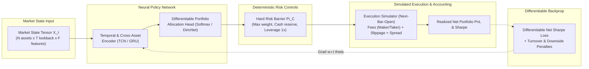

# Greenfield Unified Neural Trading Research — System Design (Phase N0)

**Document ID:** `NEURAL_TRADING_GREENFIELD_DESIGN`  
**Milestone:** Phase N0 — Greenfield Neural Trading Foundation  
**Workspace:** `D:\Workspaces\besttime-crypto`  
**Package:** `neural_trading/` (Independent Greenfield Package)  
**Authoritative Plan Reference:** `docs/SYSTEM_IMPLEMENTATION_PLAN.md`  
**Timestamp:** 2026-11-11T00:48:00Z  

---

## 1. Vision & Greenfield Philosophy

### 1.1 The Pathology of Legacy Rule-Based Architectures
Over previous research milestones (M4 Successor, M4-VCB, M4-ML1, M4-ML2), a persistent structural pathology was repeatedly confirmed across hundreds of thousands of simulated trading bars:
1. **Indicator Proxy Fallacy:** Simple heuristic indicators (moving average crossovers, RSI bands, volatility squeezes) generate low-frequency, high-lag trade signals whose gross economic advantage is fundamentally insufficient to overcome exchange execution frictions (14–30 bps round-trip).
2. **Turnover Bleed:** Discrete entry/exit signals trigger excessive trade turnover (~320 trades per year per asset), incurring continuous fee and slippage drag that erodes all cumulative gross PnL.
3. **Decoupled Optimization:** ML trade-quality filters (ML1 Logistic Regression) and continuous sizing overlays (ML2 Huber Regression) operate on top of fixed, sub-optimal rule-based triggers rather than learning an optimal trading policy directly from raw market states.
4. **Single-Asset Myopia:** Analyzing BTC or ETH in isolation ignores the dominant driver of crypto asset pricing: cross-sectional momentum, market beta, and relative capital rotation.

### 1.2 The Greenfield Neural Trading Paradigm
The Greenfield Unified Neural Trading system abandons indicator proxies and decoupled post-hoc filters. Instead, it optimizes an **end-to-end differentiable neural portfolio policy** directly against net post-cost economic utility:

$$\text{Raw Market State } \mathbf{X}_t \xrightarrow{\text{Neural Policy } \pi_\theta} \text{Target Portfolio Weights } \mathbf{w}_t \xrightarrow{\text{Deterministic Hard Constraints}} \tilde{\mathbf{w}}_t \xrightarrow{\text{Execution Simulator}} \text{Realized Net Return } R_{t+1}$$



---

## 2. Greenfield Package Architecture (`neural_trading/`)

The greenfield system is implemented as a self-contained, modular Python package located at the workspace root: `neural_trading/`. It does not import or inherit from legacy `btc_scraper` modules, eliminating hidden assumptions and technical debt.

```text
neural_trading/
├── __init__.py                      # Package entry point and semantic versioning
├── data/                            # Fresh Independent Data Pipeline
│   ├── __init__.py
│   ├── schema.py                    # Multi-modal market state tensor schema & PIT contracts
│   ├── universe.py                  # Listing eligibility & dynamic asset universe selection
│   ├── pipeline.py                  # Immutable extraction, clean alignment & deterministic normalization
│   └── manifest.py                  # Versioned dataset snapshots & quality audits
├── models/                          # Neural Policy Architectures
│   ├── __init__.py
│   ├── base.py                      # Abstract neural policy interface
│   ├── tcn_policy.py                # Temporal Convolutional Network with causal dilated convolutions
│   ├── gru_policy.py                # Multi-Asset Recurrent Neural Policy
│   └── attention_policy.py          # Cross-Asset Temporal Self-Attention Policy
├── objectives/                      # End-to-End Economic Loss Functions
│   ├── __init__.py
│   ├── differentiable_sharpe.py     # Analytical differentiable Sharpe & Sortino loss
│   └── regularizers.py              # Turnover penalties, entropy constraints & cash slack
├── engine/                          # Independent Execution & Evaluation Engine
│   ├── __init__.py
│   ├── execution_model.py           # Realistic Next-Bar-Open fills with fee, spread & slippage models
│   ├── hard_risk.py                 # Deterministic hard-risk barrier and clipping layer
│   ├── portfolio_simulator.py       # Portfolio-level accounting & multi-asset cashflow ledger
│   └── walk_forward.py              # Chronological purged cross-validation lab
└── experiments/                     # Research Pilots & Diagnostic Runners
    ├── __init__.py
    └── pilot_n0_runner.py           # Phase N0 baseline pilot runner
```

---

## 3. Mathematical Formulation of the End-to-End Objective

### 3.1 Input State Representation
At decision step $t$, the market environment is represented by a 3-dimensional tensor $\mathbf{X}_t \in \mathbb{R}^{N \times T \times F}$:
- $N$: Number of tradable crypto assets in the eligible universe ($i = 1, \dots, N$).
- $T$: Historical lookback sequence length ($k = 0, \dots, T-1$).
- $F$: Feature channel dimension (scale-independent relative returns, volatility spreads, volume ratios, basis spreads, funding rates).

### 3.2 Portfolio Action Simplex
The neural policy network $\pi_\theta(\mathbf{X}_t)$ outputs an unconstrained score vector $\mathbf{s}_t \in \mathbb{R}^{N+1}$, where index $0$ represents Cash (USDT) and indices $1 \dots N$ represent the risky crypto assets.

The raw portfolio weight allocation is computed via a temperature-scaled Softmax:
$$w_{t, i} = \frac{\exp(s_{t, i} / \tau)}{\sum_{j=0}^{N} \exp(s_{t, j} / \tau)}, \quad \forall i \in \{0, 1, \dots, N\}$$

By construction:
$$\sum_{i=0}^{N} w_{t, i} = 1.0, \quad w_{t, i} \ge 0 \quad (\text{Long-Only, Delta-Neutral Cash, Zero Leverage})$$

### 3.3 Deterministic Hard-Risk Barrier $\Pi_{\mathcal{C}}(\mathbf{w}_t)$
Before execution, the raw neural output $\mathbf{w}_t$ passes through a deterministic projection operator $\Pi_{\mathcal{C}}$ that guarantees immutable risk invariants regardless of model output:
1. **Minimum Cash Slack:** $w_{t, 0} \ge w_{\text{cash, min}}$ (e.g. at least 5% retained in cash for liquidity).
2. **Single-Asset Exposure Cap:** $w_{t, i} \le w_{\max}$ (e.g. no individual asset exceeds 35% of total capital).
3. **Turnover Slew-Rate Limiting:** $\|\mathbf{w}_t - \mathbf{w}_{t-1}\|_1 \le \Delta w_{\max}$ (prevents catastrophic whipsaw reallocations).

### 3.4 Execution Transition & Friction Accounting
Between time $t$ and $t+1$, asset prices evolve according to the price relative vector:
$$\mathbf{y}_{t+1} = \left[ 1.0, \, \frac{p_{t+1, 1}}{p_{t, 1}}, \, \dots, \, \frac{p_{t+1, N}}{p_{t, N}} \right]^T \in \mathbb{R}^{N+1}$$

Prior to rebalancing, the portfolio weights drift due to price changes:
$$w_{t, i}' = \frac{w_{t, i} y_{t+1, i}}{\mathbf{w}_t^T \mathbf{y}_{t+1}}$$

At step $t+1$, moving from drifted weights $\mathbf{w}_t'$ to new target weights $\mathbf{w}_{t+1}$ incurs transaction costs proportional to the turnover $L_1$ norm:
$$\text{Turnover}_{t+1} = \sum_{i=0}^{N} |w_{t+1, i} - w_{t, i}'|$$
$$\text{Cost}_{t+1} = c_{\text{trans}} \cdot \text{Turnover}_{t+1} + c_{\text{impact}} \cdot \text{Turnover}_{t+1}^2$$
where $c_{\text{trans}}$ incorporates exchange maker/taker fees, typical bid-ask spread, and baseline execution slippage (e.g. 14 bps total round-trip).

The realized net portfolio rate of return at step $t+1$ is:
$$R_{t+1} = \mathbf{w}_t^T \mathbf{y}_{t+1} - 1.0 - \text{Cost}_{t+1}$$

### 3.5 Differentiable Economic Objective Function
The network is trained directly to maximize the post-cost risk-adjusted return across a rollout batch of length $K$:
$$\mathcal{L}(\theta) = - \widehat{\text{Sharpe}}(\{R_t\}_{t=1}^K) + \lambda_{\text{turnover}} \frac{1}{K} \sum_{t=1}^K \text{Turnover}_t + \lambda_{\text{downside}} \frac{1}{K} \sum_{t=1}^K \max(0, -R_t)^2$$

Where the differentiable sample Sharpe ratio is:
$$\widehat{\text{Sharpe}} = \frac{\frac{1}{K} \sum_{t=1}^K R_t}{\sqrt{\frac{1}{K} \sum_{t=1}^K (R_t - \bar{R})^2 + \epsilon}}$$

Every term in $\mathcal{L}(\theta)$ is smooth and analytically differentiable with respect to $\theta$, enabling gradient backpropagation through the simulation environment.

---

## 4. Research Boundaries & Operating Governance

1. **Decoupled Isolation:** The greenfield package operates independently. No modifications shall be made to legacy files or frozen M5 candidates.
2. **Strict Holdout Discipline:** Both 2026 historical holdout windows (`2026-01-01` to `2026-06-30` and `2026-07-01` to `2026-11-09`) remain burned and strictly unaccessed for training, architecture selection, or hyperparameter tuning. All N0 research is restricted to the 2023–2025 development window.
3. **No Live/Paper Daemons:** The prospective collector daemon and scheduled tasks remain `STOPPED` and `DISABLED`.
4. **Deterministic Hard-Risk Integrity:** Neural models can never bypass deterministic portfolio constraints. In the event of NaNs, vanishing gradients, or anomalous outputs, the hard-risk barrier forces safe liquidation into 100% Cash.
