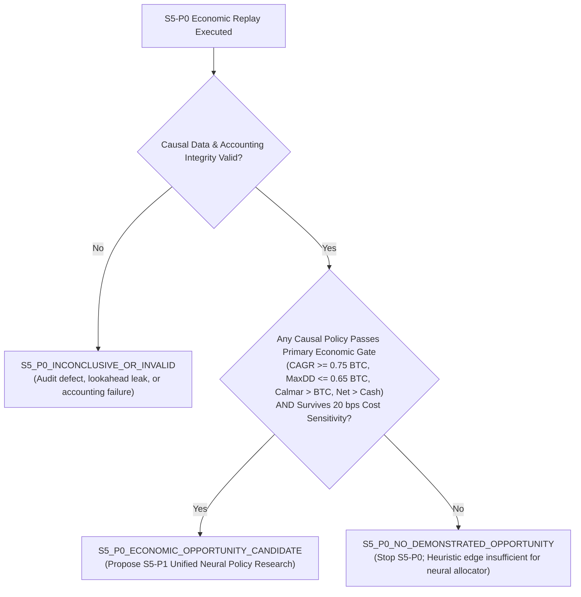

# BESTTIME-CRYPTO — S5-P0 EXECUTABLE PRE-REGISTRATION
## Dynamic Cash Gating & Cross-Asset Rotation Economic Opportunity Screen

- **Document Version:** 1.0.0
- **Status:** `FROZEN_SPECIFICATION`
- **Repository:** `https://github.com/jarm237/besttime-crypto`
- **Branch:** `research/s5-p0-economic-opportunity`
- **Base Commit / Tag:** `s4-stage1-closure` (`e46e89685b3d8412b0d00f0f2ea1228440e602f9`)
- **Date (UTC):** 2026-11-19
- **Governing Scope:** S5-P0 Design and Pre-Registration ONLY. Zero Neural training, zero historical replay execution, zero access to 2024–2026 data.

---

## 1. Executive Summary & Scientific Mission

Following the conclusive closure of S4 Stage 1 (`STAGE1_SIGNAL_INCONCLUSIVE`), which established that a shared neural forecast did not provide statistically significant incremental predictive skill over a high-regularization Ridge baseline in predicting 24h normalized crypto returns, the research pipeline pivots to an **economic-first opportunity screen** before considering any complex Unified Neural Policy.

The mission of **S5-P0** is to pre-register an unambiguous, causally strict, and friction-aware economic opportunity screen. This screen evaluates whether simple, rule-based exposure control (cash timing) and cross-asset rotation among four liquid spot crypto assets can generate sufficient net-of-fee compounding and drawdown control to justify subsequent research into a **Unified Neural Policy (S5-P1)**.

### Explicit Operational Boundaries

```text
S5_P0_PHASE             = PRE_REGISTRATION_ONLY
HISTORICAL_REPLAY       = NOT_AUTHORIZED
2024_2026_ACCESS        = LOCKED
NEURAL_TRAINING         = NOT_AUTHORIZED
FAILED_S4_WEIGHT_REUSE  = PROHIBITED
NEXT_ACTION_AFTER_P0    = STOP
```

Under no circumstances will failed model artifacts, weights, or latent representations from S4 be transferred, seeded, or fine-tuned. S5-P0 must be frozen and committed before any economic replay code is executed.

---

## 2. Research Hypotheses & Factorial Attribution

S5-P0 tests two distinct economic mechanisms whose benefits must be isolated and measured independently, rather than assumed to be additive:

### H1 — Market Timing / Dynamic Cash Exposure
> **Hypothesis H1:** A causal market-timing policy that dynamically shifts portfolio exposure between crypto assets and cash based on observed aggregate trend or volatility can significantly reduce maximum drawdown and improve compounding net of transaction fees compared to static passive holding of Bitcoin (`BTC_BH`) or an Equal-Weight crypto basket (`EW4`).

### H2 — Cross-Asset Relative Rotation
> **Hypothesis H2:** For a given, identical cash exposure path, dynamically rotating capital among the four crypto assets (`BTC`, `ETH`, `SOL`, `BNB`) based on relative momentum or inverse volatility produces incremental net economic value after transaction friction over a static Bitcoin-only or Equal-Weight risky sleeve.

### Mathematical Factorial Decomposition

To prevent confounding market beta with cross-sectional selection, all portfolio allocations are parameterized via a two-layer factorial decomposition:

$$\mathbf{w}_t = \begin{bmatrix} w_{\text{crypto},t} \\ w_{\text{cash},t} \end{bmatrix} = \begin{bmatrix} g_t \cdot \mathbf{q}_t \\ 1 - g_t \end{bmatrix}$$

Where:
- $g_t \in [0, 1]$ is the total crypto exposure fraction (cash gate).
- $w_{\text{cash},t} = 1 - g_t \ge 0$ is the unencumbered cash allocation.
- $\mathbf{q}_t = [q_{\text{BTC},t}, q_{\text{ETH},t}, q_{\text{SOL},t}, q_{\text{BNB},t}]^T$ is the sub-portfolio asset allocation vector within the risky sleeve, satisfying:
  $$q_{i,t} \ge 0, \quad \sum_{i=1}^4 q_{i,t} = 1.0$$
- $w_{i,t} = g_t \cdot q_{i,t}$ is the absolute portfolio weight in asset $i$.

The factorial analysis decomposes total policy performance into three strictly orthogonal components evaluated under identical execution clocks and cost models:

```text
1. Cash Timing Effect:
   Fixed Risky Sleeve (e.g., q = EW4 or BTC-only) + Variable Cash Gate g_t
   --> Isolates the standalone value of beta modulation.

2. Relative Rotation Effect:
   Fixed Exposure (e.g., g_t = 1.0) + Variable Risky Sleeve q_t
   --> Isolates the standalone value of cross-sectional asset selection.

3. Joint Interaction & Friction Term:
   Variable g_t + Variable q_t
   --> Measures the non-linear interaction between timing and rotation,
       specifically accounting for rebalancing turnover drag and fee amplification.
```

---

## 3. Universe, Asset Assumptions & Causal Execution Protocol

### 3.1. Asset Universe
The trading universe comprises exactly five assets:
1. `BTCUSDT` (Binance Spot)
2. `ETHUSDT` (Binance Spot)
3. `SOLUSDT` (Binance Spot)
4. `BNBUSDT` (Binance Spot)
5. `CASH` (USDT-denominated nominal cash reserve)

### 3.2. Structural Trading Constraints
- **Long-Only Spot:** $w_{i,t} \ge 0$ for all $i \in \{1, 2, 3, 4\}$, and $w_{\text{cash},t} \ge 0$.
- **No Leverage:** $\sum_{i=1}^4 w_{i,t} + w_{\text{cash},t} = 1.0$.
- **No Shorting & No Borrowing:** No margin loans, zero negative token balances.
- **No Funding Arbitrage:** Long-only spot execution; zero perpetual futures funding PnL.
- **Zero Nominal Cash Yield:** Cash is modeled strictly as nominal USDT with an assumed annual risk-free yield of $0.0\%$. This assumption isolates pure investment edge without relying on exogenous stablecoin staking or yield farming, while acknowledging that it does not model stablecoin depeg, regulatory, or custodial risks.

### 3.3. Causal Timing Architecture
Inherited directly from the rigorously validated S4 causal clock:

```text
[ Feature Window: 168 Hours ]
|-----------------------------------|
Hourly bars [t-168, t-1] completed
                                    |
                            Feature Cutoff:    t 00:00 UTC
                            Decision Timestamp: t 00:05 UTC (5-min latency proxy)
                            Execution Proxy:    t 01:00 UTC (open of 01:00 UTC bar)
```

1. **Feature Cutoff ($t$ 00:00 UTC):** All features, indicators, rolling volatilities, and trailing returns must be calculated strictly from hourly bars timestamped prior to or at 00:00 UTC. The 00:00 UTC hourly bar closes at 00:00 UTC.
2. **Decision Latency ($t$ 00:05 UTC):** Allocation decisions are formed within a causal 5-minute compute window.
3. **Execution Timestamp ($t$ 01:00 UTC):** All target weight transitions are filled at the Open price of the 01:00 UTC hourly candle on the decision day. This enforces a conservative 1-hour delay between feature snapshot and physical fill, preventing lookahead leakage.

### 3.4. Path-Dependent Portfolio Accounting (No Driftless Approximations)
Simplified weighted-return approximations (e.g., $R_p = \sum w_i R_i$) ignore path-dependent intra-week price drift, cash accumulation, and cash drag. S5-P0 mandates exact stateful balance accounting:

Let $V_t$ be total portfolio equity, $C_t$ be cash balance, and $h_{i,t}$ be the physical token units held in asset $i$ at hour $t$:

$$V_t = C_t + \sum_{i=1}^4 h_{i,t} \cdot P_{i,t}^{\text{open}}$$

Between rebalancing dates, positions drift passively:

$$w_{i,t}^{\text{drifted}} = \frac{h_{i,t-1} \cdot P_{i,t}^{\text{open}}}{V_t}$$

Upon a triggered rebalancing event with target weights $w_{i,t}^{\text{target}}$:
1. Target notional for asset $i$: $N_{i,t}^{\text{target}} = w_{i,t}^{\text{target}} \cdot V_t$.
2. Current notional for asset $i$: $N_{i,t}^{\text{current}} = h_{i,t-1} \cdot P_{i,t}^{\text{open}}$.
3. Trade notional: $\Delta N_{i,t} = N_{i,t}^{\text{target}} - N_{i,t}^{\text{current}}$.
4. Transaction fee incurred at rate $c$ (e.g., 12 bps = 0.0012):
   $$\text{Fee}_t = c \cdot \sum_{i=1}^4 |\Delta N_{i,t}|$$
5. New physical token holdings:
   $$h_{i,t} = \frac{N_{i,t}^{\text{target}}}{P_{i,t}^{\text{open}}}$$
6. New cash balance:
   $$C_t = V_t - \sum_{i=1}^4 N_{i,t}^{\text{target}} - \text{Fee}_t$$

Conservation of capital is strictly enforced at every fill: $V_t^{\text{post-trade}} = V_t^{\text{pre-trade}} - \text{Fee}_t$.

---

## 4. Data Population, Manifests & Historical Contamination

### 4.1. Chronological Partitions

```text
2021-11-01 00:00 UTC  to  2021-12-31 23:00 UTC:  Historical Feature Warmup (168h features + causal sigma)
2022-01-01 00:00 UTC  to  2023-12-30 00:00 UTC:  Development & Policy Calibration Window
2024-01-01 00:00 UTC  to  2026-06-30 23:00 UTC:  Reused Research Diagnostic Replay (LOCKED in S5-P0)
```

### 4.2. Explicit Contamination Disclosures
1. **Reused 2023 Data:** The calendar year 2023 was previously used as a screening target in S4. Any policy calibration or parameter selection (lookbacks, bands, thresholds) conducted on 2022–2023 carries historical exposure. S5-P0 formally rejects treating 2023 as pristine out-of-sample data.
2. **Locked 2024–2026 Data:** Historical data beyond 2023-12-30 must not be accessed, loaded, or inspected during the pre-registration phase. No threshold, momentum window, or cost parameter in this document has been tuned on or informed by 2024–2026 data.
3. **Independent Data Provenance:** When replay execution is authorized in S5-P0 Replay, new data files must have their own independent SHA-256 manifests, gap audits, and missing-candle validations. S4's 104 monthly archives covering up to 2023 cannot be assumed to cover 2024–2026.

---

## 5. Specification of Fixed Policy Families

To prevent post-hoc data mining or variant shopping, all policy specifications are frozen herein.

### 5.1. Tier 0 — Passive Benchmarks

| Policy ID | Risky Sleeve $\mathbf{q}_t$ | Exposure $g_t$ | Rebalancing Rule |
|---|---|---|---|
| `CASH_100` | N/A ($q_i = 0$) | $g_t = 0.0$ | Pure cash, zero trading, zero friction, nominal zero yield. |
| `BTC_BH` | $q_{\text{BTC}} = 1.0, q_{\text{other}} = 0$ | $g_t = 1.0$ | Buy Bitcoin at initial execution bar ($t_0$); pay initial entry fee; hold indefinitely with zero subsequent trades. |
| `EW4` | $q_i = 0.25$ for all 4 assets | $g_t = 1.0$ | Equal-weight crypto basket; rebalanced on weekly Sunday schedule subject to the 5% no-trade band and 12 bps transaction cost. |
| `EW4_BUY_AND_HOLD` | Initial $q_i = 0.25$ | $g_t = 1.0$ | Equal-weight purchase at $t_0$; pay initial entry fee; drift unconstrained without any subsequent rebalancing. |

### 5.2. Tier 1 — Exposure Control (Market Timing)

Each exposure control policy is paired with both `BTC_ONLY` ($q_{\text{BTC}} = 1.0$) and `EW4` ($q_i = 0.25$) risky sleeves.

#### 1. `TREND_CASH_GATE`
- **Indicator:** Trailing 168-hour (7-day) simple return of the equal-weight 4-asset market index:
  $$R_{\text{mkt},t}^{168\text{h}} = \frac{1}{4} \sum_{i=1}^4 \left( \frac{P_{i, t-1}^{\text{close}}}{P_{i, t-169}^{\text{close}}} - 1 \right)$$
- **Causal Rule:**
  $$g_t = \begin{cases} 1.0 & \text{if } R_{\text{mkt},t}^{168\text{h}} > 0.0 \\ 0.0 & \text{if } R_{\text{mkt},t}^{168\text{h}} \le 0.0 \end{cases}$$
- **Disambiguation from R5 Policy A:** R5 Policy A operated on 8–9 assets within an intraday volatility-breakout trading framework. `TREND_CASH_GATE` operates exclusively on the 4-asset spot universe evaluated at the weekly Sunday 00:00 UTC causal clock.

#### 2. `CAUSAL_VOL_TARGET`
- **Target Volatility:** $\sigma_{\text{target}} = 40\%$ annualized ($\approx 0.40 / \sqrt{365 \times 24} \approx 0.004276$ per hour).
- **Realized Volatility Estimator:** Causal sample standard deviation of hourly log returns of the equal-weight 4-asset basket over the preceding 168 hours, annualized:
  $$\sigma_{\text{realized},t} = \sqrt{8760} \times \sqrt{\frac{1}{167} \sum_{k=1}^{168} \left( r_{\text{mkt}, t-k} - \bar{r} \right)^2}$$
- **Continuous Exposure Scale:**
  $$g_t = \min\left(1.0, \; \frac{\sigma_{\text{target}}}{\max(\sigma_{\text{realized},t}, \; 0.10)}\right)$$
  *(Bounded strictly in $[0.0, 1.0]$, cash receives $1 - g_t$.)*

### 5.3. Tier 2 — Cross-Asset Relative Rotation

Evaluated under both full exposure ($g_t = 1.0$) and paired with `TREND_CASH_GATE`.

#### 1. `MOMENTUM_TOP1`
- **Signal:** Trailing 168-hour cumulative log return:
  $$\text{Mom}_{i,t} = \ln(P_{i,t-1}^{\text{close}}) - \ln(P_{i,t-169}^{\text{close}})$$
- **Allocation:** Rank assets descending by $\text{Mom}_{i,t}$. Top 1 asset receives $q_{\text{top1},t} = 1.0$; all other assets receive $0.0$. Ties broken deterministically in canonical symbol order (`BTC`, `ETH`, `SOL`, `BNB`).

#### 2. `MOMENTUM_TOP2`
- **Allocation:** Top 2 assets by trailing 168-hour return receive equal allocation:
  $$q_{\text{rank1},t} = 0.50, \quad q_{\text{rank2},t} = 0.50, \quad q_{\text{rank3},t} = 0.0, \quad q_{\text{rank4},t} = 0.0$$

#### 3. `INVERSE_VOL4`
- **Signal:** Individual asset trailing 168-hour realized hourly return volatility $\sigma_{i,t}^{168\text{h}}$.
- **Allocation:** Inverse-volatility weighting:
  $$q_{i,t} = \frac{1 / \sigma_{i,t}^{168\text{h}}}{\sum_{j=1}^4 (1 / \sigma_{j,t}^{168\text{h}})}$$

#### 4. `CARM4_ADAPTATION`
- **Lineage:** Adapted from the 8-asset Cross-Asset Relative Momentum (`CARM-CC`) investigated in historical research.
- **Specification:** Trailing 168-hour momentum ranking evaluated across the 4-asset universe. Because Top-3 in a 4-asset universe is essentially equal-weight with one exclusion, `CARM4_ADAPTATION` is standardized to **Top-2 assets with equal weighting** ($50\% / 50\%$) combined with the weekly Sunday rebalance schedule. It is strictly designated as an adaptation and must never be reported as canonical 8-asset CARM.

---

## 6. Primary Economic Objective & Quantitative Gate Criteria

### 6.1. Primary Objective: Drawdown-Controlled Compounding
Rather than unconstrained return maximization (which favors reckless volatility in bull regimes), the primary economic objective is **Drawdown-Controlled Compounding**: achieving strong capital compounding while mitigating deep peak-to-trough drawdowns through dynamic cash preservation and robust rotation.

### 6.2. Baseline Operational Configuration
- **Rebalance Frequency:** `WEEKLY_SUNDAY_UTC` (evaluated Sundays at 00:00 UTC cutoff, executed at 01:00 UTC).
- **No-Trade Band:** $5\%$ one-way portfolio weight deviation:
  $$\Delta w_t = \frac{1}{2} \left( \sum_{i=1}^4 |w_{i,t}^{\text{target}} - w_{i,t}^{\text{current}}| + |w_{\text{cash},t}^{\text{target}} - w_{\text{cash},t}^{\text{current}}| \right)$$
  If $\Delta w_t \le 0.05$ (500 bps), **no trades are executed**, eliminating churn from minor price drift. If $\Delta w_t > 0.05$, the portfolio rebalances fully to target weights.
- **Primary Cost Friction:** $12\text{ bps}$ ($0.0012$) one-way per traded notional, applied uniformly across all buys and sells.

### 6.3. Quantitative Gate Criteria (Evaluated When $\text{CAGR}_{\text{BTC}} > 0$)

A causal policy qualifies as an **Economic Opportunity Candidate** if and only if it satisfies all of the following conditions simultaneously across the designated development window:

1. **Growth Retention Hurdle:**
   $$\text{CAGR}_{\text{POLICY}} \ge 0.75 \times \text{CAGR}_{\text{BTC}}$$
   *(The policy must capture at least 75% of Bitcoin's annualized growth.)*

2. **Drawdown Compression Hurdle:**
   $$|\text{MaxDD}_{\text{POLICY}}| \le 0.65 \times |\text{MaxDD}_{\text{BTC}}|$$
   *(The policy must reduce maximum peak-to-trough equity drawdown by at least 35% relative to Bitcoin.)*

3. **Risk-Adjusted Superiority (Calmar Ratio):**
   $$\text{Calmar}_{\text{POLICY}} > \text{Calmar}_{\text{BTC}}, \quad \text{where } \text{Calmar} = \frac{\text{CAGR}}{|\text{MaxDD}|}$$

4. **Absolute Capital Preservation:**
   $$V_T > V_0 \quad (\text{Net terminal wealth strictly greater than } 100\% \text{ cash})$$

5. **Accounting Invariant Integrity:**
   Zero cash-balance overdrafts ($C_t \ge 0$), zero negative token balances ($h_{i,t} \ge 0$), and exact unit conservation across all fills.

### 6.4. Special Regime Handling (When $\text{CAGR}_{\text{BTC}} \le 0$)
In a net down-market or severe bear regime where Bitcoin's CAGR is zero or negative:
- Condition (1) is mathematically ill-posed and must be explicitly recorded as `NOT_APPLICABLE`.
- The policy must achieve:
  $$V_T > V_0 \quad \text{OR} \quad \text{CAGR}_{\text{POLICY}} - \text{CAGR}_{\text{BTC}} \ge +15.0\% / \text{year}$$
  alongside the drawdown reduction condition $|\text{MaxDD}_{\text{POLICY}}| \le 0.65 \times |\text{MaxDD}_{\text{BTC}}|$.
- Under no circumstances will a passing verdict be fabricated for a mathematically inapplicable condition.

---

## 7. Friction Sensitivity Grid & Breakeven Diagnostics

### 7.1. Systematic Parameter Sensitivity Grid
To ensure edge robustness is not a fragile artifact of 12 bps or weekly timing, all policies must be re-simulated across a deterministic $3 \times 2 \times 3$ matrix:

| Dimension | Values | Description |
|---|---|---|
| **One-Way Cost ($c$)** | `10 bps`, `20 bps`, `30 bps` | Stresses fee drag from standard retail (10 bps) to high-slippage (30 bps). |
| **Rebalance Cadence** | `WEEKLY_SUNDAY`, `DAILY` | Tests whether daily trading captures faster shifts or merely burns capital in fees. |
| **No-Trade Band** | `0%` (continuous), `5%` (primary), `10%` (wide) | Evaluates trade-filtering effectiveness. |

### 7.2. Breakeven Cost Diagnostic ($c^*$)
For each candidate policy and benchmark, compute the exact breakeven one-way transaction cost $c^*$ that eliminates its net log-wealth advantage over the designated benchmark:

$$\Delta \ln V_T(c^*) = \ln\left(\frac{V_T^{\text{POLICY}}(c^*)}{V_T^{\text{BENCHMARK}}(c^*)}\right) = 0.0$$

#### Numerical Root-Finding Protocol
1. **Search Domain:** $c \in [0.0, 100.0\text{ bps}]$ ($[0.0000, 0.0100]$).
2. **Algorithm:** Robust bisection method with function tolerance $|\Delta \ln V_T| < 10^{-5}$ and root bracket tolerance $\le 0.1\text{ bps}$.
3. **Path-Dependent Execution:** At each iteration of $c$, target weights and rebalance dates remain identical, but cash balances, drifted positions, traded notionals, and equity curves are re-simulated statefully.
4. **Boundary Dispositions:**
   - If $\Delta \ln V_T(0.0) \le 0.0$: Record `NO_POSITIVE_BREAKEVEN_EDGE` (the policy lacks gross edge even before friction).
   - If $\Delta \ln V_T(100.0\text{ bps}) > 0.0$: Record `NO_CROSSING_IN_RANGE` (edge exceeds 100 bps/side).

*Note: Breakeven cost is an indicator of terminal wealth durability; it does not guarantee Calmar or MaxDD superiority at $c^*$.*

---

## 8. Regime-Level Reporting & Mandatory Scorecard

### 8.1. Calendar Segments
Performance must be reported both aggregated and segmented by historical calendar epochs:
- **2022 (Bear / Deleveraging):** Protracted market drawdown, high volatility, macro contagion.
- **2023 (Recovery / Chop):** Range-bound accumulation, regulatory cross-currents, selective altcoin rallies.
- **2024–2026 (Expansion / Later Market Period):** Institutional inflows, multi-asset dispersion *(diagnostic only; locked in S5-P0)*.

### 8.2. Causal Market States
In addition to calendar epochs, performance must be conditioned on causal regime states as observable by the policy at $t$:
- **Regime Bull:** $R_{\text{mkt},t}^{168\text{h}} > +2.0\%$
- **Regime Bear:** $R_{\text{mkt},t}^{168\text{h}} < -2.0\%$
- **Regime Neutral / Chop:** $|R_{\text{mkt},t}^{168\text{h}}| \le 2.0\%$

### 8.3. Mandatory Scorecard Metrics
Every evaluated policy and benchmark must report the complete 10-metric scorecard:

| Metric | Definition | Purpose |
|---|---|---|
| **Net CAGR** | $(V_T / V_0)^{365.25 / \text{Days}} - 1$ | Annualized compounding rate net of fees. |
| **Net Cumulative Return** | $(V_T / V_0) - 1$ | Total capital expansion/contraction. |
| **Maximum Drawdown (MaxDD)** | $\min_t \left( \frac{V_t}{\max_{s \le t} V_s} - 1 \right)$ | Worst peak-to-trough equity decline. |
| **Calmar Ratio** | $\text{CAGR} / |\text{MaxDD}|$ | Primary efficiency metric of drawdown-adjusted compounding. |
| **Sharpe Ratio** | Annualized mean hourly return / std dev | Traditional risk-adjusted return metric. |
| **Excess vs. BTC** | $\text{CAGR}_{\text{POLICY}} - \text{CAGR}_{\text{BTC}}$ | Relative advantage over pure crypto market beta. |
| **Excess vs. Best Tier Baseline** | $\text{CAGR}_{\text{POLICY}} - \text{CAGR}_{\text{Best Tier-1/2 Baseline}}$ | **Incremental hurdle for S5-P1 Unified Neural Policy**. |
| **Average Cash Weight** | $\frac{1}{T} \sum_{t=1}^T w_{\text{cash},t}$ | Degree of capital de-risking and cash drag. |
| **Annualized Turnover** | $\frac{365.25}{\text{Days}} \times \sum_{t} \frac{\text{Notional Traded}_t}{V_t}$ | Trading activity and portfolio velocity. |
| **Total Fees Paid** | Cumulative USD transaction costs | Direct friction drag quantification. |
| **Breakeven Cost ($c^*$)** | One-way fee rate where excess terminal wealth $= 0$ | Robustness to adverse execution slippage. |

---

## 9. Optional Hindsight Upper Bound (Diagnostic Only)

To contextualize the maximum theoretical opportunity available across the 4-asset + cash universe, an optional **Friction-Aware Hindsight Upper Bound** (`FRICTION_AWARE_HINDSIGHT_BOUND`) may be constructed.

### Strict Governance Restrictions
- **Mandatory Labeling:** This benchmark must always be prominently flagged as `NON_CAUSAL_ORACLE_DIAGNOSTIC`.
- **Lookahead Definition:** Evaluated weekly with full forward knowledge of the upcoming week's returns, selecting the single asset (or cash) that yields the maximum terminal wealth after subtracting the 12 bps entry and exit friction.
- **Epistemic Firewall:** Oracle weights, forward returns, and hindsight regime labels are strictly barred from being used as features, targets, heuristics, or priors for any causal policy.
- **No Promotion Rights:** High hindsight performance cannot be used to justify promoting an otherwise failing causal strategy to S5-P1.

---

## 10. Quantitative Decision Gate for S5-P0

Upon completion of the authorized economic replay across the development population, the research trajectory will terminate at exactly one of three mutually exclusive dispositions:



### Disposition 1: `S5_P0_ECONOMIC_OPPORTUNITY_CANDIDATE`
- **Conditions:** At least one causal policy (Tier 1 or Tier 2) satisfies all Primary Economic Gate criteria on 2022–2023, retains positive excess terminal wealth at $20\text{ bps}$ cost sensitivity, and demonstrates clear factorial attribution (timing or rotation edge exceeds interaction friction).
- **Consequence:** Recommends opening **S5-P1 (Unified Neural Policy Research)** to explore whether neural dynamic allocation can improve upon the best heuristic baseline. *Does not grant automatic production promotion or live trading rights.*

### Disposition 2: `S5_P0_NO_DEMONSTRATED_OPPORTUNITY`
- **Conditions:** The replay executes without causal or accounting errors, but zero causal policies meet the economic gate criteria, or all apparent edges evaporate at 20 bps friction.
- **Consequence:** Immediate termination of the S5 research line. Halts further expenditure of compute on neural policy architectures on this universe/cadence. *Does not imply neural policies are universally impossible, only that this specific economic substrate lacks demonstrated edge.*

### Disposition 3: `S5_P0_INCONCLUSIVE_OR_INVALID`
- **Conditions:** Missing data, lookahead contamination, balance conservation violations ($V_t \ne V_{t-1} + \Delta P - \text{Fee}$), or undefined metrics prevent rigorous evaluation.
- **Consequence:** Halt replay; resolve fundamental integrity bugs. Heuristic tuning to force a pass is strictly prohibited.

---

## 11. Pre-Registration Verification & Next Action

This document serves as the immutable contract for S5-P0.

```text
PRE_REGISTRATION_VERIFIED: True
AUTHORIZATION_SCOPE:       DOCUMENTATION_ONLY
CURRENT_ACTION:            COMMIT & PUSH TO research/s5-p0-economic-opportunity
NEXT_ACTION:               STOP
```

Execution of code, data ingestion, backtest simulations, and historical replay are deferred until explicit subsequent authorization under `S5-P0_REPLAY_IMPLEMENTATION_AND_EXECUTION`.
