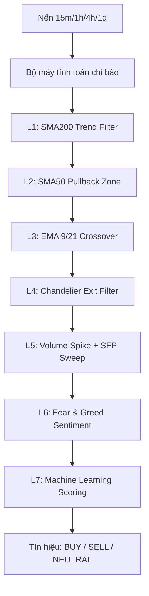

# BÁO CÁO ĐÁNH GIÁ SÂU TOÀN DIỆN HỆ THỐNG
## DỰ ÁN: besttime-crypto (AI Quant Trading Platform)

> **Ngày thực hiện**: 14/06/2026
> **Người thực hiện**: Antigravity AI Coding Assistant
> **Mục tiêu**: Đánh giá toàn diện kiến trúc thiết kế, bộ máy thuật toán, hệ thống Machine Learning/Reinforcement Learning, cơ chế phân bổ danh mục, quản lý rủi ro và các điểm nghẽn kỹ thuật hiện tại của hệ thống.

---

## 1. TỔNG QUAN HỆ THỐNG

**besttime-crypto** đã phát triển qua 5 giai đoạn, từ một hệ thống **Signal Bot cơ bản** trở thành một **AI Quant Trading Platform** hoàn chỉnh với khả năng tự học (Continuous Learning), tự tối ưu hóa tham số (Optuna Bayesian Optimization), tự quản lý danh mục (Mean-Variance Optimization / Risk Parity) và ứng dụng Học Tăng Cường (Reinforcement Learning - PPO/DQN) trong việc quản lý đóng vị thế.

Hệ thống bao gồm 3 cấu phần chính hoạt động song song:
1. **Core Loop Daemon (`main.py`)**: Đóng vai trò bộ máy điều phối chu kỳ (Orchestrator), kết nối WebSocket thu thập nến, chạy pipeline đa tác nhân (Multi-Agent), tính điểm tín hiệu, giao dịch tự động qua CCXT và gọi Gemini AI phân tích.
2. **Backend API Server (`api/server.py`)**: Viết bằng FastAPI, đóng vai trò cầu nối dữ liệu, phục vụ các truy vấn từ Dashboard và cung cấp cổng điều khiển (close trade, update status).
3. **Web Dashboard (`web/`)**: Phát triển bằng React / Vite, cung cấp giao diện trực quan theo dõi tín hiệu thị trường, PnL vị thế thực tế, log Auto Trader và kết quả calibration của mô hình Meta.

---

## 2. PHÂN TÍCH CHI TIẾT KIẾN TRÚC & CÁC THÀNH PHẦN CORE

### 2.1. Bộ máy Phân tích kỹ thuật (`analysis.py`)
Hệ thống sử dụng giải pháp lập trình các chỉ báo kỹ thuật bằng **Python thuần** (không phụ thuộc vào thư viện bên ngoài như `ta-lib` hay `pandas`).



#### Đánh giá Kỹ thuật:
- **Ưu điểm**:
  - Không có phụ thuộc nặng nề vào các thư viện C-extension như `ta-lib`, giúp hệ thống dễ dàng triển khai trên nhiều môi trường khác nhau (Windows, Linux, macOS).
  - Thuật toán trượt $O(N)$ cho SMA, EMA giúp tối ưu tốc độ tính toán cho danh sách coin dài.
  - Cơ chế **6 lớp lọc logic** kết hợp cả xu hướng (SMA200, Chandelier), xung lượng (RSI, EMA cross), cấu trúc thị trường (SFP), thanh khoản (Volume Spike) và tâm lý đám đông (Fear & Greed Index).
- **Hạn chế**:
  - Việc không dùng `numpy` và `pandas` trong `analysis.py` làm giới hạn khả năng tối ưu hóa vector (vectorized calculation) khi cần phân tích dữ liệu lịch sử lớn (như backtest 18 tháng với hàng triệu dòng dữ liệu), dẫn đến tốc độ chạy backtest chậm hơn.

---

### 2.2. Hệ thống Multi-Agent AI (`multi_agent.py` & `portfolio_manager.py`)
Mô hình chạy qua cấu trúc điều phối tuần tự `AgentOrchestrator`:

| Tên Agent | Nhiệm vụ chính | Đóng góp vào Alpha/Risk |
| :--- | :--- | :--- |
| **MarketAnalystAgent** | Tính chỉ báo kỹ thuật 15m & xu hướng đa khung thời gian (1h, 4h, 1d). | Cung cấp dữ liệu thô và cấu trúc thị trường. |
| **SignalGeneratorAgent** | Sử dụng Meta Model chấm điểm xác suất thắng (`meta_confidence`). | Tạo alpha dự báo bằng cách ước lượng xác suất thắng. |
| **RiskManagerAgent** | Áp dụng Drawdown Limits (ngắt mạch khi DD > 10%) và Risk Multiplier (giảm vị thế khi gặp chuỗi thua). | Bảo vệ vốn, ngăn chặn cháy tài khoản khi thị trường chuyển biến xấu. |
| **PortfolioManagerAgent** | Thực thi tối ưu hóa danh mục sử dụng **MVO (Mean-Variance Optimization)** hoặc **Risk Parity**. | Tránh rủi ro tập trung vốn vào các tài sản có tương quan cao (correlation). |
| **RLExitAgent** | Tải mô hình PPO/DQN từ Stable-Baselines3 để đưa ra gợi ý thoát vị thế động. | Tối ưu hóa thời điểm chốt lời/cắt lỗ thay vì dùng mức ATR tĩnh. |
| **ExecutionAgent** | Giao dịch tự động CCXT Binance Testnet và ghi log shadow prediction. | Thực thi lệnh kỷ luật và tích lũy dữ liệu huấn luyện. |

#### Đánh giá Công thức Tối ưu hóa Danh mục (MVO & Risk Parity):
- **Công thức MVO** cực đại hóa Utility (hàm mục tiêu trong code):
  $$Utility = w^T \cdot R_{expected} - \frac{1}{2} \lambda \cdot (w^T \cdot \Sigma \cdot w)$$
  Trong đó:
  - $w$ là vector tỷ trọng danh mục (tối đa `max_weight=0.30` per asset).
  - $R_{expected}$ là tỷ suất sinh lời kỳ vọng được tính từ: $(2 \times P_{meta\_confidence} - 1) \times ATR\%$.
  - $\Sigma$ là ma trận covariance của tỷ suất sinh lời nến 15m trong 100 chu kỳ gần nhất.
  - $\lambda$ là hệ số ngại rủi ro (`risk_aversion=2.0`).
- **Tác động thực tế**: Khi có tín hiệu mua đồng thời cả BTC, ETH và SOL, thay vì đặt lệnh 3 đồng với kích thước lớn gây tập trung rủi ro (do tương quan $r \approx 0.8 - 0.9$), MVO sẽ tự động cân bằng tỷ trọng để tối ưu hóa Sharpe Ratio danh mục, giảm biến động tổng thể.

---

### 2.3. Bộ máy Học máy Thích ứng (`adaptive_scoring.py` & `meta_model.py`)
Hệ thống sử dụng mô hình kết hợp **Ensemble (Random Forest + LightGBM + CatBoost + XGBoost)** để dự đoán xác suất thắng dựa trên 14 đặc trưng kỹ thuật (`FEATURE_SCHEMA`).

```
Xác suất thắng thô (Probability)
      ↓
Bộ hiệu chuẩn Platt Scaling (CalibratedClassifierCV)
      ↓
Xác suất thắng hiệu chuẩn (Win Probability < 10% sai số thực tế)
      ↓
Ngưỡng Auto-Trade Cutoff (ví dụ >= 85%) OR Kelly Position Sizing
```

#### Đánh giá Kỹ thuật:
- **Ưu điểm**:
  - **Probability Calibration**: Việc sử dụng Platt Scaling (Sigmoid) hoặc Isotonic Regression giúp xác suất đầu ra phản ánh trung thực tỉ lệ thắng thực tế (ví dụ: mô hình dự đoán xác suất 80% thì trong 100 giao dịch sẽ có ~80 giao dịch thắng). Điều này cực kỳ quan trọng đối với công thức Kelly Sizing.
  - **Continuous Learning Pipeline**: Chạy định kỳ vào Chủ Nhật hàng tuần giúp mô hình thích nghi với sự thay đổi của cấu trúc thị trường (Concept Drift). Tự động kiểm tra điều kiện kích hoạt `CV ROC-AUC >= 0.55` trước khi lưu đè mô hình mới.
  - **Walk-Forward Validation**: Sử dụng phương pháp kiểm định tịnh tiến (Walk Forward) mô phỏng chính xác quá trình giao dịch thực tế theo thời gian, tránh rò rỉ dữ liệu tương lai (Data Leakage).
- **Hạn chế**:
  - Khi số lượng mẫu dữ liệu đóng trong `logs/adaptive_signals.json` còn ít, việc hiệu chuẩn Isotonic dễ bị overfit. Hệ thống đã xử lý tốt điểm này bằng cách chỉ kích hoạt Calibration khi số mẫu $\ge 50$ và chọn Isotonic khi mẫu $\ge 100$ kèm theo so sánh lỗi.

---

### 2.4. Học tăng cường quản lý thoát lệnh (`rl_trading_env.py` & `train_rl_exit_manager.py`)
Môi trường RL được xây dựng theo tiêu chuẩn Gymnasium để huấn luyện Agent thoát lệnh động.

- **State Space (18 đặc trưng)**: RSI, MACD Histogram, ATR%, ADX, meta_confidence, one-hot regime, PnL%, thời gian nắm giữ, Fear & Greed, Volume Ratio, Bollinger Band width.
- **Action Space (5 hành động)**:
  - `0`: HOLD (Tiếp tục giữ vị thế)
  - `1`: PARTIAL_CLOSE_50 (Đóng 50% vị thế)
  - `2`: MOVE_SL_TO_BREAKEVEN (Dời dừng lỗ về giá vào lệnh)
  - `3`: TAKE_PROFIT (Chốt lời toàn bộ)
  - `4`: EXIT (Thoát vị thế khẩn cấp)
- **Hàm thưởng (Reward Function)**:
  $$Reward = PnL_{pct} - Drawdown\_Penalty + Sharpe\_Bonus$$

#### Đánh giá Kỹ thuật:
- **Ưu điểm**: 
  - Khắc phục nhược điểm của các mức TP/SL tĩnh (thường bỏ lỡ các đợt xu hướng mạnh hoặc bị quét dừng lỗ vô ích do biến động nhiễu).
  - Tích hợp PPO/DQN từ Stable-Baselines3 mang lại tính ổn định cao trong quá trình hội tụ chính sách (policy convergence).
- **Thách thức**: Môi trường RL rất nhạy cảm với việc gán nhãn phần thưởng (Reward Shaping). Nếu hình phạt Drawdown quá lớn, agent có xu hướng thoát lệnh quá sớm (early exit), làm giảm đáng kể mức sinh lời trung bình trên mỗi lệnh thắng.

---

### 2.5. Cơ chế Thực thi lệnh & Bảo vệ tài khoản (`auto_trader.py` & `ccxt_client.py`)
Bot hỗ trợ tự động đặt lệnh qua thư viện CCXT kết nối với Binance Testnet.

#### Kích thước Vị thế Thích ứng (Fixed-Fractional Risk Sizing):
Hệ thống không đặt một số tiền cố định cho mỗi lệnh, mà tính toán dựa trên mức rủi ro kiểm soát (mặc định 2% tài khoản) và khoảng cách từ giá Entry đến mức Stop Loss kỹ thuật:
$$Risk\_Amount = Account\_USDT \times 2\% \times Kelly\_Fraction$$
$$Position\_Sizing\_USDT = \frac{Risk\_Amount}{\frac{|Entry - SL|}{Entry}}$$
*Giới hạn biên*: Chặn dưới 10 USDT (min notional) và chặn trên 100 USDT để bảo vệ tài khoản Sandbox.

#### Cơ chế Ngắt mạch (Circuit Breaker):
- **Daily Limit**: Tối đa 5 lệnh/ngày.
- **Consecutive Loss Protect**: Nếu chuỗi lệnh thua liên tiếp $\ge 5$ (lưu trạng thái tại `auto_trade_circuit.json`), hệ thống tự động khóa Auto Trader trong 24 giờ để ngăn ngừa tài khoản bị bào mòn khi mô hình đang rơi vào chu kỳ không tương thích với thị trường.

---

## 3. PHÂN TÍCH ƯU ĐIỂM CỦA HỆ THỐNG

1. **Khả năng quản lý vốn chặt chẽ**: Việc kết hợp MVO (giảm thiểu tương quan), Kelly Sizing (định cỡ theo xác suất thắng) và Fixed-Fractional Risk (giới hạn rủi ro tuyệt đối trên mỗi lệnh ở mức 2%) tạo nên một hệ thống quản lý rủi ro ba lớp cực kỳ vững chắc.
2. **Cơ chế Tự học và Thích ứng**: Tích hợp Optuna tối ưu tham số và pipeline huấn luyện lại mô hình hàng tuần giúp giải quyết bài toán suy giảm hiệu năng của mô hình định lượng theo thời gian (Concept Drift).
3. **Thiết kế Bất đồng bộ Hiệu quả (Async / Queue)**: Việc đẩy tác vụ gọi API Gemini AI và phân tích đa khung thời gian sang một luồng xử lý nền (`ai_worker` với `queue.Queue`) giúp vòng lặp quét core 15 phút và 5 phút không bao giờ bị nghẽn do độ trễ của API Gemini hoặc giới hạn quota (Rate Limits).
4. **Hệ thống cảnh báo Telegram đa dạng**: Tích hợp gửi báo cáo tín hiệu, cảnh báo TP/SL khẩn cấp và nhận định chuyên sâu từ Gemini AI kèm theo ngữ cảnh lịch sử giao dịch (RAG) giúp người dùng nắm bắt thông tin nhanh chóng.

---

## 4. CÁC ĐIỂM YẾU & RỦI RO KỸ THUẬT (BOTTLENECK & RISKS)

Qua phân tích sâu mã nguồn, chúng tôi phát hiện một số điểm yếu và rủi ro tiềm ẩn cần được xử lý:

### ⚠️ 4.1. Vấn đề Đồng bộ hóa và Xung đột Ghi File (I/O Bottleneck)
- **Hiện trạng**: Các cấu phần `main.py`, `api/server.py` và các script chạy nền độc lập (`continuous_learning.py`, `weekly_job.py`) đều thực hiện đọc ghi trực tiếp lên các file JSON tĩnh (`data/positions.json`, `logs/closed_positions.json`, `logs/auto_trade_circuit.json`).
- **Rủi ro**: Khi FastAPI server (`server.py`) và luồng Core Loop (`main.py`) cùng ghi vào file `positions.json` tại một thời điểm (ví dụ: người dùng click đóng vị thế trên Web UI đúng lúc Core Loop đang ghi đè kết quả quét 5 phút), hiện tượng **Race Condition** hoặc **File Lock Error** sẽ xảy ra gây mất mát dữ liệu hoặc crash bot.

### ⚠️ 4.2. Nghẽn CPU do tính toán đồng thời trên một luồng (Blocking Code)
- **Hiện trạng**: `main.py` chạy lập lịch bằng thư viện `schedule`. Khi đến chu kỳ quét, bot chạy tuần tự qua toàn bộ danh sách `COINS` (24 coins) để fetch dữ liệu REST (nếu WS fallback xảy ra) hoặc tính toán chỉ báo kỹ thuật phức tạp.
- **Rủi ro**: Việc tính toán này hoàn toàn là blocking. Nếu số lượng coin tăng lên hoặc mạng gặp độ trễ cao, Core loop sẽ bị chậm trễ giờ đóng nến (ví dụ nến đóng lúc 12:00 nhưng đến 12:02 bot mới xử lý xong), làm mất đi tính chính xác của tín hiệu giao dịch.

### ⚠️ 4.3. Quản lý Khóa bảo mật (Security Risks)
- **Hiện trạng**: Các khóa API (`TELEGRAM_BOT_TOKEN`, `BINANCE_API_KEY`, `GEMINI_API_KEY_1`) được lưu dưới dạng plain-text trong file `.env`.
- **Rủi ro**: Rò rỉ thông tin cấu hình khi deploy hoặc khi chia sẻ mã nguồn nếu không cấu hình `.gitignore` cẩn thận (mặc dù hiện tại đã có `.gitignore`). Không có cơ chế mã hóa các khóa nhạy cảm khi tải vào bộ nhớ.

### ⚠️ 4.4. Rủi ro Overfitting (Quá khớp) trong Optuna và Học máy
- **Hiện trạng**: Tập dữ liệu huấn luyện ML xuất phát từ lịch sử giao dịch thực tế hoặc backtest tự động (khoảng 18 tháng). Công cụ Optuna chạy tối ưu hóa các tham số `atr_sl_mult`, `atr_tp_mult` trên toàn bộ lịch sử này.
- **Rủi ro**: Việc tối ưu hóa quá mức các tham số TP/SL trên dữ liệu quá khứ dễ dẫn đến tình trạng mô hình hoạt động rất tốt trong backtest nhưng sụt giảm nghiêm trọng khi chạy thực tế (Out-of-Sample decay).

---

## 5. LỘ TRÌNH ĐỀ XUẤT TỐI ƯU HÓA HỆ THỐNG (UPGRADE ROADMAP)

Để đưa hệ thống **besttime-crypto** lên chuẩn công nghiệp (Production-ready), chúng tôi đề xuất các hạng mục cải tiến sau:

### Giai đoạn 1: Giải quyết điểm nghẽn I/O và Chuyển đổi Cơ sở dữ liệu (Ưu tiên Cao)
- [ ] **Chuyển đổi sang SQLite**: Thay thế toàn bộ các file JSON tĩnh bằng một cơ sở dữ liệu SQLite cục bộ (sử dụng thư viện `sqlite3` hoặc `SQLAlchemy` async). SQLite hỗ trợ ghi đồng thời an toàn (WAL mode) và giải quyết triệt để nguy cơ Race Condition giữa API FastAPI và Core Daemon.
- [ ] **Mã hóa API Keys**: Hỗ trợ tải API keys từ các biến môi trường hệ thống thay vì phụ thuộc hoàn toàn vào file `.env` tĩnh, hoặc tích hợp mã hóa cơ bản cho các trường nhạy cảm.

### Giai đoạn 2: Tối ưu hiệu năng tính toán chỉ báo và Async
- [ ] **Tích hợp NumPy/Pandas cho bộ chỉ báo**: Cấu trúc lại các hàm tính toán chỉ báo kỹ thuật trong `analysis.py` bằng `numpy` để thực hiện tính toán vector hóa. Điều này sẽ tăng tốc độ chạy Backtest lên ít nhất 10 - 50 lần.
- [ ] **Chuyển đổi sang Asyncio**: Chuyển đổi các tác vụ gọi REST API của CCXT và Binance sang lập trình bất đồng bộ (`asyncio` và `aiohttp`), giúp bot có thể fetch dữ liệu của 24 coin song song thay vì tuần tự như hiện tại.

### Giai đoạn 3: Cải tiến Mô hình ML & Học tăng cường
- [ ] **Bổ sung Feature Correlation Check**: Loại bỏ các đặc trưng có độ tương quan quá cao trước khi đưa vào huấn luyện mô hình Meta để giảm thiểu overfitting.
- [ ] **RL Agent Continuous Warm-start**: Thiết lập cơ chế tải mô hình RL Exit cũ làm điểm khởi đầu cho chu kỳ huấn luyện mới (Transfer Learning), giúp Agent không phải học lại từ đầu khi cập nhật dữ liệu.

---

## 6. KẾT LUẬN

Hệ thống **besttime-crypto** hiện tại là một nền tảng giao dịch định lượng có cấu trúc thuật toán cực kỳ thông minh, khoa học và chặt chẽ. Sự kết hợp giữa **phân tích kỹ thuật truyền thống**, **Machine Learning kiểm soát xác suất thắng**, **Reinforcement Learning quản lý lệnh** và **Multi-Agent điều phối** là một thiết kế rất tiên tiến trong giới Quant Trading.

Bằng cách triển khai lộ trình tối ưu hóa (đặc biệt là việc chuyển đổi từ lưu trữ JSON sang SQLite và nâng cấp Asyncio), hệ thống sẽ đạt được độ ổn định, bảo mật và hiệu năng cực kỳ cao, sẵn sàng cho việc giao dịch tài khoản thực tế với quy mô lớn.
