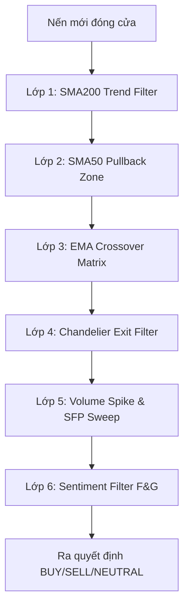

# CHIẾN LƯỢC GIAO DỊCH & CÔNG THỨC TOÁN HỌC ĐANG SỬ DỤNG

Tài liệu này tổng hợp toàn bộ các chỉ báo kỹ thuật, công thức tính toán, quy tắc xác định tín hiệu (6 lớp lọc) và logic quản lý vị thế hiện tại trong hệ thống bot giao dịch Crypto.

---

## 1. Các Chỉ báo Kỹ thuật & Công thức Toán học

Hệ thống được lập trình hoàn toàn bằng Python thuần (không phụ thuộc vào các thư viện bên ngoài như `pandas` hay `ta`).

### 1.1. Average True Range (ATR - 14)
* **Mục đích**: Đo lường độ biến động của giá để làm cơ sở tính toán khoảng cách Stop Loss và Take Profit.
* **Công thức**:
  1. Tính **True Range (TR)** cho mỗi phiên:
     $$TR = \max(High - Low, |High - Close_{prev}|, |Low - Close_{prev}|)$$
  2. Khởi tạo ATR của 14 phiên đầu tiên bằng Simple Moving Average (SMA) của TR:
     $$ATR_{14} = \frac{1}{14} \sum_{i=1}^{14} TR_i$$
  3. Làm mượt ở các phiên tiếp theo bằng **Wilder's Smoothing** (tương đương EMA với $\alpha = 1/\text{period}$):
     $$ATR_{t} = \frac{ATR_{t-1} \times 13 + TR_t}{14}$$

### 1.2. Relative Strength Index (RSI - 14)
* **Mục đích**: Đo lường động lượng để xác định vùng quá mua (Overbought) và quá bán (Oversold).
* **Công thức**:
  1. Tính Gain (lợi nhuận) và Loss (thua lỗ) của từng phiên:
     * Nếu $Close_{t} > Close_{t-1}$: $Gain_t = Close_{t} - Close_{t-1}$, $Loss_t = 0$
     * Nếu $Close_{t} < Close_{t-1}$: $Gain_t = 0$, $Loss_t = |Close_{t} - Close_{t-1}|$
  2. Khởi tạo giá trị trung bình đầu tiên ($Average\ Gain$ và $Average\ Loss$) bằng SMA của 14 phiên đầu.
  3. Các phiên tiếp theo sử dụng **Wilder's Smoothing**:
     $$Average\ Gain_t = \frac{Average\ Gain_{t-1} \times 13 + Gain_t}{14}$$
     $$Average\ Loss_t = \frac{Average\ Loss_{t-1} \times 13 + Loss_t}{14}$$
  4. Tính Chỉ số Sức mạnh Tương đối (RS):
     $$RS = \frac{Average\ Gain}{Average\ Loss}$$
  5. Tính RSI:
     $$RSI = 100 - \left(\frac{100}{1 + RS}\right)$$

### 1.3. Exponential Moving Average (EMA - 9 & 21)
* **Mục đích**: Xác định xu hướng ngắn hạn và điểm giao cắt tín hiệu.
* **Công thức**:
  1. Khởi tạo EMA đầu tiên bằng SMA của $N$ phiên ($N = 9$ hoặc $21$).
  2. Hệ số làm mượt (Multiplier):
     $$k = \frac{2}{N + 1}$$
  3. Tính EMA tiếp theo:
     $$EMA_t = (Close_t - EMA_{t-1}) \times k + EMA_{t-1}$$

### 1.4. Simple Moving Average (SMA - 50 & 200)
* **Mục đích**: Xác định xu hướng trung hạn (SMA 50) và dài hạn (SMA 200).
* **Công thức**:
  $$SMA_{N} = \frac{1}{N} \sum_{i=0}^{N-1} Close_{t-i}$$

### 1.5. MACD (Moving Average Convergence Divergence - 12, 26, 9)
* **Mục đích**: Đánh giá động lượng và độ mạnh yếu của xu hướng.
* **Công thức**:
  1. **MACD Line** = $EMA_{12}(Close) - EMA_{26}(Close)$
  2. **Signal Line** = $EMA_9(MACD\ Line)$
  3. **Histogram** = $MACD\ Line - Signal\ Line$

### 1.6. Bollinger Bands (BB - 20, 2)
* **Mục đích**: Xác định vùng biến động giá tiêu chuẩn và mục tiêu chốt lời tiềm năng.
* **Công thức**:
  1. **Middle Band** = $SMA_{20}(Close)$
  2. **Standard Deviation ($\sigma$)**:
     $$\sigma = \sqrt{\frac{1}{20} \sum_{i=0}^{19} (Close_{t-i} - Middle\ Band)^2}$$
  3. **Upper Band** = $Middle\ Band + 2 \times \sigma$
  4. **Lower Band** = $Middle\ Band - 2 \times \sigma$

### 1.7. Chandelier Exit (22, 3.0)
* **Mục đích**: Lọc xu hướng và bảo vệ vốn khỏi các pha đảo chiều bất ngờ.
* **Công thức**:
  * **Long Stop (Đường chặn bán)**:
     $$Long\ Stop = Highest\ High(22\ phiên) - 3.0 \times ATR_{22}$$
     * Nếu giá đóng cửa giảm xuống dưới mức này $\rightarrow$ **Trạng thái BEAR** (Cấm BUY).
  * **Short Stop (Đường chặn mua)**:
     $$Short\ Stop = Lowest\ Low(22\ phiên) + 3.0 \times ATR_{22}$$
     * Nếu giá đóng cửa vượt lên trên mức này $\rightarrow$ **Trạng thái BULL** (Cho phép BUY).

---

## 2. Chiến lược Tín hiệu (6 Lớp Lọc Quyết Định)

Quy trình ra quyết định của bot trải qua 6 lớp lọc bảo mật chặt chẽ:

### 6 Lớp Lọc Chi Tiết:
1. **Lớp 1: Bộ lọc xu hướng SMA 200 (Trend Filter)**
   * Xác định thị trường Bullish ($Close > SMA_{200}$) hay Bearish ($Close < SMA_{200}$).
2. **Lớp 2: Vùng điều chỉnh SMA 50 (Pullback to SMA50)**
   * Khi xu hướng SMA 50 đang hướng lên và giá nằm trong vùng kẹp giữa $SMA_{50} \times 0.99$ và $EMA_{21}$, xuất hiện nến xanh đảo chiều $\rightarrow$ Kích hoạt tín hiệu **BUY (Pullback-Zone)**.
3. **Lớp 3: Ma trận giao cắt EMA (EMA Crossover)**
   * Giao cắt vàng (Golden Cross - EMA9 cắt lên EMA21) $\rightarrow$ Tín hiệu BUY.
   * Giao cắt tử thần (Death Cross - EMA9 cắt xuống EMA21) $\rightarrow$ Tín hiệu SELL.
4. **Lớp 4: Bộ chặn Chandelier Exit**
   * Nếu Chandelier đang ở trạng thái **BEAR** (downtrend dài hạn), tất cả các tín hiệu BUY/STRONG BUY từ các chỉ báo khác sẽ bị chặn hoặc hạ cấp độ an toàn.
5. **Lớp 5: Khối lượng & Quét thanh khoản (Volume Spike & SFP)**
   * **Volume Spike**: Xác định dòng tiền lớn khi $Volume_{current} > 1.3 \times Volume\ SMA_{20}$.
   * **SFP Bullish (Sweep False Pivot)**: Giá quét qua mức hỗ trợ (đáy thấp nhất 50 cây nến trước) tạo râu nến (wick), sau đó đóng cửa trên hỗ trợ và RSI < 45 $\rightarrow$ **BUY (SFP-Liquidity-Sweep)**.
   * **SFP Bearish**: Giá quét qua mức kháng cự (đỉnh cao nhất 50 cây nến trước) tạo râu nến, đóng cửa dưới kháng cự, RSI > 55 và đang dưới SMA 200 $\rightarrow$ **SELL (SFP-Liquidity-Sweep)**.
6. **Lớp 6: Sentiment Filter (Fear & Greed Index)**
   * Sử dụng chỉ số tâm lý Fear & Greed để chặn các tín hiệu giao dịch ngược đám đông lúc cực đoan.
   * **Extreme Fear ($Score < -0.6$)**: Hạ cấp các tín hiệu BUY mạnh $\rightarrow$ **WEAK BUY (Sentiment-Blocked)**.
   * **Extreme Greed ($Score > 0.6$)**: Hạ cấp các tín hiệu SELL mạnh $\rightarrow$ **WEAK SELL (Sentiment-Blocked)**.

---

## 3. Công thức tính Entry, Stop Loss (SL) & Take Profit (TP)

Mức vào lệnh và thoát lệnh được tối ưu hóa tự động bằng cách kết hợp ATR, Kháng cự/Hỗ trợ lịch sử và Bollinger Bands:

### 3.1. Lệnh BUY (Long)
* **Entry**: Giá đóng cửa hiện tại ($Close$).
* **Stop Loss (SL)**:
  * $SL_{ATR} = Entry - 1.2 \times ATR$
  * $SL_{Support} = Hỗ\ trợ \times 0.998$ (vùng hỗ trợ của 50 phiên gần nhất, buffer 0.2%).
  * Chọn: $$SL = \max(SL_{ATR}, SL_{Support})$$ (chọn mức gần entry hơn để thắt chặt rủi ro, nếu $SL \ge Entry$ thì fallback về $SL_{ATR}$).
* **Take Profit 1 (TP1)**:
  * $TP1_{ATR} = Entry + 3.5 \times ATR$
  * $TP1_{BB} = Middle\ Band$
  * Chọn: $$TP1 = \min(TP1_{BB}, TP1_{ATR})$$ (chốt lời bảo thủ ở đường trung bình Bollinger).
* **Take Profit 2 (TP2)**:
  * Các ứng viên: $[Kháng\ cự \times 0.998,\ Upper\ Band \times 0.998,\ Entry + 7.0 \times ATR]$ (chỉ chọn các ứng viên lớn hơn TP1).
  * Chọn: $$TP2 = \min(\text{Các ứng viên})$$

### 3.2. Lệnh SELL (Short)
* **Entry**: Giá đóng cửa hiện tại ($Close$).
* **Stop Loss (SL)**:
  * $SL_{ATR} = Entry + 1.2 \times ATR$
  * $SL_{Resistance} = Kháng\ cự \times 1.002$ (buffer 0.2%).
  * Chọn: $$SL = \min(SL_{ATR}, SL_{Resistance})$$ (nếu $SL \le Entry$ thì fallback về $SL_{ATR}$).
* **Take Profit 1 (TP1)**:
  * $TP1_{ATR} = Entry - 3.5 \times ATR$
  * $TP1_{BB} = Middle\ Band$
  * Chọn: $$TP1 = \max(TP1_{BB}, TP1_{ATR})$$
* **Take Profit 2 (TP2)**:
  * Các ứng viên: $[Hỗ\ trợ \times 1.002,\ Lower\ Band \times 1.002,\ Entry - 7.0 \times ATR]$ (chỉ chọn các ứng viên nhỏ hơn TP1).
  * Chọn: $$TP2 = \max(\text{Các ứng viên})$$

---

## 4. Quy tắc Quản lý Vị thế & Hiệu suất

Được quản lý trong file `position_tracker.py` khi bot quét định kỳ các vị thế đang mở:

### 4.1. Đánh giá khuyến nghị lệnh đang mở
* **🚨 CẮT LỖ NGAY**: Khi giá chạm hoặc vượt qua mức $SL$ khuyến nghị.
* **🎯 CHỐT LỜI TP2**: Khi giá đạt hoặc vượt qua mức $TP2$.
* **✅ Xem xét CHỐT TP1**: Khi giá chạm $TP1$, khuyến nghị đóng **50% vị thế** để bảo vệ lợi nhuận.
* **⚠️ XEM XÉT ĐÓNG LỆNH / CÂN NHẮC CẮT LỖ**: Khi vị thế đang mở gặp tín hiệu kỹ thuật đảo chiều mạnh đi ngược hướng (ví dụ: đang LONG nhưng xuất hiện `STRONG SELL` hoặc `SELL (Crossover)`).

### 4.2. Công thức Đánh giá Hiệu suất Vị thế đã Đóng
* **Lợi nhuận phần trăm (PnL %)**:
  * LONG: $$PnL\% = \frac{Exit\ Price - Entry\ Price}{Entry\ Price} \times 100$$
  * SHORT: $$PnL\% = \frac{Entry\ Price - Exit\ Price}{Entry\ Price} \times 100$$
* **Bội số R-multiplier (Đo lường lợi nhuận trên đơn vị rủi ro)**:
  $$Risk\% = \frac{|Entry\ Price - SL|}{Entry\ Price} \times 100$$
  $$R\_multiplier = \frac{PnL\%}{Risk\%}$$
* **Lợi nhuận thực tế (đã trừ phí giao dịch - giả định phí 0.1% mỗi chiều)**:
  $$PnL\ USD = Invested\ USDT \times \left(\frac{PnL\%}{100}\right)$$
  $$Fee\ USD = (Invested\ USDT \times 0.001) + (Received_{gross} \times 0.001)$$
  $$Received\ Net = Invested\ USDT + PnL\ USD - Fee\ USD$$
